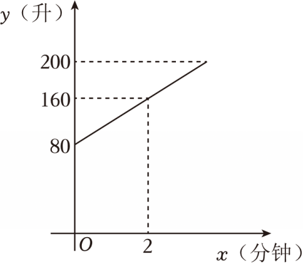

# 21 题精讲 01 · 储水机加水函数

（图象说明：一条从 $(0,80)$ 出发、经过 $(2,160)$ 的上升线段，$y$ 轴刻度 80、160、200，$x$ 轴刻度 2。）

## 📝 题目

某品牌储水机的容量是 200 升，当加水加满时，储水机会自动停止加水。已知加冷水量 $y$（升）和时间 $x$（分钟）的图象如图所示。加水过程中，水的温度 $t$（摄氏度）和 $x$（分钟）的关系是

$$t=\frac{20x+100}{x+2}$$

(1) 求 $y$ 与 $x$ 的函数关系式，并写出定义域；

(2) 求储水机中的水加满时，储水机内水的温度。

## 🧭 思路导航（渐进提示）

- **提示 1（识别）**：$y$-$x$ 图象是一条线段——"累计加水量随时间均匀增加"的一次函数。第 (2) 问的钥匙是先问：**加满 200 升发生在第几分钟**？再把手头唯一的温度公式 $t(x)$ 用上。
- **提示 2（突破）**：图象上有两个带刻度的点 $(0,80)$、$(2,160)$ → 斜率就是"每分钟加水量"，纵截距 80 就是机内**原有**水量；定义域的上界必须由"容量 200 升"解方程得出，不能凭感觉写。
- **提示 3（路线）**：(1) 每分钟加水量 $(160-80)\div2=40$ → 待定系数得 $y=40x+80$；令 $y=200$ 解得 $x=3$ → 定义域 $0\le x\le3$。(2) 把 $x=3$ 代入 $t=\dfrac{20x+100}{x+2}$：分子 $160$、分母 $5$，得 $t=32$ 摄氏度。

## ✍️ 详解

**(1)** 读图：图象是线段，经过 $(0,80)$ 与 $(2,160)$——开机时机内已有水 $80$ 升，$2$ 分钟末累计加水 $160$ 升。

加水是匀速的，每分钟加水量即图象的斜率：

$$(160-80)\div 2=40\ (\text{升/分钟})$$

设 $y=kx+b$。图象上的点满足解析式（待定系数法），代两点：

$$x=0:\quad b=80$$

$$x=2:\quad 2k+b=160\Rightarrow 2k=80\Rightarrow k=40$$

故 $y=40x+80$。

检验：$x=2$ 时 $y=40\times2+80=160$ ✓，与图象刻度相符。

储水机容量 200 升，"加满即停"给出定义域上界。令 $y=200$：

$$40x+80=200\Rightarrow 40x=120\Rightarrow x=3$$

代回检验：$x=3$ 时 $y=40\times3+80=200$ ✓，恰好加满。

$$\boxed{y=40x+80\quad(0\le x\le 3)}$$

（$x=0$ 是开始加水的时刻；$x=3$ 时恰好加满 200 升、自动停止，故 $x$ 不能超过 3。$y$ 的实际最大值是 $200-80=120$ 升——容量 200 是"水箱上限"，不是 $y$ 的上限。）

**(2)** 由 (1)，"水加满"对应 $x=3$。代入温度公式，分子分母分别计算：

$$\text{分子}=20\times3+100=60+100=160,\qquad \text{分母}=3+2=5\neq0$$

$$t=\frac{160}{5}=32$$

$$\boxed{\text{储水机中的水加满时，机内水温为 }32\ \text{摄氏度}}$$

（总量验算：原有 $80$ 升 $+$ 每分钟 $40$ 升 $\times\,3$ 分钟 $=80+120=200$ 升，恰为容量 ✓。）

## ⚠️ 评分点与易错

- **题源 OCR 讹误**：原文"$t=20x+100x+2$"丢了分数线，应读作 $t=\dfrac{20x+100}{x+2}$。自检：$t(3)=\frac{160}{5}=32$ 与题源答案吻合。若误读为 $t=20x+\dfrac{100}{x+2}$，则 $t(3)=80$，与答案矛盾，且 $t(1)\approx53.3>t(0)=50$（加冷水反而升温），双重排除。
- $y$ 是**累计**加水量：图象从 $(0,80)$ 出发，别写成 $y=40x$——"$80$"是机内原有水量，截距有实际意义。
- **定义域是采分点**：只答 $y=40x+80$ 不写 $0\le x\le3$ 要扣分；上界必须由 $40x+80=200$ 解出并交代"加满停止"。分式 $\dfrac{100}{x+2}$ 的分母 $x+2>0$ 在 $x\ge0$ 时恒成立，定义域不受分式限制，只由实际过程决定。
- 常见变式的区别：本题定义域约束的是**时间** $x$（$0\le x\le3$）；若题目改问"$y$ 的取值范围"，答案是 $80\le y\le200$（把 $x=0$、$x=3$ 代入函数），两者不要混写。
- (2) 的自变量是加满时刻 $x=3$，不是把 $y=200$ 代进 $t$——$t$ 只是 $x$ 的函数，与 $y$ 之间没有直接关系式。
- 两问互锁：若 (1) 误写成 $y=40x$，(2) 会解出 $x=5$，与图象只到 $x=3$ 附近矛盾——前后两问互为验算。
- 作答规范：应用题的答句要带单位——"机内水温为 32 摄氏度"，只写数字 32 在应用题里可能被扣分；$y$、$x$、$t$ 的单位（升、分钟、摄氏度）在设句里交代清楚。
- 情境检验是好习惯：$t(0)=\frac{100}{2}=50$，逐分钟 $50\to40\to35\to32$ 单调下降，与"加冷水降温"一致。

| $x$（分钟） | 0 | 1 | 2 | 3 |
| --- | --- | --- | --- | --- |
| $t$（摄氏度） | 50 | 40 | 35 | 32 |

## 🔗 关联

- [[03-数学/专题/第21-22题-函数与三角比应用]]
- [[03-数学/知识点/00-六至八年级核心公式定理总表]]（一次函数 $y=kx+b$ 与截距）
- 同类题：[[21-07-平行直线与等距点]]（一次函数待定系数）、[[21-02-反比例交点与正弦]]（图象上的点满足解析式）
