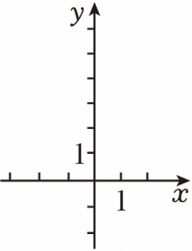

# 21 题精讲 02 · 反比例交点与正弦

## 📝 题目

在平面直角坐标系 $xOy$ 中，反比例函数 $y=\dfrac{k}{x}$（$k$ 为常数且 $k\neq0$）的图象上有一点 $A(-3,m)$，且图象与直线 $y=-2x+4$ 交于另一点 $B(n,6)$。

(1) 求 $k$ 与 $m$ 的值；

(2) 过点 $A$ 作直线 $l\parallel x$ 轴，与直线 $y=-2x+4$ 交于点 $C$，求 $\sin\angle OCA$ 的值。

## 🧭 思路导航（渐进提示）

- **提示 1（识别）**：交点问题——"点在图象上 $\Leftrightarrow$ 坐标满足解析式"是全程唯一的代数工具；先定 $B$，再定 $k$，最后定 $m$，顺序不能乱。
- **提示 2（突破）**：(2) 中 $l\parallel x$ 轴且过 $A$ → $l$ 就是水平线 $y=y_A$，$C$ 的纵坐标已知；$\angle OCA$ 不在坐标轴上，但 $CA$ 是水平线段——从 $O$ 向 $CA$ 作垂线，正弦就落在现成直角三角形里。
- **提示 3（路线）**：(1) 把 $B(n,6)$ 代直线解出 $n=-1$ → $B(-1,6)$；代 $k=xy$ 得 $k=-6$；再代 $A(-3,m)$ 得 $m=2$。(2) $l:y=2$，与直线联立得 $C(1,2)$；作 $OF\perp CA$ 于 $F(0,2)$，则 $OF=2$、$OC=\sqrt{1^2+2^2}=\sqrt5$，$\sin\angle OCA=\dfrac{OF}{OC}=\dfrac{2}{\sqrt5}=\dfrac{2\sqrt5}{5}$。

## ✍️ 详解

**(1)** 点 $B(n,6)$ 在直线 $y=-2x+4$ 上（坐标满足解析式）：

$$-2n+4=6\Rightarrow -2n=2\Rightarrow n=-1\quad\Rightarrow\quad B(-1,6)$$

点 $B$ 在反比例函数 $y=\dfrac{k}{x}$ 的图象上：

$$k=xy=(-1)\times6=-6$$

反比例函数为 $y=-\dfrac{6}{x}$。点 $A(-3,m)$ 也在其图象上：

$$m=\frac{-6}{-3}=2$$

$$\boxed{k=-6,\qquad m=2}$$

（即 $A(-3,2)$，位于第二象限，与 $x<0,\ y>0$ 时 $y=-\frac6x>0$ 相符 ✓。）
**(2)** 过 $A(-3,2)$ 且 $l\parallel x$ 轴 → $l$ 上的点纵坐标全相同，$l$ 就是水平线

$$l:\ y=2$$

与直线 $y=-2x+4$ 联立求 $C$：

$$-2x+4=2\Rightarrow -2x=-2\Rightarrow x=1\quad\Rightarrow\quad C(1,2)$$

于是 $C$、$A$ 纵坐标都是 2，$CA$ 在水平线 $y=2$ 上，且

$$CA=|1-(-3)|=4$$

作 $OF\perp CA$，垂足为 $F$，则 $F(0,2)$（原点向直线 $y=2$ 作垂线，垂足在 $O$ 正上方），且 $F$ 在射线 $CA$ 上（$-3\le0\le1$ ✓，故 $\angle OCF=\angle OCA$）。

在 Rt$\triangle OCF$ 中（$\angle OFC=90°$）：

$$OF=2\quad(\text{原点到直线}\ y=2\ \text{的距离})$$

$$OC=\sqrt{1^2+2^2}=\sqrt5\quad(\text{两点距离公式/勾股定理})$$

$$\sin\angle OCA=\sin\angle OCF=\frac{OF}{OC}=\frac{2}{\sqrt5}\quad(\text{正弦}=\text{对边}/\text{斜边})$$

分母有理化：

$$\sin\angle OCA=\frac{2}{\sqrt5}=\frac{2\times\sqrt5}{\sqrt5\times\sqrt5}=\frac{2\sqrt5}{5}$$

$$\boxed{\sin\angle OCA=\frac{2\sqrt5}{5}}$$

## ⚠️ 评分点与易错

- 求解顺序：直线定 $n$ → 双曲线定 $k$ → 双曲线定 $m$；跳步直接设 $k$ 容易把 $m$、$n$ 混在一起算错。
- **题源 OCR 讹误**：解答中"$OC=5$"应为 $OC=\sqrt5$（由 $1^2+2^2$ 勾股而来）；"$\sin\angle OCA=\frac25=\frac{2\sqrt5}{5}$"首步应为 $\frac{2}{\sqrt5}$，再分母有理化。
- $l\parallel x$ 轴 → $l$ 上的点**纵坐标全相同**，所以 $l$ 就是 $y=2$；别误写成"过 $A$ 垂直 $x$ 轴"。
- 双曲线系数的一致性检验：$A(-3,2)$ 与 $B(-1,6)$ 代出的都是 $k=-6$（$(-3)\times2=-6$ ✓），两个交点互相印证。
- 符号预估先行：$A$、$B$ 都在第二象限（横负纵正）→ $k=xy<0$；若你解出 $k>0$，不用查就知道错了。
- 正弦的对边是 $O$ 到 $CA$ 的**垂线段** $OF=2$，斜边是 $OC=\sqrt5$；若误用 $OA=\sqrt{13}$ 当斜边，就把角的顶点搞错了（$\angle OCA$ 的两边是 $CO$ 与 $CA$）。
- 结果须有理化：$\frac{2}{\sqrt5}$ 不是最简形式，答题卡上写 $\frac{2\sqrt5}{5}$。
- 定位自检：$A(-3,2)$、$C(1,2)$ 关于 $y$ 轴一左一右，$O(0,0)$ 到直线 $CA$ 的垂足 $F(0,2)$ 恰在线段 $CA$ 内部——所以 $\sin\angle OCA$ 的"对边"就是 $OF=2$；若题目改的是别的角，先找垂足落点再下笔。
- 书写顺序：先写等角转换 $\sin\angle OCA=\sin\angle OCF$（$F$ 在射线 $CA$ 上），再代数值——依据链完整才不丢过程分。

## 🔗 关联

- [[03-数学/专题/第21-22题-函数与三角比应用]]
- [[03-数学/知识点/九年级/锐角的三角比与解直角三角形]]
- 同类题：[[21-10-反比例与三角形面积]]（同型：直线截双曲线求图形量）、[[21-11-反比例与角相等]]（反比例 + 角的条件）
