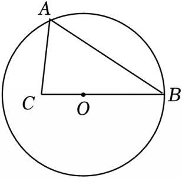

# 21 题精讲 03 · 圆中弦与正切

## 📝 题目

如图，在 $\odot O$ 中，弦 $AB$ 的长为 $8$，点 $C$ 在 $BO$ 延长线上，且 $\cos\angle ABC=\dfrac45$，$OC=\dfrac12OB$。

(1) 求 $\odot O$ 的半径；

(2) 求 $\angle BAC$ 的正切值。

## 🧭 思路导航（渐进提示）

- **提示 1（识别）**：已知弦长和"弦端点处角的余弦"求半径——标准的"弦心距 + 解直角三角形"组合；$\angle ABC$ 的两边是 $BA$、$BC$，而 $B$、$O$、$C$ 共线，所以它就是 $\angle ABO$。
- **提示 2（突破）**：过 $O$ 作 $OD\perp AB$，垂径定理把弦砍成两半，$BD=4$ 落进 Rt$\triangle OBD$，余弦立刻给出 $OB$。(2) 里 $C$ 在圆外，需要过 $C$ 再作 $AB$ 的垂线，两条垂线平行，把 $BE$ 用比例"传"出来。
- **提示 3（路线）**：(1) $OD\perp AB$ 于 $D$ → $BD=\frac12AB=4$；Rt$\triangle OBD$ 中 $\cos\angle OBD=\frac{BD}{OB}=\frac45$ → $OB=5$。(2) $OC=\frac12OB=\frac52$ → $BC=\frac{15}2$；作 $CE\perp AB$ 于 $E$，由 $OD\parallel CE$ 得 $\frac{OB}{BC}=\frac{BD}{BE}$ → $BE=6$、$AE=2$；勾股 $CE=\sqrt{BC^2-BE^2}=\sqrt{\frac{225}4-36}=\frac92$；$\tan\angle BAC=\frac{CE}{AE}=\frac92$。

## ✍️ 详解

**(1)** 作 $OD\perp AB$，垂足为 $D$。

$OD$ 是弦心距，由垂径定理（垂直于弦的直径平分弦）：

$$AD=BD=\frac12AB=\frac12\times8=4$$

点 $C$ 在 $BO$ 延长线上 → $B$、$O$、$C$ 三点共线 → $\angle ABC=\angle ABO$（同一个角）。

在 Rt$\triangle OBD$ 中（$\angle ODB=90°$）：

$$\cos\angle OBD=\frac{BD}{OB}=\frac45\quad(\text{余弦}=\text{邻边}/\text{斜边})$$

$$OB=\frac{BD}{\cos\angle OBD}=\frac{4}{4/5}=5$$

$$\boxed{\odot O\ \text{的半径为}\ 5}$$

（备料：$OD=\sqrt{OB^2-BD^2}=\sqrt{25-16}=3$，后面相似比 $\frac23$ 的直观来源。）

**(2)** $OC=\dfrac12OB=\dfrac52$，且 $O$ 在 $B$、$C$ 之间（$C$ 在 $BO$ **延长**线上）：

$$BC=BO+OC=5+\frac52=\frac{15}2=7.5$$

作 $CE\perp AB$，垂足为 $E$。由 $OD\perp AB$、$CE\perp AB$：

$$OD\parallel CE\quad(\text{垂直于同一条直线的两直线平行})$$

在 $\triangle BCE$ 中，$O$ 在边 $BC$ 上、$D$ 在边 $BE$ 上，且 $OD\parallel CE$，由平行线分线段成比例：

$$\frac{OB}{CB}=\frac{BD}{BE}\quad\Longrightarrow\quad\frac{5}{7.5}=\frac{4}{BE}\quad\Longrightarrow\quad\frac23=\frac4{BE}$$

$$BE=6$$

$BE=6<AB=8$ → $E$ 在线段 $AB$ 上，且

$$AE=AB-BE=8-6=2$$

在 Rt$\triangle BCE$ 中（$\angle BEC=90°$，勾股定理）：

$$CE=\sqrt{BC^2-BE^2}=\sqrt{\left(\frac{15}2\right)^2-6^2}=\sqrt{\frac{225}4-36}=\sqrt{\frac{81}4}=\frac92=4.5$$

$E$ 在线段 $AB$ 上 → 射线 $AE$ 与射线 $AB$ 重合 → $\angle BAC=\angle EAC$。在 Rt$\triangle AEC$ 中：

$$\tan\angle BAC=\frac{CE}{AE}=\frac{9/2}{2}=\frac94\quad(\text{正切}=\text{对边}/\text{邻边})$$

$$\boxed{\tan\angle BAC=\frac94}$$

## ⚠️ 评分点与易错

- **题源讹误确认**：原文"$CE=\sqrt{7.5^2-6^2}=4.5$"排版丢失根号，实为 $CE=\sqrt{7.5^2-6^2}=\sqrt{20.25}=4.5$，数值无误；"$\tan=\frac94$"原文印作"94"，是分线丢失。
- "$\angle ABC$ 就是 $\angle ABO$"这一步要写出来（$B,O,C$ 共线），它是 (1) 能用余弦的前提。
- (2) 的比例方向易错：是 $\dfrac{OB}{CB}=\dfrac{BD}{BE}$（平行于 $\triangle BCE$ 第三边的线段截两边成比例），别倒置成 $\frac{BC}{OB}$。
- $CE$ 用 $BC$ 作斜边、$BE$ 作直角边（Rt$\triangle BCE$），**不是**用 $OC$ 或半径作斜边——垂足 $E$ 把图形拆成的是 $\triangle BCE$ 与 $\triangle ACE$。
- 检验链：$\frac{OB}{BC}=\frac53=2:3$，$BE=6$ 恰为 $BD=4$ 的 $\frac32$ 倍，与 $OD=3:CE=4.5=3:\frac92$ 同比例 ✓；$AE=2>0$ 且 $E$ 在弦上，舍根依据自然成立。
- 审题收尾：题目问的是"**半径**"，答案是 $OB=5$；若答成直径 $10$，整题功亏一篑。

## 🔗 关联

- [[03-数学/知识点/九年级/圆与正多边形]]
- [[03-数学/知识点/九年级/锐角的三角比与解直角三角形]]
- 同类题：[[21-18-弧中点与垂径定理]]（垂径 + 勾股求弦心距）、[[21-16-半圆中的弧与正切]]（圆中角度链 + 正切）
