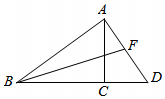

# 21 题精讲 05 · 中线作高正切

## 📝 题目

如图，已知 $\triangle ABD$ 中，$AC\perp BD$，垂足为 $C$，$BC=8$，$CD=4$，$\cos\angle ABC=\dfrac45$，$BF$ 为 $AD$ 边上的中线。

(1) 求 $AC$ 的长；

(2) 求 $\tan\angle FBD$ 的值。

## 🧭 思路导航（渐进提示）

- **提示 1（识别）**：$\triangle ABD$ 被高 $AC$ 拆成两个直角三角形；$\angle ABC$ 在 Rt$\triangle ABC$ 里，余弦直接可解——(1) 是送分的解直角三角形。(2) 的 $\angle FBD$ 在斜线 $BF$ 与底线 $BD$ 之间，$F$ 是 $AD$ 中点是唯一的"新信息"。
- **提示 2（突破）**：想用正切就要把 $BF$ 两端"落"到 $BD$ 上——过 $F$ 作 $BD$ 的垂线，垂足 $E$；中点 + 平行（$FE\parallel AC$）立刻触发**中位线**，$FE$、$CE$ 全部变成现成比例。
- **提示 3（路线）**：(1) $\cos\angle ABC=\frac{BC}{AB}=\frac45$，$BC=8$ → $AB=10$ → 勾股 $AC=\sqrt{10^2-8^2}=6$。(2) 作 $FE\perp BD$ 于 $E$：$FE\parallel AC$ 且 $F$ 为 $AD$ 中点 → $FE$ 是 $\triangle ACD$ 的中位线 → $FE=\frac12AC=3$、$CE=\frac12CD=2$ → $BE=BC+CE=10$ → $\tan\angle FBD=\frac{FE}{BE}=\frac3{10}$。

## ✍️ 详解

**(1)** $AC\perp BD$，垂足为 $C$ → $\triangle ABC$ 是直角三角形（$\angle ACB=90°$）。

在 Rt$\triangle ABC$ 中：

$$\cos\angle ABC=\frac{BC}{AB}=\frac45\quad(\text{余弦}=\text{邻边}/\text{斜边})$$

$BC=8$ 代入：

$$AB=\frac{BC}{\cos\angle ABC}=\frac{8}{4/5}=10$$

勾股定理求第三边：

$$AC=\sqrt{AB^2-BC^2}=\sqrt{10^2-8^2}=\sqrt{36}=6$$

$$\boxed{AC=6}$$

（6-8-10 是勾股数 3-4-5 的两倍：可以借此心算预判，但首答必须写出余弦求 $AB$ 与勾股求 $AC$ 的过程。）

**(2)** 连结相关线段，过 $F$ 作 $FE\perp BD$，垂足为 $E$。

$BF$ 是 $AD$ 边上的中线 → $F$ 是 $AD$ 的中点（中线定义：平分对边）。

由 $FE\perp BD$、$AC\perp BD$：

$$FE\parallel AC\quad(\text{垂直于同一条直线的两直线平行})$$

在 $\triangle ACD$ 中：$F$ 是 $AD$ 的中点，$FE\parallel AC$ → $FE$ 是 $\triangle ACD$ 的**中位线**（过一边中点平行于另一边的直线，必平分第三边），所以

$$FE=\frac12AC=\frac12\times6=3,\qquad CE=\frac12CD=\frac12\times4=2$$

（对应关系：$FE$ 对应 $AC$、$CE$ 对应 $CD$，中位线把两条边同时折半；由 $CE=2<CD=4$ 知 $E$ 落在线段 $CD$ 内部，即 $E$ 在线段 $BD$ 上，垂足位置合法。）

于是（$E$ 在 $C$、$D$ 之间，因为 $CE=2<CD=4$）：

$$BE=BC+CE=8+2=10$$

在 Rt$\triangle FEB$ 中（$\angle FEB=90°$）：

$$\tan\angle FBD=\frac{FE}{BE}=\frac{3}{10}\quad(\text{正切}=\text{对边}/\text{邻边})$$

$$\boxed{\tan\angle FBD=\frac{3}{10}}$$

（验算法二：连 $CF$，则 $CF$ 是 Rt$\triangle ACD$ 斜边 $AD$ 上的中线，$AD=\sqrt{AC^2+CD^2}=\sqrt{36+16}=2\sqrt{13}$，$CF=FD=\sqrt{13}$；等腰 $\triangle FCD$ 中 $FE\perp CD$ → 三线合一 $CE=\frac12CD=2$、$FE=\sqrt{13-4}=3$，与中位线法一致 ✓。）

（对比：法一全程不出现 $AD$ 与 $BF$ 的长度，用中位线把 $FE$、$CE$ 直接"折半"得到，是最短路径；法二要用斜边中线定理 + 二次勾股，作为验算更合适。）

## ⚠️ 评分点与易错

- (1) 的余弦是 $\dfrac{\text{邻边}}{\text{斜边}}=\dfrac{BC}{AB}$，别写成 $\dfrac{AC}{AB}$（那是正弦的位置）；解出 $AB=10$ 后必须用**勾股**收尾，不能凭 6-8-10 直接报数。
- **题源 OCR 讹误**："$AD=213$"应为 $AD=2\sqrt{13}$（$\sqrt{36+16}=\sqrt{52}$）；"$\tan=310$"应为 $\frac3{10}$。
- (2) 的题眼是"中点 + 平行 → 中位线"：先证 $FE\parallel AC$（双垂直），再用 $F$ 为中点得中位线，两步依据缺一不可。
- 法一里 $FE=\frac12AC$ 用的是 (1) 的结论 $AC=6$——上一小问的答案常常是下一小问的原料，(1) 算错则 (2) 连锁失分，交卷前回看一眼。
- $BE=BC+CE=8+2=10$：$E$ 在 $C$ 的**外侧**（朝 $D$ 一侧），别算成 $BC-CE=6$；看图确认 $C$、$E$、$D$ 的顺序。
- $\angle FBD$ 的对边是 $FE$（$F$ 到 $BD$ 的垂线段），邻边是 $BE$（从 $B$ 量到垂足），不是 $BD$ 也不是 $BF$。
- 收尾自检：$FE=3<BE=10$ → $\tan\angle FBD=\frac3{10}<1$，即 $\angle FBD<45°$，与图中 $BF$ 较"平"的走向相符；若算出 $\tan>1$，优先怀疑 $BE$ 用了 $BC-CE$。

## 🔗 关联

- [[03-数学/知识点/九年级/锐角的三角比与解直角三角形]]
- [[03-数学/知识点/九年级/相似三角形]]
- 同类题：[[21-12-中线角平分与垂直]]（中线 + 双垂直的中位线链）、[[21-13-梯形中的三角比]]（余切设参 + 作高构造相似）
