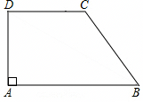

# 21 题精讲 06 · 直角梯形双垂线

## 📝 题目

**1.**（题库典例 6）如图，在直角梯形 $ABCD$ 中，$AB\parallel DC$，$\angle DAB=90°$，$AB=8$，$CD=5$，$BC=3\sqrt5$。

（1）求梯形 $ABCD$ 的面积；

（2）连接 $BD$，求 $\angle DBC$ 的正切值。

> [!tip]- 💡 思路导航
> 直角梯形求面积缺"高"，而过 $C$ 作 $AB$ 的垂线能把高与 $BE$ 同时造出来（直角腰 $AD$ 本身也是高）；(2) 的 $\angle DBC$ 由斜线 $DB$ 与斜腰 $BC$ 组成，两条"斜线"的夹角必须靠**双垂线**落到直角三角形里：作 $CH\perp BD$，$\tan\angle DBC=\dfrac{CH}{BH}$，$CH$ 用 $\triangle CDH\backsim\triangle DBA$ 求，$BH$ 用勾股收口。

> [!success]- ✅ 详解 · 评分点 · 易错 · 关联
> **详解**：
>
> **（1）**过 $C$ 作 $CE\perp AB$，垂足为 $E$。
>
> $AB\parallel DC$，$\angle DAB=90°$ → $\angle ADC=180°-\angle DAB=90°$（两直线平行，同旁内角互补）。
>
> 于是 $\angle A=\angle ADC=\angle AEC=90°$ → 四边形 $AECD$ 是矩形（有三个角是直角的四边形），
>
> $$AE=CD=5,\qquad AD=CE$$
> $$BE=AB-AE=8-5=3$$
>
> 在 Rt$\triangle BEC$ 中（$\angle BEC=90°$，勾股定理）：
>
> $$CE=\sqrt{BC^2-BE^2}=\sqrt{(3\sqrt5)^2-3^2}=\sqrt{45-9}=\sqrt{36}=6$$
>
> 故 $AD=CE=6$。梯形面积（上底 $CD$、下底 $AB$、高 $CE$）：
>
> $$S=\frac12(AB+CD)\cdot CE=\frac12\times(8+5)\times6=39$$
> $$\boxed{S_{梯形ABCD}=39}$$
>
> **（2）**过 $C$ 作 $CH\perp BD$，垂足为 $H$。先在 Rt$\triangle DAB$ 中求对角线：
>
> $$BD=\sqrt{AB^2+AD^2}=\sqrt{8^2+6^2}=10\quad(\text{勾股定理})$$
>
> $CD\parallel AB$ → $\angle CDH=\angle DBA$（两直线平行，内错角相等）；又 $\angle CHD=\angle DAB=90°$：
>
> $$\triangle CDH\backsim\triangle DBA\quad(\text{两角分别相等的两个三角形相似})$$
>
> 对应边成比例：
>
> $$\frac{CH}{AD}=\frac{CD}{BD}\quad\Longrightarrow\quad\frac{CH}{6}=\frac{5}{10}\quad\Longrightarrow\quad CH=3$$
>
> 在 Rt$\triangle CHB$ 中（$\angle CHB=90°$，$H$ 在线段 $BD$ 上，勾股定理）：
>
> $$BH=\sqrt{BC^2-CH^2}=\sqrt{(3\sqrt5)^2-3^2}=\sqrt{45-9}=\sqrt{36}=6$$
>
> （互检：$DH=\sqrt{CD^2-CH^2}=\sqrt{25-9}=4$，$BH=BD-DH=10-4=6$ ✓ 两条路一致。）
>
> 在 Rt$\triangle CHB$ 中：
>
> $$\tan\angle DBC=\frac{CH}{BH}=\frac{3}{6}=\frac12\quad(\text{正切}=\text{对边}/\text{邻边})$$
> $$\boxed{\tan\angle DBC=\frac12}$$
>
> **评分点**：(1) 先说清 $AECD$ 是矩形（三个直角）再取 $AE=CD$、$AD=CE$，面积用 $\frac12(\text{上底}+\text{下底})\times\text{高}$；(2) "平行移角"（$\angle CDH=\angle DBA$，内错角）是拿分点，依据要落在纸面上；相似判定写 AA（两角）时要把"双直角 + 平行移角"都点出来；相似对应顶点是 $C\leftrightarrow D$、$D\leftrightarrow B$、$H\leftrightarrow A$，比例式 $\frac{CH}{AD}=\frac{CD}{BD}$ 别交叉写错。
>
> **易错**：把 $BC$ 当高或漏乘 $\frac12$ 都常见——直角梯形的**直角腰就是高**，$\angle DAB=90°$ 说明 $AD$ 垂直于两底，作 $CE\perp AB$ 后 $ADCE$ 是矩形，$AD=CE$ 这条等长关系是 (1)(2) 共同的桥。$\tan\angle DBC$ 的对边是 $CH$、邻边是 $BH$；若写成 $\frac{CH}{BD}$，分母用错了斜线段。$BH$ 有两条路（勾股 $\sqrt{BC^2-CH^2}$ 与 $BD-DH$），答案必须一致——不一致说明 $CH$ 算错，这是免费的验算。数感自检：$BC=3\sqrt5\approx6.7$，是梯形里最长的"斜"线段；若你算出 $CH=6>BC$，量级上就错了——直角三角形里直角边必须短于斜边。
>
> **题源讹误说明**：题源 docx/网页文本层把公式对象丢成纯数字——"$BC=35$"应为 $BC=3\sqrt5$（下文 $(3\sqrt5)^2=45$ 可反推），"$\tan=12$"应为 $\frac12$；本讲已按几何关系还原，配图取自原卷 docx 内嵌图。
>
> **关联**：[[03-数学/知识点/九年级/锐角的三角比与解直角三角形]]、[[03-数学/知识点/九年级/相似三角形]]；同类题 [[03-数学/专题/真题精讲/21-13-梯形中的三角比]]（直角梯形 + 设参面积方程）、[[03-数学/专题/真题精讲/21-14-勾股逆定理与平行]]（梯形背景 + 相似求线段）。
