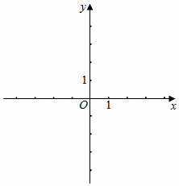

# 21 题精讲 07 · 平行直线与等距点

## 📝 题目

在平面直角坐标系 $xOy$ 中（如图），已知一次函数的图象平行于直线 $y=\dfrac12x$，且经过点 $A(2,3)$，与 $x$ 轴交于点 $B$。

(1) 求这个一次函数的解析式；

(2) 设点 $C$ 在 $y$ 轴上，当 $AC=BC$ 时，求点 $C$ 的坐标。

## 🧭 思路导航（渐进提示）

- **提示 1（识别）**：(1) 是"平行 + 过一点"定直线——平行给 $k$，点给 $b$；(2) 的 "$AC=BC$" 是**等距条件**：$C$ 到 $A$、$B$ 两点距离相等，用两点距离公式把条件翻译成方程。
- **提示 2（突破）**：距离相等 → 先**平方**去掉根号（两边都非负，平方是等价变形）；设 $C(0,m)$，两个平方和里 $m^2$ 会抵消，方程实际是一次方程。
- **提示 3（路线）**：(1) $k=\frac12$ → $y=\frac12x+b$，代 $A(2,3)$ 得 $b=2$。(2) 令 $y=0$ 得 $B(-4,0)$；设 $C(0,m)$，$AC^2=BC^2$：$(2-0)^2+(3-m)^2=(-4-0)^2+(0-m)^2$ → $13-6m=16$ → $m=-\frac12$ → $C\left(0,-\frac12\right)$。

## ✍️ 详解

**(1)** 一次函数图象平行于 $y=\dfrac12x$：

$$k=\frac12\quad(\text{两直线平行}\Rightarrow k\ \text{相等})$$

设解析式为 $y=\dfrac12x+b$。图象经过 $A(2,3)$（坐标代入）：

$$3=\frac12\times2+b\Rightarrow 3=1+b\Rightarrow b=2$$

$$\boxed{y=\frac12x+2}$$

（自检：截距 $b=2>0$、斜率 $\frac12>0$ → 直线交 $x$ 轴于负半轴，与 (2) 中 $B$ 的位置预告一致。）

**(2)** 求 $B$：令 $y=0$（$x$ 轴上的点纵坐标为 0）：

$$\frac12x+2=0\Rightarrow x=-4\quad\Rightarrow\quad B(-4,0)$$

点 $C$ 在 $y$ 轴上 → 横坐标为 0，设 $C(0,m)$。

$AC=BC$，两边均非负，平方等价：

$$AC^2=BC^2$$

两点距离公式（的平方形式）：

$$AC^2=(2-0)^2+(3-m)^2=4+9-6m+m^2=13-6m+m^2$$

$$BC^2=(-4-0)^2+(0-m)^2=16+m^2$$

令两式相等：

$$13-6m+m^2=16+m^2$$

$m^2$ 抵消，得一次方程：

$$13-6m=16\Rightarrow -6m=3\Rightarrow m=-\frac12$$

（方程为一次，根唯一，无增根；代回检验：$AC^2=BC^2=16+\dfrac14=\dfrac{65}4>0$ ✓。）

$$\boxed{C\left(0,\ -\frac12\right)}$$

（几何验算：$AC=BC$ 说明 $C$ 在线段 $AB$ 的垂直平分线上。$AB$ 中点 $M\left(-1,\dfrac32\right)$，$k_{AB}=\dfrac12$ → 垂直平分线的斜率为 $-2$（互负倒数），过 $M$：

$$y-\frac32=-2(x+1)$$

令 $x=0$ 得 $y=-\dfrac12$ ✓，与方程解一致。）

## ⚠️ 评分点与易错

- **题源 OCR 讹误**："$y=12x$"应为 $y=\frac12x$；"$x=-4$""$y=-\frac12$""$C(0,-\frac12)$"中的"-12"均为 $-\frac12$（分线丢失）。
- (2) 必须先求出 $B$：漏掉"令 $y=0$"直接设 $B$ 坐标是常见起点失分。
- $B(-4,0)$ 的符号自检：直线斜率、截距均为正 → 图象与 $x$ 轴交点必在负半轴 ✓，与 $x=-4$ 相符。
- 设 $C(0,m)$ 后用**平方等式** $AC^2=BC^2$ 而不是带根号的 $AC=BC$——书写简洁且无根号运算；交代"两边非负、平方等价"更稳。
- $m^2$ 抵消后是一次方程：若你解出二次方程，多半是展开 $(3-m)^2$ 时漏了 $-6m$ 或符号出错，回查。
- 舍根不存在 ≠ 不检验：$C\left(0,-\frac12\right)$ 代回 $AC=\sqrt{16.25}=BC$ ✓，一步验算保住 (2) 全分。
- 概念辨析：$AC=BC$ 的几何意义是"$C$ 在线段 $AB$ 的垂直平分线上"，本题 $C$ 被限定在 $y$ 轴上，所以是"垂直平分线与 $y$ 轴的交点"，唯一存在；若题目把 $C$ 放到 $x$ 轴上，则要另解一次距离方程。

## 🔗 关联

- [[03-数学/专题/第21-22题-函数与三角比应用]]
- 同类题：[[21-01-储水机加水函数]]（一次函数待定系数）、[[21-04-截距与平移余弦]]（坐标距离 + 三角比）
