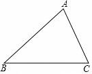

# 21 题精讲 08 · 等腰与垂直平分线

## 📝 题目

如图，已知 $\triangle ABC$ 中，$AB=BC=5$，$\tan\angle ABC=\dfrac34$。

(1) 求边 $AC$ 的长；

(2) 设边 $BC$ 的垂直平分线与边 $AB$ 的交点为 $D$，求 $\dfrac{AD}{DB}$ 的值。

## 🧭 思路导航（渐进提示）

- **提示 1（识别）**：等腰三角形 + 顶角正切——作底角处的垂线（$AE\perp BC$）把正切落进 Rt$\triangle ABE$；(2) 的垂直平分线给出"中点 $F$ + 垂直"两个条件，$D$ 在 $AB$ 上，求的是 $AB$ 被分成的两段之比。
- **提示 2（突破）**：$\tan\angle ABC=\frac34$ 配 $AB=5$ → 3-4-5 直接拆出 $AE$、$BE$；(2) 有两条路：硬算——Rt$\triangle BFD$ 中再用一次 $\frac34$ 求 $DF$、勾股求 $BD$；巧算——$DF\parallel AE$（双垂直），用平行线分线段成比例直接出 $\frac{AD}{DB}$。
- **提示 3（路线）**：(1) $AE=3$、$BE=4$ → $CE=BC-BE=1$ → $AC=\sqrt{3^2+1^2}=\sqrt{10}$。(2) $F$ 为 $BC$ 中点 → $BF=\frac52$；Rt$\triangle BFD$：$\tan\angle DBF=\frac{DF}{BF}=\frac34$ → $DF=\frac{15}8$ → $BD=\sqrt{\frac{25}4+\frac{225}{64}}=\sqrt{\frac{625}{64}}=\frac{25}8$ → $AD=5-\frac{25}8=\frac{15}8$ → $\frac{AD}{DB}=\frac35$。（巧算：$\frac{AD}{DB}=\frac{EF}{FB}=\frac{3/2}{5/2}=\frac35$。）

## ✍️ 详解

**(1)** 作 $AE\perp BC$，垂足为 $E$。

在 Rt$\triangle ABE$ 中（$\angle AEB=90°$）：

$$\tan\angle ABC=\frac{AE}{BE}=\frac34\quad(\text{正切}=\text{对边}/\text{邻边})$$

设 $AE=3k$，$BE=4k$（$k>0$）。由 $AB=5$ 与勾股定理：

$$(3k)^2+(4k)^2=5^2\Rightarrow 25k^2=25\Rightarrow k=1$$

故 $AE=3$，$BE=4$。于是

$$CE=BC-BE=5-4=1$$

在 Rt$\triangle AEC$ 中（$\angle AEC=90°$，勾股定理）：

$$AC=\sqrt{AE^2+CE^2}=\sqrt{3^2+1^2}=\sqrt{10}$$

$$\boxed{AC=\sqrt{10}}$$

**(2)** 设垂直平分线交 $BC$ 于 $F$，则 $F$ 是 $BC$ 的中点，且 $DF\perp BC$：

$$BF=CF=\frac12BC=\frac52$$

**法一（直接计算）**：$D$ 在边 $AB$ 上 → $\angle DBF=\angle ABC$（同一个角）。

在 Rt$\triangle BFD$ 中（$\angle BFD=90°$）：

$$\tan\angle DBF=\frac{DF}{BF}=\frac34\quad\Longrightarrow\quad DF=\frac34\times\frac52=\frac{15}8$$

勾股定理：

$$BD=\sqrt{BF^2+DF^2}=\sqrt{\frac{25}4+\frac{225}{64}}=\sqrt{\frac{400+225}{64}}=\sqrt{\frac{625}{64}}=\frac{25}8$$

$BD=\dfrac{25}8<5$ ✓，$D$ 确在线段 $AB$ 上，故

$$AD=AB-BD=5-\frac{25}8=\frac{40-25}{8}=\frac{15}8$$

$$\frac{AD}{DB}=\frac{15/8}{25/8}=\frac35$$

**法二（比例巧算）**：由 $AE\perp BC$、$DF\perp BC$ 得 $DF\parallel AE$（垂直于同一直线的两直线平行）。

在 $\triangle BAE$ 中，$D$ 在 $BA$ 上、$F$ 在 $BE$ 上、$DF\parallel AE$，由平行线分线段成比例：

$$\frac{AD}{DB}=\frac{EF}{FB}$$

（对应段：$A\leftrightarrow E$、$D\leftrightarrow F$。）

$$EF=CF-CE=\frac52-1=\frac32\qquad(\text{顺序：}B,F,E,C)$$

$$\frac{AD}{DB}=\frac{3/2}{5/2}=\frac35$$

$$\boxed{\frac{AD}{DB}=\frac35}$$

## ⚠️ 评分点与易错

- **题源 OCR 讹误（本题根号丢失多处，须全程重算）**："$AC=\sqrt{3^2+1^2}=10$"应为 $\sqrt{10}$；"$DF=158$"应为 $DF=\frac{15}8$；"$BD=258$"应为 $BD=\frac{25}8$——由 $BF^2=\frac{25}4=\frac{400}{64}$、$DF^2=\frac{225}{64}$ 勾股得 $\sqrt{\frac{400+225}{64}}=\sqrt{\frac{625}{64}}=\frac{25}8$（$625=25^2$ 恰为完全平方，数值自洽）；"$AD=\frac{15}8$""比值 $\frac35$"随之全部吻合。若把 $BD$ 读作 $\frac{5\sqrt8}{8}\approx1.77$，则与 $BF=2.5$、$DF=1.875$ 的直角三角形（斜边必大于任一直角边）矛盾，排除。
- (1) 设参 $AE=3k$、$BE=4k$ 后必须用勾股（或 3-4-5）定出 $k=1$，不能默认单位长。
- (2) 中 $\angle DBF$ 与 $\angle ABC$ 是同一个角要交代（$D$ 在 $BA$ 上），这是第二次使用 $\tan=\frac34$ 的合法性来源。
- 法二的分子分母是 $EF$ 与 $FB$：$E$ 在 $F$ 的外侧（顺序 $B,F,E,C$），$EF=CF-CE$ 或 $BE-BF$ 均为 $\frac32$；写成 $CE-CF$ 得负数即错。
- 两法对照是最好的验算：$AD=DB=\frac{15}8:\frac{25}8=3:5$ 与 $EF:FB=3:5$ 完全一致。

## 🔗 关联

- [[03-数学/知识点/九年级/锐角的三角比与解直角三角形]]
- [[03-数学/知识点/九年级/相似三角形]]
- 同类题：[[21-05-中线作高正切]]（中点作垂线 + 中位线）、[[21-12-中线角平分与垂直]]（双垂直 + 比例链）
