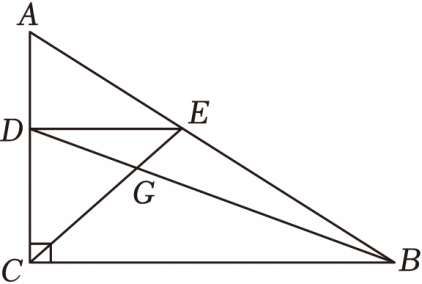

# 21 题精讲 09 · 相似建模与重心

## 📝 题目

如图，在 Rt$\triangle ABC$ 中，$\angle ACB=90°$，$AC=5$，$BC=8$。点 $D$ 在边 $AC$ 上运动（不与 $A$、$C$ 重合），$DE\parallel BC$，交 $AB$ 于点 $E$。设 $AD=x$，$\triangle BDE$ 的面积为 $y$。

(1) 求 $y$ 关于 $x$ 的函数关系式，及自变量 $x$ 的取值范围；

(2) 设 $BD$ 与 $CE$ 相交于点 $G$，当点 $G$ 是 $\triangle ABC$ 的重心时，求 $\triangle BEG$ 的面积。

## 🧭 思路导航（渐进提示）

- **提示 1（识别）**：动点 + 面积函数——用 $x$（即 $AD$）表示 $\triangle BDE$ 的底和高；(2) 的"重心"是钥匙词：**重心在中线上**，而 $G$ 已在 $BD$ 上，所以 $BD$ 必须是中线 → $D$ 是 $AC$ 中点，$x$ 当场定值。
- **提示 2（突破）**：$DE\parallel BC$ → $A$ 字型相似 $\triangle ADE\backsim\triangle ABC$，$DE=\frac85x$；$\triangle BDE$ 以 $DE$ 为底时，高是平行线 $DE$ 与 $BC$ 之间的距离 $CD=5-x$；重心分中线 $BG:GD=2:1$，"同高三角形面积比等于底之比"收尾。
- **提示 3（路线）**：(1) $\frac{DE}{BC}=\frac{AD}{AC}$ → $DE=\frac85x$；$y=\frac12\cdot DE\cdot CD=\frac12\cdot\frac85x(5-x)=-\frac45x^2+4x$，定义域 $0<x<5$。(2) 重心 → $x=\frac52$，代函数得 $S_{\triangle BDE}=5$；$S_{\triangle BEG}=\frac{BG}{BD}\cdot S_{\triangle BDE}=\frac23\times5=\frac{10}3$。

## ✍️ 详解

**(1)** $DE\parallel BC$ → $\triangle ADE\backsim\triangle ABC$（平行于三角形一边的直线截其他两边，所得三角形与原三角形相似），

$$\frac{DE}{BC}=\frac{AD}{AC}\quad\Longrightarrow\quad\frac{DE}{8}=\frac{x}{5}\quad\Longrightarrow\quad DE=\frac85x$$

$DE\parallel BC$ 且 $BC\perp AC$（$\angle ACB=90°$）→ $DE\perp AC$，即 $DE\perp CD$。

取 $DE$ 为 $\triangle BDE$ 的底，则 $B$ 到直线 $DE$ 的距离 = 平行线 $DE$、$BC$ 之间的距离 = $CD$（两条平行线分别过 $D$、$C$，都垂直于 $AC$）：

$$CD=AC-AD=5-x$$

$$y=S_{\triangle BDE}=\frac12\cdot DE\cdot CD=\frac12\cdot\frac85x\cdot(5-x)=\frac45x(5-x)$$

$$\boxed{y=-\frac45x^2+4x\qquad(0<x<5)}$$

（定义域：$D$ 在边 $AC$ 上且不与 $A$、$C$ 重合 → $AD>0$ 且 $AD<AC=5$，开区间，两端都取不到。展开验算：$\frac45x(5-x)=4x-\frac45x^2$ ✓。）

（另法验算：$S_{\triangle ABC}=\frac12\cdot AC\cdot BC=\frac12\times5\times8=20$，$S_{\triangle ADE}=\frac12\cdot x\cdot\frac85x=\frac45x^2$，$S_{\triangle BCE}=\frac12\cdot BC\cdot\left(5\cdot\frac{5-x}{5}\right)=4(5-x)$，三者相减 $y=20-\frac45x^2-4(5-x)=-\frac45x^2+4x$ ✓，与直接法一致。）

**(2)** $G$ 是 $\triangle ABC$ 的重心，且 $G$ 在线段 $BD$ 上 → $BD$ 是 $\triangle ABC$ 的中线（重心必在三边上三条中线上）→ $D$ 是 $AC$ 的中点：

$$x=AD=\frac12AC=\frac52$$

（自洽检验：此时 $DE$ 过 $AC$ 中点且 $DE\parallel BC$ → $E$ 是 $AB$ 中点 → $CE$ 也是中线，$G=BD\cap CE$ 恰为两中线交点 = 重心 ✓。）

代入 (1) 的函数：

$$y=-\frac45\times\left(\frac52\right)^2+4\times\frac52=-\frac45\times\frac{25}4+10=-5+10=5$$

即 $S_{\triangle BDE}=5$。

（有趣的巧合：$y=-\frac45x^2+4x$ 的对称轴是 $x=-\frac{4}{2\times(-\frac45)}=\frac52$——重心条件对应的 $x$ 恰是抛物线顶点，$y=5$ 是定义域内的最大面积，两问的衔接点在此。）

重心分每条中线为 $2:1$（顶点到重心 : 重心到对边中点）：

$$\frac{BG}{GD}=\frac21\quad\Longrightarrow\quad\frac{BG}{BD}=\frac23$$

（具体地：$BD=BG+GD$，$BG=2GD$ → $BD=3GD$ → $\frac{BG}{BD}=\frac{2GD}{3GD}=\frac23$。）

$\triangle BEG$ 与 $\triangle BED$ 有公共顶点 $E$，底 $BG$、$BD$ 在同一直线上 → 同高，面积比等于底之比：

$$\frac{S_{\triangle BEG}}{S_{\triangle BDE}}=\frac{BG}{BD}=\frac23\quad\Longrightarrow\quad S_{\triangle BEG}=\frac23\times5$$

$$\boxed{S_{\triangle BEG}=\frac{10}{3}}$$

（单位提醒：$y$ 与 $S_{\triangle BEG}$ 都是面积，本题答"$\dfrac{10}3$"即可；变式若问"当 $y=4$ 时求 $x$"，则解 $-\frac45x^2+4x=4$ 即 $x^2-5x+5=0$，$x=\frac{5\pm\sqrt5}2$，两根都落在 $0<x<5$ 内，均保留。）

## ⚠️ 评分点与易错

- $\triangle BDE$ 的**高是 $CD=5-x$**，不是 $AD$ 也不是 $AC$：$DE$ 与 $BC$ 平行，$B$ 到 $DE$ 的距离等于两平行线间距，沿 $AC$ 方向量恰为 $CD$；写成 $\frac12\cdot DE\cdot x$ 直接全错。
- **定义域 $0<x<5$ 是开区间**："不与 $A$、$C$ 重合"意味着两端取不到，写 $0\le x\le5$ 扣分。
- (2) 先把"重心"翻译成"$D$ 为 $AC$ 中点、$x=\frac52$"再代函数；跳过这一步直接说"重心分中线 2:1"而不交代 $BD$ 是中线，过程不完整。
- 面积比用"同高 → 底之比"：$\frac{S_{\triangle BEG}}{S_{\triangle BDE}}=\frac{BG}{BD}=\frac23$，别误用 $\frac{GD}{BD}=\frac13$ 或 $\frac{BG}{GD}=\frac23$ 当面积比。
- 重心表述要精确：重心分**每条中线**成 $2:1$（顶点到重心 : 重心到对边中点），且重心是三条中线的交点——本题正是先用"交点在 $BD$ 上"反推 $BD$ 是中线，再用 $2:1$ 求面积比。
- 函数式自检：$0<x<5$ 时 $x>0$、$5-x>0$ → $y=\frac45x(5-x)>0$ 恒成立（面积必为正），且开口向下的抛物线段无零点穿越定义域内部；图象上 $x\to0^+$、$x\to5^-$ 时 $y\to0$，与"$D$ 重合端点则 $\triangle BDE$ 退化"一致。
- 检验：$x=\frac52$ 时 $DE=4$、$CD=\frac52$，$y=\frac12\times4\times\frac52=5$ ✓；$S_{\triangle BEG}=\frac{10}3<5$ ✓（部分小于整体）。

## 🔗 关联

- [[03-数学/知识点/九年级/相似三角形]]
- [[03-数学/专题/第21-22题-函数与三角比应用]]
- 同类题：[[21-10-反比例与三角形面积]]（函数图象 + 面积）、[[21-22-菱形矩形与相似]]（相似比例求线段）
