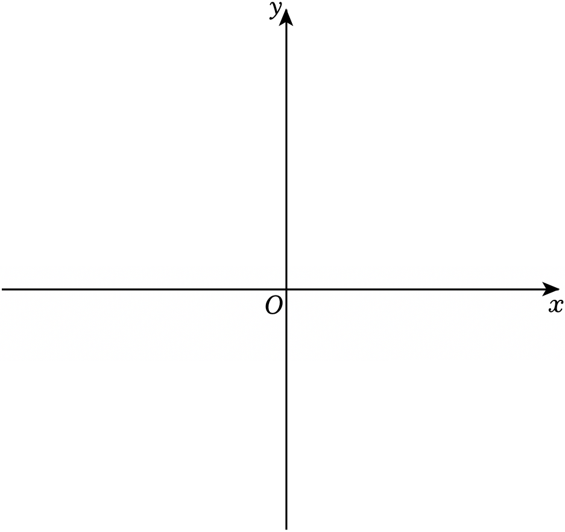

# 21 题精讲 10 · 反比例与三角形面积

（题图为空白坐标系，作答时自行描点：$A(6,-2)$、$B(2,0)$、$C(2,-6)$，草图是本题最好的检查工具。）

## 📝 题目

在平面直角坐标系 $xOy$ 中，直线 $y=-\dfrac12x+1$ 与双曲线 $y=\dfrac{k}{x}$（$k$ 是常数，且 $k\neq0$）交于点 $A(6,m)$。

(1) 求 $k$ 与 $m$ 的值；

(2) 直线 $y=-\dfrac12x+1$ 与 $x$ 轴交于点 $B$，过点 $B$ 作 $y$ 轴的平行线，交双曲线 $y=\dfrac{k}{x}$ 于点 $C$，求 $\triangle ABC$ 的面积。

## 🧭 思路导航（渐进提示）

- **提示 1（识别）**：又是"点在图象上 ⇔ 坐标满足解析式"：$A$ 先喂给直线得 $m$，再喂给双曲线得 $k$；(2) 的三条线段都藏在两函数里，逐一定点即可。
- **提示 2（突破）**：过 $B$ 平行 $y$ 轴的直线就是竖直线 $x=x_B$ → $C$ 与 $B$ 横坐标相同；$\triangle ABC$ 选**铅垂的 $BC$ 当底**，高就是 $A$ 到这条竖直线的水平距离——面积脱离"斜边高"的麻烦。
- **提示 3（路线）**：(1) $m=-\frac12\times6+1=-2$ → $A(6,-2)$ → $k=6\times(-2)=-12$。(2) 令 $y=0$ 得 $B(2,0)$；$x=2$ 代双曲线得 $C(2,-6)$；$BC=|0-(-6)|=6$，高 $=|6-2|=4$ → $S=\frac12\times6\times4=12$。

## ✍️ 详解

**(1)** 点 $A(6,m)$ 在直线 $y=-\dfrac12x+1$ 上（坐标满足解析式）：

$$m=-\frac12\times6+1=-3+1=-2\quad\Longrightarrow\quad A(6,-2)$$

点 $A$ 在双曲线 $y=\dfrac{k}{x}$ 上：

$$k=xy=6\times(-2)=-12$$

$$\boxed{k=-12,\qquad m=-2}$$

（检验：$A(6,-2)$ 在第四象限；$k=-12<0$ 时双曲线两支在二、四象限，$x=6>0$ 对应 $y<0$ ✓。）

**(2)** 求 $B$：直线 $y=-\dfrac12x+1$ 令 $y=0$（$x$ 轴上纵坐标为 0）：

$$-\frac12x+1=0\Rightarrow x=2\quad\Longrightarrow\quad B(2,0)$$

过 $B$ 作 $y$ 轴的平行线 → 竖直线 $x=2$（其上所有点横坐标相同）。点 $C(2,\,y_C)$ 在双曲线 $y=-\dfrac{12}{x}$ 上：

$$y_C=-\frac{12}{2}=-6\quad\Longrightarrow\quad C(2,-6)$$

（$C$ 在第四象限双曲线的下支 ✓，且 $C\neq B$。）

三点坐标盘点：

| 点 | 坐标 | 得来 |
| --- | --- | --- |
| $A$ | $(6,-2)$ | 代直线求 $m$，再代双曲线求 $k$ |
| $B$ | $(2,0)$ | 直线令 $y=0$ |
| $C$ | $(2,-6)$ | $x=2$ 代**双曲线** |

底边 $BC$ 竖直，长度为纵坐标差（也可用两点距离公式：$\sqrt{(2-2)^2+(0+6)^2}=6$）：

$$BC=|0-(-6)|=6$$

高 = $A(6,-2)$ 到直线 $x=2$ 的距离（水平距离）：

$$h=|6-2|=4$$

（$A$ 在直线 $x=2$ 的右侧 4 个单位，$B$、$C$ 都在直线上——"铅垂底 + 水平高"两线垂直，面积公式直接可用。）

$$S_{\triangle ABC}=\frac12\cdot BC\cdot h=\frac12\times6\times4=12$$

$$\boxed{S_{\triangle ABC}=12}$$

## ⚠️ 评分点与易错

- **$k=-12$ 是"负十二"这个数值**，不是分数 $-\frac12$！本题直线斜率恰为 $-\frac12$、双曲线系数为 $-12$，两个数在题源里排在一起，极容易看串——落笔前先分清"$-\frac12x$"（直线）与"$k=-12$"（双曲线），建议草稿上把两个解析式并排抄写、分别圈出系数。
- (2) 的 $C$ 用**双曲线**算（$y=-\frac{12}{2}=-6$），别顺手代直线（那会得 $y=0$，与 $B$ 重合，三角形退化）。
- 竖直线段长度 $=$ 纵坐标差的绝对值；$BC=6$ 写成 $-6$ 说明没取绝对值。
- 面积选铅垂底 $BC$ + 水平高，是最省事的"宽高法"；若坚持用 $AB$ 当底，需要求点 $C$ 到斜线 $AB$ 的距离，初中阶段没有点到直线距离公式，运算量陡增——选底本身就是策略分。
- 检验：$A$、$C$ 都在双曲线上（$6\times(-2)=-12$ ✓，$2\times(-6)=-12$ ✓），交点条件全部落实；图象上 $C$ 在 $B$ 正下方 6 个单位，作草图可直观复核"底 6 高 4"。
- 走势自检：直线 $y=-\frac12x+1$ 递减，双曲线 $y=-\frac{12}{x}$ 在 $x>0$ 上 $y<0$ 且随 $x$ 增大而增大（趋向 0⁻）——$C(2,-6)$ 之后若再取 $x=3$，$y=-4$，位置关系与草图一致。
- 辨析：$B(2,0)$ 不在双曲线上（$2\times0=0\neq-12$），$B$ 只是直线与 $x$ 轴的交点；三个点 $A$、$B$、$C$ 中只有 $A$、$C$ 是双曲线上的点。

## 🔗 关联

- [[03-数学/专题/第21-22题-函数与三角比应用]]
- 同类题：[[21-02-反比例交点与正弦]]（同型：直线 + 双曲线定点）、[[21-11-反比例与角相等]]（双曲线 + 角条件求坐标）
