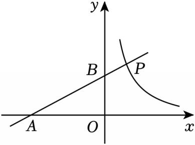

# 21 题精讲 11 · 反比例与角相等

## 📝 题目

如图，在平面直角坐标系 $xOy$ 中，已知直线 $l$：$y=kx+3$（$k\neq0$）与 $x$ 轴、$y$ 轴交于 $A$、$B$ 两点，反比例函数 $y=\dfrac8x$（$x>0$）的图象经过直线 $l$ 上的点 $P(2,n)$。

(1) 求直线 $l$ 的表达式；

(2) 已知点 $C$ 在反比例函数 $y=\dfrac8x$（$x>0$）的图象上，且 $\angle BOC=\angle ABO$，求点 $C$ 的坐标。

## 🧭 思路导航（渐进提示）

- **提示 1（识别）**：(1) 是标准待定系数：$P$ 先喂给双曲线得 $n$，再喂给直线得 $k$。(2) 的"$\angle BOC=\angle ABO$"是**角的条件**——要把它变成可计算的比例式，路径是构造两个直角三角形相似。
- **提示 2（突破）**：设 $C(m,\frac8m)$，作 $CD\perp y$ 轴于 $D$：$\angle CDO=90°=\angle AOB$，两个直角就位；关键一步是看清 $B$、$D$ 都在 $y$ 轴**正半轴**上，射线 $OB$ 与 $OD$ 重合 → $\angle BOC$ 就是 $\angle DOC$。
- **提示 3（路线）**：(1) $n=\frac82=4$ → $P(2,4)$ → $4=2k+3$ → $k=\frac12$，$l:y=\frac12x+3$。(2) 令 $x=0$、$y=0$ 得 $B(0,3)$、$A(-6,0)$；$\angle COD=\angle ABO$ + 直角 → $\triangle COD\backsim\triangle ABO$（$C\leftrightarrow A$，$O\leftrightarrow B$，$D\leftrightarrow O$）→ $\frac{OA}{CD}=\frac{OB}{OD}$ → $\frac6m=\frac{3}{8/m}$ → $m^2=16$ → $m=4$（$m>0$ 舍负）→ $C(4,2)$。

## ✍️ 详解

**(1)** 点 $P(2,n)$ 在 $y=\dfrac8x$（$x>0$）的图象上：

$$n=\frac82=4\quad\Longrightarrow\quad P(2,4)$$

$P$ 也在直线 $y=kx+3$ 上（待定系数法）：

$$4=2k+3\Rightarrow 2k=1\Rightarrow k=\frac12$$

$$\boxed{l:\ y=\frac12x+3}$$

**(2)** 求截距定 $A$、$B$：令 $x=0$ 得 $y=3$ → $B(0,3)$；令 $y=0$ 得 $x=-6$ → $A(-6,0)$。

$$OA=6,\qquad OB=3$$

$C$ 在 $y=\dfrac8x$（$x>0$）上 → 设 $C\left(m,\dfrac8m\right)$，其中 $m>0$。

作 $CD\perp y$ 轴，垂足为 $D$，则 $D\left(0,\dfrac8m\right)$（第一象限的点到 $y$ 轴作垂线，垂足在正半轴上）：

$$CD=m,\qquad OD=\frac8m$$

关键转化：$B(0,3)$ 与 $D\left(0,\frac8m\right)$ 都在 $y$ 轴**正半轴**上 → 射线 $OB$ 与射线 $OD$ 重合 →

$$\angle BOC\ \text{与}\ \angle DOC\ \text{是同一个角，即}\ \angle COD=\angle BOC$$

结合已知 $\angle BOC=\angle ABO$：

$$\angle COD=\angle ABO$$

又 $\angle CDO=\angle AOB=90°$（垂直定义、坐标轴互相垂直）：

$$\triangle COD\backsim\triangle ABO\quad(\text{两角分别相等的两个三角形相似；对应顶点 }C\leftrightarrow A,\ O\leftrightarrow B,\ D\leftrightarrow O)$$

对应边成比例：

$$\frac{OA}{CD}=\frac{OB}{OD}\quad\Longrightarrow\quad\frac{6}{m}=\frac{3}{8/m}$$

即 $\dfrac6m=\dfrac{3m}{8}$，交叉相乘：

$$48=3m^2\Rightarrow m^2=16\Rightarrow m=\pm4$$

$m>0$（$C$ 在第一象限分支上，$x>0$）→ $m=-4$ 舍去，$m=4$。

$$OD=\frac84=2,\qquad y_C=2$$

$$\boxed{C(4,\ 2)}$$

（检验：$4\times2=8$ ✓ 在双曲线上；$\tan\angle ABO=\frac{OA}{OB}=2$，$\tan\angle COD=\frac{CD}{OD}=\frac42=2$，两锐角正切相等 → 两角相等 ✓。）

## ⚠️ 评分点与易错

- "射线 $OB$ 与 $OD$ 重合 → $\angle BOC=\angle DOC$"是本题的题眼，必须写明（$B$、$D$ 同在 $y$ 轴正半轴）；跳过直接写相似会被判跳步。
- **相似对应顺序别写反**：是 $\triangle COD\backsim\triangle ABO$（$O\leftrightarrow B$、$D\leftrightarrow O$），比例式 $\frac{OA}{CD}=\frac{OB}{OD}$ 依据这个顺序；写成 $\frac{OA}{OD}=\frac{OB}{CD}$ 会解出 $m^2=1$ 的错根。
- **舍根要给理由**：$m=\pm4$ 中舍去 $-4$ 的依据是"$x>0$"（题目对双曲线分支的限定），不是"长度为正"泛泛一句。
- (1) 的顺序是"双曲线先定 $n$、直线再定 $k$"，反过来无 $n$ 可用。
- 别忘记 $C$ 有两个约束：在双曲线上（已用设参落实）+ 满足角条件（相似方程落实），最后代回双曲线检验 $y_C=\frac84=2$ 收尾。

## 🔗 关联

- [[03-数学/知识点/九年级/相似三角形]]
- [[03-数学/专题/第21-22题-函数与三角比应用]]
- 同类题：[[21-10-反比例与三角形面积]]（直线 + 双曲线定点与面积）、[[21-02-反比例交点与正弦]]（函数 + 角度计算）
