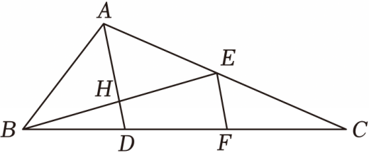

# 21 题精讲 12 · 中线角平分与垂直

## 📝 题目

如图，在 $\triangle ABC$ 中，$BE$ 为中线（$E$ 在 $AC$ 上），$AD$ 平分 $\angle BAC$，且 $AD\perp BE$，分别交 $BE$、$BC$ 于点 $H$、$D$；$EF\perp BE$，交 $BC$ 于点 $F$。$AB=5$，$\tan\angle ABE=\dfrac34$。

(1) 求 $BE$ 的长；

(2) 求 $\tan\angle EBC$ 的值。

## 🧭 思路导航（渐进提示）

- **提示 1（识别）**：图形里"垂直 + 角平分线 + 中线"三件套；(1) 的钥匙是——$AD$ 既平分 $\angle BAC$ 又垂直 $BE$，$H$ 落在 $BE$ 上，$\triangle ABE$ 被迫成为**等腰三角形**，$BE$ 是底、$AH$ 是高。
- **提示 2（突破）**：(1) 先在 Rt$\triangle ABH$ 里用 $\tan\angle ABE=\frac34$ 和 $AB=5$ 拆出 $AH$、$BH$，再由全等（或三线合一）把 $BH$ 翻倍。(2) 的 $EF\perp BE$ 与 $AD\perp BE$ 平行，图形里串起**两级中位线**：$H$ 是 $BE$ 中点 → $HD$ 是 $\triangle FBE$ 的中位线；$E$ 是 $AC$ 中点 → $EF$ 是 $\triangle CAD$ 的中位线；而 $AD=AH+HD$ 是现成的"总长方程"。
- **提示 3（路线）**：(1) Rt$\triangle ABH$：$\frac{AH}{BH}=\frac34$，$AB=5$ → $AH=3$、$BH=4$；$\angle BAH=\angle EAH$、$\angle AHB=\angle AHE=90°$、$AH$ 公共 → $\triangle ABH\cong\triangle AEH$ → $BH=EH=4$ → $BE=8$。(2) $AD\parallel EF$：$H$ 为 $BE$ 中点 → $EF=2HD$；$E$ 为 $AC$ 中点 → $AD=2EF=4HD$；又 $AD=AH+HD=3+HD$ → $3+HD=4HD$ → $HD=1$；Rt$\triangle BHD$ 中 $\tan\angle EBC=\tan\angle HBD=\frac{HD}{BH}=\frac14$。

## ✍️ 详解

**(1)** $AD\perp BE$ 于 $H$ → $\angle AHB=90°$，$\triangle ABH$ 是直角三角形。

在 Rt$\triangle ABH$ 中：

$$\tan\angle ABE=\tan\angle ABH=\frac{AH}{BH}=\frac34\quad(\text{正切}=\text{对边}/\text{邻边})$$

结合 $AB=5$ 与勾股定理（$3:4:5$ 的直角三角形）：

$$AH=3,\qquad BH=4$$

$AD$ 平分 $\angle BAC$，$H$ 在 $AD$ 上、$E$ 在 $AC$ 上 → $\angle BAH=\angle EAH$（角平分线定义）。

在 $\triangle ABH$ 与 $\triangle AEH$ 中：

$$\angle BAH=\angle EAH,\qquad AH=AH\ (\text{公共边}),\qquad \angle AHB=\angle AHE=90°$$

$$\Longrightarrow\quad\triangle ABH\cong\triangle AEH\quad(\text{ASA})$$

所以 $BH=EH$（全等对应边），即 $H$ 是 $BE$ 的中点：

$$BE=2BH=2\times4=8$$

$$\boxed{BE=8}$$

（等价说法：$AB=AE=5$，$\triangle ABE$ 是等腰三角形，$AH$ 既是高又是底边中线——三线合一。）

**(2)** 由 $EF\perp BE$、$AD\perp BE$：

$$AD\parallel EF\quad(\text{垂直于同一条直线的两直线平行})$$

**第一级中位线**：在 $\triangle FBE$ 中，$H$ 是 $BE$ 的中点（(1) 已证），且 $HD\parallel EF$（$D$、$H$ 在直线 $AD$ 上）→ $HD$ 是 $\triangle FBE$ 的中位线：

$$EF=2HD$$

**第二级中位线**：$BE$ 是中线 → $E$ 是 $AC$ 的中点；在 $\triangle CAD$ 中，$E$ 是 $CA$ 中点且 $EF\parallel AD$ → $EF$ 是 $\triangle CAD$ 的中位线：

$$AD=2EF=2\times(2HD)=4HD$$

另一方面，$H$ 在线段 $AD$ 上（$A$、$H$、$D$ 共线，$H$ 在 $A$ 与 $D$ 之间）：

$$AD=AH+HD=3+HD$$

两个表达式相等：

$$3+HD=4HD\Rightarrow 3HD=3\Rightarrow HD=1$$

$\angle EBC$：$D$ 在 $BC$ 上 → 射线 $BD$ 与射线 $BC$ 重合 → $\angle EBC=\angle EBD=\angle HBD$（$H$ 在 $BE$ 上）。

在 Rt$\triangle BHD$ 中（$\angle BHD=90°$）：

$$\tan\angle EBC=\tan\angle HBD=\frac{HD}{BH}=\frac{1}{4}\quad(\text{正切}=\text{对边}/\text{邻边})$$

$$\boxed{\tan\angle EBC=\frac14}$$

（坐标验算：取 $B(0,0)$、$H(4,0)$、$E(8,0)$、$A(4,3)$，则 $C=2E-A=(12,-3)$，$D=AD\cap BC=(4,-1)$，$F=(8,-2)$；$\tan\angle EBC=\frac{3}{12}=\frac14$ ✓，且 $EF=2$、$HD=1$、$AD=4$ 与中位线链全部吻合。）

## ⚠️ 评分点与易错

- (1) 的全等（或等腰三线合一）是必写的论证：$\triangle ABH\cong\triangle AEH$ 依据 ASA，"角平分线 + 垂直 → 等腰"这个转化不说理直接用 $BE=2BH$ 会扣过程分。
- (2) 是**两级中位线的接力**：$HD$ 是 $\triangle FBE$ 的中位线（用 $H$ 为 $BE$ 中点），$EF$ 是 $\triangle CAD$ 的中位线（用 $E$ 为 $AC$ 中点）——两级各自的"中点 + 平行"依据都要交代，别并成一句"由中位线 $HD=1$"。
- 方程 $AD=AH+HD$ 与 $AD=4HD$ 联立是唯一的未知数来源：$AH=3$ 从 (1) 继承，$HD$ 是新未知量；漏掉 "$AD=3+HD$" 这条几何和，方程就立不起来。
- $\tan\angle EBC$ 用的是 Rt$\triangle BHD$ 里的 $\frac{HD}{BH}$：对边是 $HD$（$D$ 到 $BE$ 的垂线段），邻边是 $BH$；分子别误用 $DH=1$ 以外的量（如 $EF=2$）。
- 本题数据自洽（坐标验算见详解末），题源"$\tan\angle ABE=34$"应读作 $\frac34$，无其他讹误。

## 🔗 关联

- [[03-数学/知识点/九年级/锐角的三角比与解直角三角形]]
- [[03-数学/知识点/九年级/相似三角形]]
- 同类题：[[21-05-中线作高正切]]（中点 + 双垂直中位线）、[[21-08-等腰与垂直平分线]]（垂直平分 + 正切设边）
