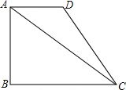

# 21 题精讲 13 · 梯形中的三角比

## 📝 题目

如图，在梯形 $ABCD$ 中，$AD\parallel BC$，$AB\perp BC$，已知 $AD=2$，$\cot\angle ACB=\dfrac43$，梯形 $ABCD$ 的面积是 $9$。

(1) 求 $AB$ 的长；

(2) 求 $\tan\angle ACD$ 的值。

## 🧭 思路导航（渐进提示）

- **提示 1（识别）**：$AB\perp BC$ 且 $AD\parallel BC$ → 这是直角梯形，$AB$ 就是高。(1) 的钥匙是"用余切设两条直角边的比，再用面积列方程"；(2) 求 $\angle ACD$ 的正切，$\angle ACD$ 不在任何现成直角三角形里——需要作高构造。
- **提示 2（突破）**：$\cot\angle ACB=\dfrac{BC}{AB}=\dfrac43$ → 设 $BC=4k$、$AB=3k$，面积公式 $\frac12(AD+BC)\cdot AB$ 变成关于 $k$ 的方程；(2) 作 $DH\perp AC$ 于 $H$，用 $AD\parallel BC$ 把 $\angle DAC$ 换成 $\angle ACB$，得到与已知 Rt$\triangle ABC$ 相似的"双垂直"三角形，求出 $DH$ 与 $CH$ 即可。
- **提示 3（路线）**：(1) 设 $BC=4k,AB=3k$ → $\frac12(2+4k)\cdot 3k=9$ → 解二次方程、舍负根 → $AB=3$，再用勾股得 $AC=5$。(2) 作 $DH\perp AC$ → $\angle DAC=\angle ACB$（内错角）+ 直角 → $\triangle ADH\backsim\triangle CAB$，相似比 $\frac{AD}{AC}=\frac25$ → $DH=\frac65$、$AH=\frac85$ → $CH=AC-AH=\frac{17}5$ → $\tan\angle ACD=\frac{DH}{CH}=\frac{6}{17}$。

## ✍️ 详解

**(1)** $AB\perp BC$ → $\angle ABC=90°$（垂直定义），在 Rt$\triangle ABC$ 中：

$$\cot\angle ACB=\frac{BC}{AB}=\frac43\quad(\text{余切}=\text{邻边}/\text{对边})$$

设 $BC=4k$，$AB=3k$（$k>0$，边长为正）。（设参依据：余切只给出**两边之比**，具体数值要靠面积方程"定"出来——设参是把比例条件变成可解方程的桥。）

$AD\parallel BC$ 且 $AB\perp BC$ → $AB\perp AD$ → $AB$ 是梯形的高，面积公式：

$$S=\frac12(AD+BC)\cdot AB=\frac12(2+4k)\cdot 3k=9$$

展开：$(1+2k)\cdot 3k=9\Rightarrow 6k^2+3k-9=0\Rightarrow 2k^2+k-3=0$

$$(2k+3)(k-1)=0\Rightarrow k=1\ \text{或}\ k=-\frac32$$

$k=-\tfrac32<0$ 舍去（边长为正，$k$ 是设参比例系数）→ $BC=4k=4$，$AB=3k=3$。

$$\boxed{AB=3}$$

（顺手为 (2) 备料：$AC=\sqrt{AB^2+BC^2}=\sqrt{9+16}=5$（勾股定理），恰是 3-4-5；回代面积 $\frac12\times(2+4)\times3=9$ ✓。3-4-5 是命题人给足的台阶，(2) 全程踩着它走。）

**(2)** 作 $DH\perp AC$，垂足为 $H$。

$AD\parallel BC$，$AC$ 是截线 → $\angle DAC=\angle ACB$（两直线平行，内错角相等）。

又 $\angle AHD=\angle ABC=90°$ → $\triangle ADH\backsim\triangle CAB$（两角分别相等的两个三角形相似）。对应顶点 $A\leftrightarrow C$、$D\leftrightarrow A$、$H\leftrightarrow B$——这也解释了为什么"内错角"那一步决定一切。

相似比为 $\dfrac{AD}{AC}=\dfrac25$，对应边成比例：

$$\frac{DH}{AB}=\frac{AH}{CB}=\frac{AD}{CA}=\frac25$$

$$DH=\frac25\cdot AB=\frac25\times3=\frac65,\qquad AH=\frac25\cdot BC=\frac25\times4=\frac85$$

（对应边认领：$DH$ 是 $\triangle ADH$ 中 $\angle DAH$ 的对边 ↔ $AB$ 是 $\triangle CAB$ 中 $\angle ACB$ 的对边，$AH$ ↔ $CB$——"角的对边对对边"，别按长短随手排。）

$H$ 在线段 $AC$ 上（$AH=\tfrac85<AC=5$）→

$$CH=AC-AH=5-\frac85=\frac{17}5$$

（垂足 $H$ 落在弦内、$CH>0$——高足位置的检验顺手带上。）

在 Rt$\triangle DHC$ 中（$\angle DHC=90°$，$H$ 在 $AC$ 上故 $\angle DCH=\angle ACD$；射线 $CH$ 与射线 $CA$ 同向）：

$$\tan\angle ACD=\frac{DH}{CH}=\frac{6/5}{17/5}\qquad(\text{正切}=\text{对边}/\text{邻边})\qquad\boxed{\tan\angle ACD=\frac{6}{17}}$$

（$\frac{6}{17}\approx0.35<1$，与 $\angle ACD$ 是锐角相符——量级自检 1 秒完成。）

（另法验算 $DH$：$AD\parallel BC$、$AB\perp BC$ → 平行线间距离 $=AB=3$ → $S_{\triangle ACD}=\frac12\cdot AD\cdot AB=3$；又 $S_{\triangle ACD}=\frac12\cdot AC\cdot DH$ → $DH=\frac{2\times3}{5}=\frac65$ ✓，与相似法一致。$k=1$ 时上底 $2$、下底 $4$、高 $3$，梯形狭长，与题图相符。）

## ⚠️ 评分点与易错

- (1) 设参前必须先写出 $\cot\angle ACB=\frac{BC}{AB}=\frac43$（余切是"邻比对"，别写成 $\frac{AB}{BC}$）；解出 $k=\pm$ 后**用 $k>0$ 舍负根**并写明理由。
- 面积方程里 $AD=2$ 是**定值上底**、$BC=4k$ 是**未知下底**，两者别混：$S=\frac12(AD+BC)\cdot AB$；二次方程的两个根必须"一用一舍"，舍根理由（$k>0$）落在纸面上。
- (2) 的题眼是"平行移角"：$\angle DAC=\angle ACB$ 这一步是拿分点，漏写内错角依据会被扣过程分；相似对应顶点是 $A\leftrightarrow C$、$D\leftrightarrow A$、$H\leftrightarrow B$，比例式 $\frac{DH}{AB}=\frac{AH}{CB}=\frac{AD}{CA}$ 别交叉写错，写完用 $CH>0$、$\frac{6}{17}<1$ 双检验。
- **题源讹误说明**：原文"$DHAB=ADAC=AHBC=25$"是分线丢失，应读作 $\frac{DH}{AB}=\frac{AD}{AC}=\frac{AH}{BC}=\frac25$；答案"$617$"同样丢分线，应读作 $\dfrac{6}{17}$——因为 $DH=\frac65$、$CH=\frac{17}5$ 都是**有理数**，若读成 $\frac{6}{\sqrt{17}}$ 则与"相似比 $\frac25$ 乘已知有理边长"的链条矛盾（坐标复验：$B(0,0),C(4,0),A(0,3),D(2,3)$，$\tan\angle ACD=\frac{|(-4)\cdot3-3\cdot(-2)|}{(-4)(-2)+3\cdot3}=\frac{6}{17}$ ✓）。
- 全题数据自洽：$AB=3,BC=4,AC=5$ 面积 $\frac12\times6\times3=9$ ✓，题干条件无需修正，只有答案层的根号/分线讹误。

## 🔗 关联

- [[03-数学/知识点/九年级/锐角的三角比与解直角三角形]]
- [[03-数学/专题/第21-22题-函数与三角比应用]]
- 同类题：[[21-14-勾股逆定理与平行]]（余切设边 + 平行相似）、[[21-15-斜边中线与正切]]（构造相似求正切）、[[21-23-尺规作图求线段]]（作高 + 平行截比例）
