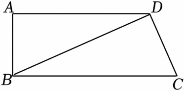

# 21 题精讲 14 · 勾股逆定理与平行

## 📝 题目

如图，在四边形 $ABCD$ 中，$BD\perp DC$，$AB=2$，$AD=4$，$DC=\sqrt5$，$\cot\angle CBD=2$。

(1) 求 $\tan\angle ADB$ 的值；

(2) 联结 $AC$ 交 $BD$ 于点 $O$，求 $BO$ 的长。

## 🧭 思路导航（渐进提示）

- **提示 1（识别）**：三个三角形共用对角线 $BD$：$\triangle BCD$ 是已知直角的三角形（$BD\perp DC$），$\triangle ABD$ 只有三条边——看到"三边"就该想到**勾股逆定理**；(2) 交点 $O$ 分对角线，是典型的相似比例模型。
- **提示 2（突破）**：先用 $\cot\angle CBD$ 在 Rt$\triangle BCD$ 里把 $BD$ 算出来，再对 $\triangle ABD$ 用勾股逆定理证 $\angle BAD=90°$，$\tan\angle ADB$ 立刻可得；(2) 的桥是**同一个 $\frac12$**：$\tan\angle ADB=\tan\angle DBC$ → 两锐角相等 → $AD\parallel BC$ → 8 字型相似。
- **提示 3（路线）**：(1) Rt$\triangle BCD$：$\cot\angle CBD=\frac{BD}{DC}=2$ → $BD=2\sqrt5$；验证 $AB^2+AD^2=BD^2$ → 勾股逆定理 → $\angle BAD=90°$ → $\tan\angle ADB=\frac{AB}{AD}=\frac12$。(2) 同一三角形中 $\tan\angle DBC=\frac{DC}{BD}=\frac12$ → $\angle DBC=\angle ADB$ → $AD\parallel BC$（内错角）→ $\triangle ADO\backsim\triangle CBO$ → $\frac{DO}{BO}=\frac{AD}{CB}=\frac45$，其中 $CB$ 用勾股算出为 $5$ → $BO=\frac{5}{9}BD=\frac{10\sqrt5}{9}$。

## ✍️ 详解

**(1)** $BD\perp DC$ → $\angle BDC=90°$（垂直定义），$\triangle BCD$ 是直角三角形。

$$\cot\angle CBD=\frac{BD}{DC}=2\quad(\text{余切}=\text{邻边}/\text{对边})\ \Rightarrow\ BD=2DC=2\sqrt5$$

在 $\triangle ABD$ 中，用三边检验：

$$AB^2+AD^2=2^2+4^2=4+16=20=(2\sqrt5)^2=BD^2$$

→ $\triangle ABD$ 是直角三角形（勾股定理的逆定理），且**最大边 $BD$ 所对的角** $\angle BAD=90°$。

在 Rt$\triangle ABD$ 中：

$$\tan\angle ADB=\frac{AB}{AD}=\frac24\qquad(\text{正切}=\text{对边}/\text{邻边})\qquad\boxed{\tan\angle ADB=\frac12}$$

（备料给 (2)：Rt$\triangle BCD$ 中 $CB=\sqrt{BD^2+DC^2}=\sqrt{20+5}=5$（勾股定理），(2) 的相似比要用它。逆定理也可反着读：$AD^2=BD^2-AB^2=20-4=16=4^2$，正反两读一致。）

**(2)** 在 Rt$\triangle BCD$ 中（$\angle BDC=90°$）：

$$\tan\angle DBC=\frac{DC}{BD}=\frac{\sqrt5}{2\sqrt5}=\frac12$$

$\angle DBC$ 与 $\angle ADB$ 都是直角三角形的锐角，且正切值相等 → $\angle DBC=\angle ADB$。

$\angle DBC$ 与 $\angle ADB$ 是直线 $AD$、$BC$ 被截线 $BD$ 所截的一对内错角 → $AD\parallel BC$（内错角相等，两直线平行）。

$O$ 是 $AC$ 与 $BD$ 的交点：

- $\angle ADO=\angle CBO$（两直线平行，内错角相等）；
- $\angle AOD=\angle COB$（对顶角相等）；

→ $\triangle ADO\backsim\triangle CBO$（两角分别相等的两个三角形相似）。

$$\frac{DO}{BO}=\frac{AD}{CB}$$

（对应关系：$A\leftrightarrow C$、$D\leftrightarrow B$、$O\leftrightarrow O$——$AD$ 对 $CB$、$DO$ 对 $BO$；交点 $O$ 两侧的"交叉边" $AO$、$CO$ 不在这组比例里。）

其中 $CB=\sqrt{BD^2+DC^2}=\sqrt{20+5}=5$（Rt$\triangle BCD$，勾股定理，见 (1) 备料）：

$$\frac{DO}{BO}=\frac45$$

设 $DO=4t$，$BO=5t$（$t>0$）→ $BD=DO+BO=9t=2\sqrt5$ → $t=\dfrac{2\sqrt5}{9}$

$$BO=5t=\frac{5\times2\sqrt5}{9}=\frac{10\sqrt5}{9}$$

$$\boxed{BO=5t=\frac{10\sqrt5}{9}}$$

（检验：$BO=\dfrac{10\sqrt5}{9}\approx2.49$，$DO=\dfrac{8\sqrt5}{9}\approx1.99$，$BO+DO\approx4.47=BD$ ✓，$O$ 在线段 $BD$ 上，自洽。一图三个三角形各司其职：Rt$\triangle BCD$ 定边、Rt$\triangle ABD$ 定角、$\triangle ADO\backsim\triangle CBO$ 定比。）

## ⚠️ 评分点与易错

- 勾股逆定理要指明"最大边 $BD$ 所对的角 $\angle BAD=90°$"——逆定理只保证最大边的对角是直角，写成 $\angle ABD=90°$ 就是概念错误；配套自检：$\cot\angle CBD$ 的**邻边是 $BD$、对边是 $DC$**（直角顶点在 $D$），写反成 $\frac{DC}{BD}$ 会得 $BD=\frac{\sqrt5}2$，代回 $AB^2+AD^2=20$ 立刻验不上。
- (2) 由 $\tan$ 相等推两角相等，前提是"两角均为锐角"（直角三角形锐角），这句话要写；随后"内错角相等 → 平行"是全部相似的地基。相似比方向：$\frac{DO}{BO}=\frac{AD}{CB}=\frac45$（$AD$ 短、$CB$ 长），若写反成 $\frac54$，$BO$ 会算出 $8\sqrt5/9$ 的错值。
- 题源讹误说明：原文印作"$DC=5$"，若真有 $DC=5$ 则 $BD=10$，与 $AB^2+AD^2=20$ 矛盾，勾股逆定理失效；按 $DC=\sqrt5$（OCR 丢根号）重构后 $BD^2=20=AB^2+AD^2$ 完全自洽，已按 $\sqrt5$ 收录。
- $\cot\angle CBD$ 的对邻方向：直角顶点在 $D$，$\angle CBD$ 的**邻边是 $BD$、对边是 $DC$**，故 $\cot=\frac{BD}{DC}$；写反成 $\frac{DC}{BD}$ 会得 $BD=\frac{\sqrt5}2$，代进 $AB^2+AD^2$ 立刻验不上——设参/读角后先用逆定理"试一试"是自检习惯。
- 由正切相等推角相等的完整理由链：两角同为锐角 + 正切一一对应 → 相等；只写"正切相等则角相等"不提"锐角"前提，在严格评分下会被追问。
- 设 $DO=4t,BO=5t$ 是"按比例设参"的标准动作，$t>0$ 要写；最终答案 $\frac{10\sqrt5}{9}$ 可用"$BO+DO=BD$"快速验算：$\frac{10\sqrt5}{9}+\frac{8\sqrt5}{9}=2\sqrt5$ ✓。

## 🔗 关联

- [[03-数学/知识点/九年级/锐角的三角比与解直角三角形]]
- [[03-数学/知识点/九年级/相似三角形]]
- 同类题：[[21-13-梯形中的三角比]]（平行四边形内移角 + 相似）、[[21-20-斜边中点与圆]]（中点 + 勾股求弦）、[[21-23-尺规作图求线段]]（平行截比例求线段）
