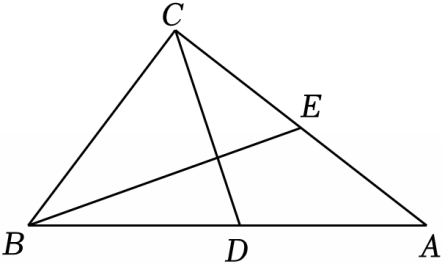

# 21 题精讲 15 · 斜边中线与正切

## 📝 题目

如图，在 Rt$\triangle ABC$ 中，$\angle ACB=90°$，$AC=8$，$\tan A=\dfrac34$，$CD$ 是中线，作 $BE\perp CD$，交边 $AC$ 于点 $E$（$CD$ 与 $BE$ 交于点 $F$）。

(1) 求 $CE$ 的长；

(2) 求 $\angle EBA$ 的正切值。

## 🧭 思路导航（渐进提示）

- **提示 1（识别）**："$CD$ 是中线"+直角 → 立刻启动"斜边上的中线等于斜边的一半"，得到 $CD=AD=DB$ 和一组等腰角；$BE\perp CD$ 又造出一个直角三角形 $\triangle BCF$——两副"余角"拼在一起就是 (1) 的相似。
- **提示 2（突破）**：(1) 用 $\tan A$ 先算 $BC$、$AB$；证 $\angle CBE=\angle A$ 后得 $\triangle BCE\backsim\triangle ACB$，用"公边 $BC$ 的平方"即 $CE/BC=BC/AC$ 求出 $CE$；(2) 在 Rt$\triangle BCF$ 里 $\tan\angle CBF=\tan A=\frac34$ → 按 $3x:4x$ 设 $CF,BF$，用 $BC=6$ 定 $x$，最后 $\tan\angle EBA=\tan\angle FBD=\frac{DF}{BF}$。
- **提示 3（路线）**：(1) $\tan A=\frac{BC}{AC}=\frac34$ → $BC=6$，$AB=10$ → $CD=AD=5$ → $\angle A=\angle ACD$；由 $\angle ACD+\angle BCD=\angle CBF+\angle BCD=90°$ 得 $\angle CBF=\angle ACD=\angle A$ → $\triangle BCE\backsim\triangle ACB$（$\angle BCE=\angle ACB=90°$）→ $CE=\frac{BC^2}{AC}=\frac{36}{8}=\frac92$。(2) Rt$\triangle BCF$：设 $CF=3x,BF=4x$ → $BC=5x=6$ → $x=\frac65$，$BF=\frac{24}5,CF=\frac{18}5$；$DF=CD-CF=5-\frac{18}5=\frac75$；Rt$\triangle BFD$ 中 $\tan\angle FBD=\frac{DF}{BF}=\frac{7}{24}$，而 $\angle FBD$ 与 $\angle EBA$ 是同一个角。

## ✍️ 详解

**(1)** 在 Rt$\triangle ABC$ 中（$\angle ACB=90°$）：

$$\tan A=\frac{BC}{AC}=\frac34\ \Rightarrow\ BC=AC\cdot\frac34=6\qquad AB=\sqrt{AC^2+BC^2}=\sqrt{64+36}=10\quad(\text{勾股定理})$$

$CD$ 是斜边 $AB$ 上的中线：

$$CD=\frac12AB=AD=5\quad(\text{直角三角形斜边上的中线等于斜边的一半})$$

→ $\triangle ACD$ 中 $DA=DC$ → $\angle A=\angle ACD$（等边对等角）。

设 $BE$ 与 $CD$ 交于 $F$。$BE\perp CD$ → $\angle BFC=90°$ → $\angle CBF+\angle BCF=90°$（直角三角形两锐角互余）；

又 $\angle ACB=90°$ → $\angle ACD+\angle BCD=90°$，且 $\angle BCF=\angle BCD$（$F$ 在 $CD$ 上）→

$$\angle CBF=\angle ACD=\angle A\quad(\text{同角的余角相等})$$

$\triangle BCE$ 与 $\triangle ACB$ 中：$\angle BCE=\angle ACB=90°$，$\angle CBE=\angle A$ → $\triangle BCE\backsim\triangle ACB$（两角分别相等）。

$$\frac{CE}{CB}=\frac{CB}{CA}\quad(\text{相似三角形对应边成比例；对应关系 }E\leftrightarrow B,\ B\leftrightarrow A,\ C\leftrightarrow C)\ \Rightarrow\ CE=\frac{CB^2}{CA}=\frac{36}{8}$$

$$\boxed{CE=\frac92}$$

（"3-4-5"在本题出现三次：$\triangle ABC$ 三边 $6,8,10$、$\tan A=\frac34$、设参 $3x:4x$——认出母图，全程数据皆整数。）

（检验：$CE=\frac92=4.5<AC=8$，$E$ 在边 $AC$ 上，且 $AE=AC-CE=\frac72>0$ ✓——$E$ 靠近 $A$ 一侧，与图相符。本题全程踩在 3-4-5 母图上：$AB=10,BC=6,AC=8$，$\tan A=\frac34$ 即"3 份对 4 份"。）

**(2)** 在 Rt$\triangle BCF$ 中（$\angle BFC=90°$）：

$$\tan\angle CBF=\frac{CF}{BF}=\tan A=\frac34$$

设 $CF=3x$，$BF=4x$（$x>0$）→ $BC=\sqrt{CF^2+BF^2}=5x$（勾股定理）→ $5x=6$ → $x=\dfrac65$

$$BF=\frac{24}5,\qquad CF=\frac{18}5$$

$$DF=CD-CF=5-\frac{18}5=\frac75\quad(F\text{在线段}CD\text{上}，CF<CD)$$

在 Rt$\triangle BFD$ 中（$\angle BFD=90°$，因 $BE\perp CD$）：

$$\tan\angle FBD=\frac{DF}{BF}=\frac{7/5}{24/5}=\frac{7}{24}$$

$F$ 在射线 $BE$ 上（$F$ 是 $BE$ 与 $CD$ 的交点，且 $CF<BF$ 由图 $F$ 在线段 $BE$ 内部）、$D$ 在射线 $BA$ 上（$D$ 是斜边 $AB$ 的**中点**，$B$、$D$、$A$ 三点共线 → 射线 $BD$ 与射线 $BA$ 重合）→ $\angle FBD$ 与 $\angle EBA$ 是同一个角：

$$\boxed{\tan\angle EBA=\frac{7}{24}}$$

（全题回看：$\triangle ABC$ 与 $\triangle BCF$ 两个 3-4-5 母图 + 一次斜边中线，所有数据都绕"3 份对 4 份"旋转——检查时盯住比例即可快速复核。）

（检验链：$CF:FB:BC=\frac{18}5:\frac{24}5:6=3:4:5$，与 $\tan\angle CBF=\frac34$ 吻合 ✓；$\frac{7}{24}<1$，$\angle EBA$ 为锐角且小于 $\angle ABC$ ✓。）

## ⚠️ 评分点与易错

- "斜边中线等于斜边一半"是第一块多米诺：由它得 $CD=AD$ 与 $\angle A=\angle ACD$，漏了这步后面全断。两组余角用的是**同一个角 $\angle BCD$**，"同角的余角相等"这句依据要落在纸面上。
- (2) 设参 $3x:4x$ 后必须用 $BC=6$ 定出 $x=\frac65$，直接把 $3,4,5$ 当边长用是最常见错误；$x$ 有意义需 $x>0$。$DF=CD-CF$ 前要说明 $F$ 在线段 $CD$ 内部（$CF=\frac{18}5<CD=5$），否则减法没有几何意义。
- $\angle EBA$ 与 $\angle FBD$ 换名时要交代两点：$F$ 在线段 $BE$ 上、$D$ 在线段 $BA$ 上（$D$ 是 $AB$ 中点、三点共线），直接跳步会被视为未证。(1) 的相似里 $CE=\frac{BC^2}{AC}$ 形似"射影定理"，但 $E$ 在**直角边**上、$CE$ 不是斜边上的高——结构相同、来源不同，别张冠李戴。
- 题源数据自洽（$BC=6,AB=10,CE=\frac92,\tan=\frac{7}{24}$ 均复算通过），无需修正。

## 🔗 关联

- [[03-数学/知识点/九年级/锐角的三角比与解直角三角形]]
- [[03-数学/知识点/九年级/相似三角形]]
- 同类题：[[21-13-梯形中的三角比]]（构造相似求正切）、[[21-21-等腰直角三角形全等]]（中点 + 双垂直余角）、[[21-22-菱形矩形与相似]]（斜边中线等长链）
