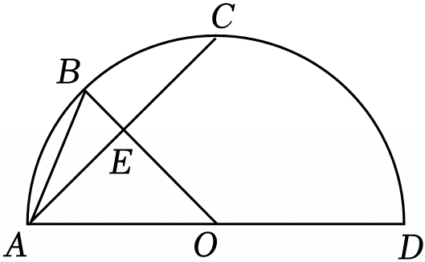

# 21 题精讲 16 · 半圆中的弧与正切

## 📝 题目

如图，$AD$ 是半圆 $O$ 的直径，半径 $OB$ 垂直于弦 $AC$，垂足为点 $E$，联结 $AB$，$\widehat{CD}=2\widehat{AB}$。

(1) 求 $\angle AOB$ 的度数；

(2) 求 $\tan\angle BAC$ 的值。

## 🧭 思路导航（渐进提示）

- **提示 1（识别）**：条件全部以"弧"的语言给出（垂径分弧 + 弧的倍数），(1) 是弧的度数运算：半圆 $=180°$ 是总量，$\widehat{AB}=\widehat{BC}$ 是平分关系；(2) 求 $\angle BAC$ 的正切，它在 Rt$\triangle ABE$ 里——只差 $BE$ 与 $AE$ 的比。
- **提示 2（突破）**：垂径定理给出 $\widehat{AB}=\widehat{BC}$，与 $\widehat{CD}=2\widehat{AB}$ 联立得 $\widehat{CD}=\widehat{AC}$，而两段弧拼成半圆 → 各 $90°$ → 圆心角可求；(2) 设 $AE=x$，$\triangle AEO$ 是含 $45°$ 角的直角三角形，全部线段都能用 $x$ 表示，$x$ 最后约掉。
- **提示 3（路线）**：(1) $OB\perp AC$ → $\widehat{AB}=\widehat{BC}$ → $\widehat{AC}=2\widehat{AB}=\widehat{CD}$；$\widehat{AC}+\widehat{CD}=180°$ → 弧 $AC=90°$；$\widehat{AB}=\widehat{BC}$ → $\angle AOB=\angle BOC=\frac12\angle AOC=45°$。(2) 设 $AE=x$ → Rt$\triangle AEO$ 中 $\angle AOE=45°$ → $OE=x$、$AO=\sqrt2x$（勾股）→ $BE=OB-OE=(\sqrt2-1)x$ → Rt$\triangle ABE$ 中 $\tan\angle BAE=\frac{BE}{AE}=\sqrt2-1$，而 $\angle BAC=\angle BAE$。

## ✍️ 详解

**(1)** 半径 $OB\perp$ 弦 $AC$，垂足 $E$：

$$\widehat{AB}=\widehat{BC}\quad(\text{垂径定理：垂直于弦的直径平分弦，并且平分弦所对的两条弧})$$

→ $\widehat{AC}=\widehat{AB}+\widehat{BC}=2\widehat{AB}$。又已知 $\widehat{CD}=2\widehat{AB}$，等量代换：

$$\widehat{CD}=\widehat{AC}$$

$\widehat{AD}$ 是半圆弧，度数为 $180°$，且 $\widehat{AD}=\widehat{AC}+\widehat{CD}$（$C$ 在弧 $AD$ 上）：

$$2\,\widehat{AC}=180°\ \Rightarrow\ \widehat{AC}=90°,\quad\angle AOC=90°\quad(\text{圆心角}=\text{所对弧的度数})$$

同时 $\widehat{CD}=\widehat{AC}=90°$ → $\angle COD=90°$，且等弧对等弦：弦 $CD=$ 弦 $AC$（这也是"弧的条件能翻译成弦"的示范）。

$$\widehat{AB}=\widehat{BC}=\frac12\,\widehat{AC}=45°$$

$\widehat{AB}=\widehat{BC}$ → $\angle AOB=\angle BOC$（同圆中，等弧所对的圆心角相等）：

$$\angle AOB=\frac12\angle AOC\qquad\boxed{\angle AOB=45°}$$

（备料给 (2)：垂径定理的另一半结论——$OB\perp AC$ 于 $E$ → $E$ 还**平分弦** $AC$，即 $AE=EC$；本题 (2) 只用到 $AE$，但"垂足 = 弦中点"常是隐藏钥匙。弧的度数 $=$ 所对圆心角的度数，"角 ↔ 弧"两套语言随时互译。）

**(2)** 设 $AE=x$（$x>0$，线段长为正）。目标再念一遍：$\tan\angle BAC$ 需要一个含 $\angle BAC$ 的直角三角形——垂足 $E$ 恰好送来 Rt$\triangle ABE$。

$OB\perp AC$ 于 $E$ → $\angle AEO=90°$（垂直定义），$E$ 在半径 $OB$ 上 → $\angle AOE=\angle AOB=45°$（同一个角；$O$、$E$、$B$ 共线）。

Rt$\triangle AEO$ 中 $\angle AOE=45°$ → 等腰直角三角形：

$$OE=AE=x\quad(\text{等腰直角三角形，两直角边相等})$$

$$AO=\sqrt{AE^2+OE^2}=\sqrt2\,x\quad(\text{勾股定理})$$

$AO=OB=\sqrt2x$（同圆半径相等）→（由图 $E$ 在线段 $OB$ 内部）

$$BE=OB-OE=(\sqrt2-1)x$$

Rt$\triangle ABE$ 中（$\angle AEB=90°$）：

$$\tan\angle BAE=\frac{BE}{AE}=\frac{(\sqrt2-1)x}{x}=\sqrt2-1\qquad(\text{正切}=\text{对边}/\text{邻边；}x\text{ 在分子分母同时约去——比值与所设的}x\text{无关})$$

$E$ 在弦 $AC$ 上 → $\angle BAC=\angle BAE$：

$$\boxed{\tan\angle BAC=\sqrt2-1}$$

（从 $\angle AOB=45°$ 走到 $\tan=\sqrt2-1$，本质是用几何把"半角正切"算了一遍——本结论可当 $\tan22.5°=\sqrt2-1$ 的推导来记。）

（位置与量级检验：$AC=2AE=2x<AD=2AO=2\sqrt2x$，"弦小于直径" ✓；$OE=x<OB=\sqrt2x$，$E$ 在半径 $OB$ 内部、$BE>0$ ✓。交叉验证：$\angle BAC$ 是 $\widehat{BC}$ 所对的圆周角 $=\frac12\times45°=22.5°$，而 $\tan22.5°=\sqrt2-1$ ✓。）

## ⚠️ 评分点与易错

- **题源讹误说明**：原文条件印作"$CD=2AB$"，按弦长理解会推出非特殊角（弦 $CD=2\cdot$弦 $AB$ 时 $\angle AOB\approx42.9°$，(1) 无简洁解、(2) 得不到 $\sqrt2-1$），故应为"$\widehat{CD}=2\widehat{AB}$"（弧符号在 docx 转文本时丢失），本讲按弧重构，结果与官方答案一致。
- 垂径定理的"平分弧"结论是 (1) 的全部起点：由 $OB\perp AC$ 写出 $\widehat{AB}=\widehat{BC}$，再谈弧的度数和；"半圆弧 $=180°$"这一总量条件要显式写出（$\widehat{AC}+\widehat{CD}=180°$），它才是方程。
- (2) 设 $AE=x$ 是"为比值服务"的设参：$x$ 最终约去，说明 $\tan$ 与半径无关；别忘交代 $E$ 在线段 $OB$ 内部（$BE=OB-OE$ 才成立）。
- 垂径定理一句话给**两个**结论：平分弦（$AE=EC$）且平分弧（$\widehat{AB}=\widehat{BC}$），(1)(2) 各用一半——只背"平分弦"会在 (1) 卡壳。
- $\angle BAC=\angle BAE$ 的换名一句话带过即可，但不能不写。

## 🔗 关联

- [[03-数学/知识点/九年级/圆与正多边形]]
- [[03-数学/知识点/九年级/锐角的三角比与解直角三角形]]
- 同类题：[[21-18-弧中点与垂径定理]]（垂径定理求距离与角）、[[21-19-切线与等边三角形]]（圆中角度链）、[[21-17-正五边形与圆]]（弧的度数计算）
