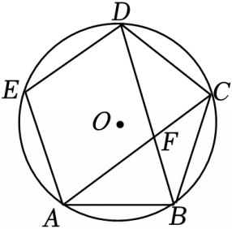

# 21 题精讲 17 · 正五边形与圆

## 📝 题目

如图，正五边形 $ABCDE$ 内接于 $\odot O$，联结 $AC$、$BD$ 交于点 $F$。

(1) 求证：$AB=AF$；

(2) 若 $\odot O$ 的半径为 $10$，求正五边形 $ABCDE$ 的面积（结果精确到 $0.1$；参考数据：$\sin36°\approx0.59$，$\cos36°\approx0.81$，$\tan36°\approx0.73$）。

## 🧭 思路导航（渐进提示）

- **提示 1（识别）**：正五边形内接于圆 → **每条边所对的弧（圆心角）都是 $72°$**，一切角都能由"弧的度数 = 圆心角度数"读出；(1) 证 $AB=AF$ 就是证 $\angle AFB=\angle ABF$，两个角都挂在不含顶点的那段弧上——这是"圆周角证等腰"的标准套路。
- **提示 2（突破）**：$\angle AFB$ 不好直接算，可用 $\triangle ABF$ 内角和：$\angle BAF$ 是 $\widehat{BC}$ 所对圆周角（$36°$），$\angle ABF$ 是 $\widehat{AD}$（经 $E$ 的那段，$144°$）所对圆周角（$72°$）；(2) 的面积用"5 个全等的 $\triangle OAB$"拼，三角形面积 $=\frac12\times$底$\times$边心距，边心距与半边长恰好由 $36°$ 的三角比给出。
- **提示 3（路线）**：(1) 每边对 $72°$ 弧 → $\angle BAC=\frac12\widehat{BC}=36°$，$\angle ABF=\frac12\widehat{AED}=72°$ → $\angle AFB=180°-36°-72°=72°$ → $\angle AFB=\angle ABF$ → 等角对等边。(2) 过 $O$ 作 $OH\perp AB$ 于 $H$：$\angle AOH=\frac12\angle AOB=36°$ → $AH=10\sin36°=5.9$、$OH=10\cos36°=8.1$ → $AB=11.8$ → $S=5\times\frac12\times11.8\times8.1=238.95\approx239.0$。

## ✍️ 详解

**(1)** 正五边形 $ABCDE$ 的五条边等长 → 五条边所对的弧相等，每条弧度数为 $\dfrac{360°}{5}=72°$（"边相等 $\Leftrightarrow$ 弧相等"，这是把正多边形条件翻译成圆的语言的第一步）：

$$\widehat{BC}=72°,\qquad \widehat{AED}=\widehat{AE}+\widehat{ED}=72°+72°=144°\quad(\text{不含}B\text{的那段弧}AD)$$

$$\angle BAC=\frac12\,\widehat{BC}=36°\quad(\text{圆周角等于所对弧度数的一半})$$

$$\angle ABF=\frac12\,\widehat{AED}=\frac12\times144°=72°\quad(\text{圆周角定理})$$

**换名**（$F$ 是两条对角线的交点，落在五边形内部）：$F$ 在对角线 $AC$ 上 → 射线 $AF$ 与射线 $AC$ 重合 → $\angle BAF=\angle BAC=36°$；$F$ 在对角线 $BD$ 上 → 射线 $BF$ 与射线 $BD$ 重合 → $\angle ABF=\angle ABD=72°$。

$$\angle BAF=36°,\qquad \angle ABF=72°\quad(\text{"点在直线上}\Rightarrow\text{射线重合}\Rightarrow\text{角相同"，各一句话})$$

（交叉验证：正五边形每个内角 $\frac{(5-2)\times180°}{5}=108°$，等腰 $\triangle ABC$ 中 $\angle BAC=\frac{180°-108°}{2}=36°$ ✓。）

在 $\triangle ABF$ 中（$F$ 是 $AC$ 与 $BD$ 的交点）：

$$\angle AFB=180°-\angle BAF-\angle ABF=180°-36°-72°=72°\quad(\text{三角形内角和定理})$$

$$\angle AFB=\angle ABF=72°\ \Rightarrow\ AB=AF\quad(\text{等角对等边})\qquad\blacksquare$$

**(2)** 过 $O$ 作 $OH\perp AB$，垂足为 $H$，联结 $OA$、$OB$。

**分割**：联结 $OA$、$OB$、$OC$、$OD$、$OE$，五条中心角都是 $\frac{360°}{5}=72°$，五个三角形按"边角边"（两邻边为半径、夹角 $72°$）全等 → 正五边形面积 $=5\,S_{\triangle OAB}$，只需算一个。（判 SAS 或 SSS 均可：半径相等给两边，中心角相等给夹角。）

$OA=OB=10$ → $\triangle OAB$ 等腰，$OH$ 是底边上的高 → $H$ 平分 $AB$（三线合一），且

$$\angle AOH=\frac12\angle AOB=36°\quad(\text{三线合一；}\angle AOB\text{ 是边}AB\text{所对的圆心角}=72°)$$

在 Rt$\triangle OAH$ 中（$\angle OHA=90°$）：

$$AH=OA\cdot\sin36°=10\times0.59=5.9\qquad OH=OA\cdot\cos36°=10\times0.81=8.1$$

$$AB=2AH=11.8$$

（$OH$ 是**边心距**——中心到边的距离，不是半径；垂足 $H$ 恰为 $AB$ 中点，"半径 + 边心距 + 半边长"构成含 $36°$ 锐角的直角三角形，参考数据正好够用。）

$$S_{\triangle OAB}=\frac12\cdot AB\cdot OH=\frac12\times11.8\times8.1=47.79$$

正五边形被 $OA,OB,OC,OD,OE$ 分成 5 个全等的这类三角形：

$$S=5\,S_{\triangle OAB}=5\times47.79=238.95\approx239.0\quad(\text{精确到}0.1)$$

$$\boxed{S_{\text{正五边形}ABCDE}\approx239.0}$$

（近似数据自检：$AH^2+OH^2=5.9^2+8.1^2=34.81+65.61=100.42\approx OA^2=100$，百分位上的偏差来自 $\sin36°,\cos36°$ 只保留两位，属正常 ✓。合并成单式：$S=5\,R^2\sin36°\cos36°=5\times100\times0.59\times0.81=238.95$，同值。书写提醒：答案前的"≈"不能省——舍入后与精确值不再相等。）

## ⚠️ 评分点与易错

- $\angle ABF$ 所对的弧是"从 $A$ 经 $E$ 到 $D$"的 $144°$ 那段（不含顶点 $B$），取成 $\widehat{AB}+\widehat{BC}$ 方向的弧就全错——圆周角永远盯住"不含角顶点"的弧。正五边形的两个"72°"也别混：**每条边**对的弧是 $72°$，**跳一个顶点**的对角线对的弧是 $144°$，(1) 的两个圆周角恰好一个挂 $72°$、一个挂 $144°$。
- (1) 是证明题，每个角都要带定理名（圆周角定理、内角和、等角对等边），不能只列数字；图形位置话术要有：$F$ 在五边形内部、同时在对角线 $AC$ 与 $BD$ 上，两个"换名"各写一句——证明里完全用不到三角比，参考数据只为 (2) 服务。
- (2) 面积模型是"中心三角形拼图"：$S=\dfrac12\times$边长$\times$边心距 $=R^2\sin36°\cos36°$ 每边一份、共 5 份；$OH$ 是边心距，不是半径。
- 近似计算按参考数据代入，最后一步才舍入：$238.95\to239.0$，**".0" 必须保留**（精确到 0.1 的格式分）。
- 参考数据只给 $36°$ 的三角比，是命题人在**提示辅助线**：要造出含 $36°$ 锐角的直角三角形——"半径 + 弦心距"模型里 $\angle AOH=\frac12\angle AOB=36°$ 恰好命中；若绕道 $\angle OAB=54°$ 就无数据可用。
- **题源解析讹误说明**：辅助线印作"过点 $B$ 作 $BH\perp OA$ 于 $H$"并配 $\sin36°$——该构造下应出现 $\sin72°$，自相矛盾，按"过 $O$ 作 $OH\perp AB$ 于 $H$"（$OH$ 为边心距）重构；中间式"$5\times\frac12\times2\times OB^2\cdot\sin30°\cdot\cos36°$"印刷混乱（"$\sin30°$"为 $\sin36°$ 之误、"OB2"为 $\frac{OB}2$ 之误）。两处均不必照抄，按本讲分步计算即可，数值 $239.0$ 复算无误。
- 正五边形的两个"72°"别混：**每条边**对的弧（和圆心角）是 $72°$，**跳一个顶点**的对角线所对的弧是 $144°$；(1) 的两个圆周角恰好一个挂 $72°$、一个挂 $144°$。

## 🔗 关联

- [[03-数学/知识点/九年级/圆与正多边形]]
- [[03-数学/知识点/九年级/锐角的三角比与解直角三角形]]
- 同类题：[[21-16-半圆中的弧与正切]]（弧与圆心角）、[[21-20-斜边中点与圆]]（圆中正弦计算）、[[21-18-弧中点与垂径定理]]（弦心距模型）
