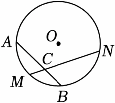

# 21 题精讲 18 · 弧中点与垂径定理

## 📝 题目

已知：如图，$M$ 是 $\widehat{AB}$ 的中点，过点 $M$ 的弦 $MN$ 交弦 $AB$ 于点 $C$，$\odot O$ 的半径为 $4\ \text{cm}$，$MN=4\sqrt3\ \text{cm}$。

(1) 求圆心 $O$ 到弦 $MN$ 的距离；

(2) 求 $\angle ACN$ 的度数。

## 🧭 思路导航（渐进提示）

- **提示 1（识别）**：两问分别指向圆的两个"标准动作"：求"圆心到弦的距离" → **作垂线段、用垂径定理折半弦长 + 勾股**；求"弦相交的角" → 利用 $M$ 是弧中点这一垂直条件。
- **提示 2（突破）**：(1) 过 $O$ 作 $OD\perp MN$ 于 $D$：$MD=\frac12MN=2\sqrt3$，$OM=4$（半径），Rt$\triangle OMD$ 勾股得 $OD$；(2) "$M$ 是 $\widehat{AB}$ 中点"$\Rightarrow OM\perp AB$（平分弧的半径垂直于弧所对的弦），再由 (1) 的 $\cos\angle OMD$ 得 $30°$，两个垂直一叠加就出 $60°$。
- **提示 3（路线）**：(1) 作 $OD\perp MN$，连 $OM$ → $MD=2\sqrt3$（垂径定理）→ $OD=\sqrt{OM^2-MD^2}=\sqrt{16-12}=2$。(2) $OM\perp AB$，垂足记 $P$；Rt$\triangle OMD$ 中 $\cos\angle OMD=\frac{MD}{OM}=\frac{2\sqrt3}{4}=\frac{\sqrt3}{2}$ → $\angle OMD=30°$ → Rt$\triangle MPC$ 中 $\angle MCP=90°-30°=60°$；由图 $C$ 在线段 $PB$ 上，故 $\angle ACM=\angle PCM=60°$；$M$、$C$、$N$ 共线 → $\angle ACN=180°-60°=120°$。

## ✍️ 详解

**(1)** "圆心到弦的距离"即垂线段的长——过 $O$ 作 $OD\perp MN$，垂足为 $D$，联结 $OM$（造出"半径 + 弦心距 + 半弦长"的标准直角三角形）。

$$MD=ND=\frac12MN=2\sqrt3\ \text{cm}\quad(\text{垂径定理：垂直于弦的直径平分弦})$$

$M$ 在 $\odot O$ 上 → $OM=4\ \text{cm}$（半径）。Rt$\triangle OMD$ 中（$\angle ODM=90°$，勾股定理）：

$$OD=\sqrt{OM^2-MD^2}=\sqrt{16-12}=2\ \text{cm}\quad(\text{勾股定理；先算}OD^2=16-12=4\text{再开方，笔算更稳})$$

$$\boxed{\text{圆心 }O\text{ 到弦 }MN\text{ 的距离为 }2\ \text{cm}}$$

（作图顺序有讲究：先作垂线、再连半径，两个动作各写各的目的；题给长度带单位 cm，(1) 的过程与答案都要带，(2) 求角度则不带单位。）

（备料给 (2)：Rt$\triangle OMD$ 三边为 $OD=2$、$MD=2\sqrt3$、$OM=4$——斜边一半恰是短直角边两倍，这是 $30°\text{-}60°\text{-}90°$ 标准三角形，(2) 的 $\angle OMD=30°$ 已在此埋下伏笔。）

**(2)** $M$ 是 $\widehat{AB}$ 的中点 → $OM\perp AB$（平分弧的半径垂直于弧所对的弦），垂足记为 $P$（$P$ 为弦 $AB$ 中点）。垂足 $P$、$D$ 是 (1)(2) 的公共基建：作图一次、两问共用。

Rt$\triangle OMD$ 中（$\angle ODM=90°$）：

$$\cos\angle OMD=\frac{MD}{OM}=\frac{2\sqrt3}{4}=\frac{\sqrt3}{2}\ \Rightarrow\ \angle OMD=30°\quad(\text{特殊角余弦值；亦可由}"OD=\frac12OM\text{"用}30°\text{角判定直接读出})$$

（此处的角色分工：斜边是半径 $OM$，邻边是半弦 $MD$，对边是弦心距 $OD$——三个量在 (1) 已全部到手，(2) 只是"倒读"。倒读也可验：$\angle OMD=30°$ → $MD=OM\cos30°=4\times\frac{\sqrt3}2=2\sqrt3$ ✓，与 (1) 的半弦吻合。）

（另注：顶点 $C$ 不在圆上，$\angle ACN$ **不是**圆周角——别试图用圆周角定理一步算它，本讲走的是"垂直 + 互余"路线。落笔前再核对一次所求角名：题目问 $\angle ACN$，抄成 $\angle ACM$ 就差了一个补角。）

垂足 $D$ 是弦 $MN$ 的中点，必在线段 $MN$ 内部；由图 $C$ 在 $M$ 与 $D$ 之间 → 射线 $MC$ 与射线 $MD$ 重合，$OM$ 与 $MN$ 的夹角即 $\angle PMC=\angle OMD=30°$。

两个垂足 $D$（对弦 $MN$）与 $P$（对弦 $AB$）把图形拆成若干直角三角形，本题只用到 Rt$\triangle OMD$ 与 Rt$\triangle MPC$ 两个。

$$\angle PMC=\angle OMD=30°\quad(D\text{、}C\text{ 同在从}M\text{出发的射线上，同角换名})$$

（$C$ 是两弦的交点，把两条弦各分成两段；本问只用到"射线方向"这一层，不需要交点分弦的比例。图形一旦给定，角度关系客观存在，笔算只是把它读出来。）

$OM\perp AB$ → $\angle MPC=90°$（$P$ 是垂足），在 Rt$\triangle MPC$ 中：

$$\angle MCP=90°-\angle PMC=60°\quad(\text{直角三角形两锐角互余})$$

弦 $AB$ 上的点序（由图）为 $A$、$P$、$C$、$B$：$C$ 在线段 $PB$ 上 → 从 $C$ 看，射线 $CA$ 与射线 $CP$ 同向重合 → $\angle ACM=\angle PCM=60°$。

$M$、$C$、$N$ 共线（$C$ 是弦 $MN$ 与弦 $AB$ 的交点）→ $\angle ACN$ 与 $\angle ACM$ 互补：

$$\angle ACN=180°-\angle ACM=180°-60°\qquad\boxed{\angle ACN=120°}$$

（取 $60°$ 还是 $120°$，完全由"$C$ 在 $P$、$B$ 之间"这处位置决定——若命题把交点挪到另一侧，同一图形会问出 $60°$。位置话术因此必须写，它是两个互补答案的裁判。）

（检验一：$\angle OMD=30°$ 意味着弦 $MN$ 离圆心 $2$、半径 $4$，弦对圆心角 $2\times60°=120°$，与 $MN=2\sqrt{r^2-d^2}=2\sqrt{12}=4\sqrt3$ ✓ 一致。检验二：联结 $ON$，$OM=ON$ → $\triangle MON$ 等腰、顶角 $\angle MON=120°$、底角 $\angle ONM=\angle OMN=30°$ ✓ 自洽。检验三：两弦相交，$\angle ACN$ 是钝角才与图相符——若算出 $60°$，多半是忘了取邻补角。记熟模型：**弦心距 $=\frac12$ 半径 $\Leftrightarrow$ 弦所对圆心角 $120°$、弦长 $\sqrt3\times$半径**，本题可秒验。）

（思路回看：全部角度由同一个 $30°$ 派生——$30°\xrightarrow{\text{互余}}60°\xrightarrow{\text{邻补}}120°$，链条单一，任何一环的角度位置写错，后面全错。三边比 $OD:MD:OM=1:\sqrt3:2$ 是 $30°\text{-}60°\text{-}90°$ 三角形的固定配方，背熟可直接读角。）

## ⚠️ 评分点与易错

- **题源讹误说明**：原文印作"$M$ 是 $AB$ 的中点"——若 $M$ 是弦 $AB$ 中点又在圆上，只能 $AB$ 为直径且 $M$ 与圆心重合，与"过点 $M$ 的弦 $MN$ 交弦 $AB$ 于 $C$"矛盾；应为"$M$ 是 $\widehat{AB}$ 的中点"（弧符号丢失），已按弧重构。
- (1) 的规范动作：作垂线段 $OD$、连半径 $OM$，"垂径定理 + 勾股"两步都要写；求的是**距离** $OD$，答案带单位 cm。计算 $\cos\angle OMD$ 时分清角色：邻边是 $MD$（垂足分出的半弦）、斜边是 $OM$（半径），写反成 $\frac{OM}{MD}$ 会把 $30°$ 读成 $60°$，链条整体错位。
- (2) 的关键是把"弧中点"翻译成 $OM\perp AB$，依据写全："平分弧的半径垂直于弧所对的弦"。
- $\angle ACM$ 与 $\angle MCP$ 换名依赖图形位置（$C$ 在 $P$、$B$ 之间），一句话交代即可；直接写 $\angle ACM=60°$ 不说明来源会被扣分。最后 $\angle ACN$ 取的是 $\angle ACM$ 的**邻补角**——$N$ 与 $M$ 在弦 $AB$ 异侧，若不加说明就可能答成 $60°$。
- "半径 + 弦心距 + 半弦长"是圆中计算的万能直角三角形（$r$、$d$、$\frac12$弦 满足勾股），知道任意两个就能求第三个，不必死记弦长公式。两问共用 (1) 的 Rt$\triangle OMD$：(1) 用勾股求 $OD$，(2) 用余弦"倒读"角——同一个三角形正反两用，是这类"一图两问"题的常见结构。

## 🔗 关联

- [[03-数学/知识点/九年级/圆与正多边形]]
- 同类题：[[21-16-半圆中的弧与正切]]（垂径分弧）、[[21-20-斜边中点与圆]]（垂径定理 + 勾股求弦长）、[[21-17-正五边形与圆]]（弦心距模型）
