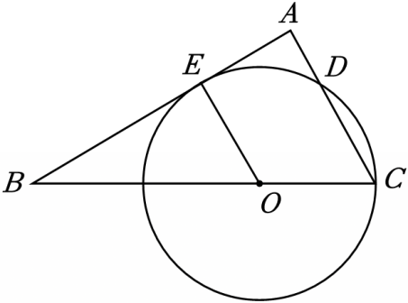

# 21 题精讲 19 · 切线与等边三角形

## 📝 题目

如图，在 $\triangle ABC$ 中，$\angle A=90°$，$\angle B=30°$，点 $O$ 在边 $BC$ 上，以 $O$ 为圆心、$OC$ 为半径的圆与边 $AC$ 交于点 $D$，与边 $AB$ 相切于点 $E$。

(1) 当 $BC=12$ 时，求 $\odot O$ 的半径长；

(2) 求 $\dfrac{AD}{CD}$ 的值。

## 🧭 思路导航（渐进提示）

- **提示 1（识别）**：切线条件第一反应是**连半径、得垂直**：$OE\perp AB$，于是 $\triangle OEB$ 是含 $30°$ 的直角三角形；(2) 求 $AD:CD$，两个点 $D,E$ 都在圆上——把 $OD,OE$ 都连起来，看半径相等能逼出哪些等边三角形。
- **提示 2（突破）**：(1) $OE=\frac12OB$（$30°$ 角对边）而 $OE=OC=r$ → $BC=OB+OC=3r$；(2) 先证 $\triangle OCD$ 等边（$OC=OD$ 且 $\angle C=60°$）得 $CD=r$、$\angle COD=60°$，再用平角算 $\angle DOE=60°$ → $\triangle EOD$ 等边 → $\angle OED=60°$ → $\angle AED=30°$，回到"$30°$ 角对边"。
- **提示 3（路线）**：(1) 连 $OE$ → $\angle OEB=90°$ → $OE=\frac12OB=2OC$ → $3OC=12$ → $r=4$。(2) 连 $OD,OE$：$\angle C=60°$、$OC=OD=r$ → $\triangle OCD$ 等边 → $CD=r,\angle COD=60°$；$\angle BOE=60°$ → $\angle DOE=180°-60°-60°=60°$ → $\triangle EOD$ 等边 → $ED=r,\angle OED=60°$；$\angle AED=180°-90°-60°=30°$ → Rt$\triangle AED$ 中 $AD=\frac12ED=\frac12r$ → $\frac{AD}{CD}=\frac12$。

## ✍️ 详解

**(1)** $\odot O$ 与 $AB$ 相切于点 $E$ → $OE\perp AB$（切线的性质：切线垂直于过切点的半径），$\angle OEB=90°$。

Rt$\triangle OEB$ 中 $\angle B=30°$：

$$OE=\frac12OB\quad(\text{直角三角形中}30°\text{角所对的直角边等于斜边的一半})$$

设半径 $r=OC$，则 $OE=r$，$OB=2r$。$O$ 在线段 $BC$ 上 → $BC=OB+OC$：

$$2r+r=12\ \Rightarrow\ 3r=12$$

$$\boxed{r=OC=4}$$

（检验：$OB=2r=8$，$OB+OC=8+4=12=BC$ ✓；结合 (2) 的链条可得 $AE=2\sqrt3>0$、切点 $E$ 在线段 $AB$ 内部，与图相符。）

**(2)** 联结 $OD$、$OE$，则 $OD=OC=OE=r$（同圆半径）。

$\angle C=90°-\angle B=60°$（直角三角形两锐角互余），$D$ 在边 $AC$ 上 → $\angle OCD=\angle C=60°$。

$\triangle OCD$ 中 $OC=OD$ 且 $\angle OCD=60°$ → 等腰三角形有一个 $60°$ 底角即等边：

$$\triangle OCD\ \text{是等边三角形}\ \Rightarrow\ CD=r,\quad\angle COD=60°$$

Rt$\triangle OEB$ 中 $\angle BOE=90°-\angle B=60°$（内角和）。

$B$、$O$、$C$ 共线（$O$ 在 $BC$ 上），$E$、$D$ 在 $BC$ 同侧 →

$$\angle DOE=180°-\angle COD-\angle BOE=180°-60°-60°=60°\quad(\text{平角})$$

$\triangle EOD$ 中 $OD=OE$ 且 $\angle DOE=60°$ → 等边三角形：

$$ED=r,\qquad \angle OED=60°$$

$\angle OEB=90°$（切线性质），$A$、$E$、$B$ 共线：

$$\angle AED=180°-\angle OED-\angle OEB=180°-60°-90°=30°\quad(\text{平角})$$

Rt$\triangle AED$ 中（$\angle A=90°$）$\angle AED=30°$：

$$AD=\frac12ED=\frac12r\quad(30°\text{角所对的直角边等于斜边的一半})$$

$$\boxed{\frac{AD}{CD}=\frac{\frac12r}{r}=\frac12}$$

（全图清一色等腰：$\triangle OCD$、$\triangle EOD$ 等边，$\triangle OEB$、$\triangle COE$ 等腰——"见切点连半径、见交点连半径"就是等腰三角形的开关。）

（检验：取 (1) 的 $r=4$，则 $CD=4$、$AD=2$，$AC=AD+CD=6=BC\sin30°=12\times\frac12$ ✓。）

## ⚠️ 评分点与易错

- **题源勘误**：其一，解析写"则 $\triangle COE$ 是等边三角形"——不对：$\angle COE=180°-\angle BOE=120°$，$\triangle COE$ 是顶角 $120°$ 的等腰三角形，真正等边的是 **$\triangle OCD$**（$OC=OD$ 且 $\angle OCD=60°$）；其二，答案"$\dfrac{AD}{CD}$ 的值为 $12$"是分线丢失，应为 $\dfrac12$（用 $AD=\dfrac12ED=\dfrac12r$、$CD=r$ 直接复核）。最终结论 $\frac12$ 不受影响，本讲已按正确链条重写。
- 顺手的自检链：$\angle COE=120°$ → 等腰 $\triangle COE$ 底角 $=\dfrac{180°-120°}{2}=30°=\angle C$ ✓，与 $OC=OE$ 相容；等边三角形链（$\triangle OCD$、$\triangle EOD$）每列一个都要给"等腰 + $60°$ 角"两个条件。
- "切线 $\Rightarrow$ 垂直"是全部角计算的第一步，必须"连 $OE$"再写垂直，凭空用 $\angle OEB=90°$ 会丢分。
- "$30°$ 角对边 = 斜边一半"用了两次（$OE=\frac12OB$ 与 $AD=\frac12ED$），每次都要写全定理名与"哪个是斜边"。
- $\angle DOE$ 由平角算出，前提是 $B,O,C$ 共线且 $E,D$ 在同侧——看图说一句，防止角度位置搞错。
- (2) 的比值与 $BC$ 无关（对任意半径都成立），(1) 的数据只是让链条可检验；写结论时别把"$r=4$"当成 (2) 的条件。
- (1) 的方程 $2r+r=12$ 来自"$O$ 在线段 $BC$ 上"的线段和 $BC=OB+OC$——切点、交点谁在线段上要看图说一句，$O$ 若在 $BC$ 延长线上此式就不成立。

## 🔗 关联

- [[03-数学/知识点/九年级/圆与正多边形]]
- [[03-数学/知识点/九年级/锐角的三角比与解直角三角形]]
- 同类题：[[21-16-半圆中的弧与正切]]（圆中角度与正切）、[[21-18-弧中点与垂径定理]]（圆的性质 + 角度计算）、[[21-20-斜边中点与圆]]（圆中等腰转换求正弦）
