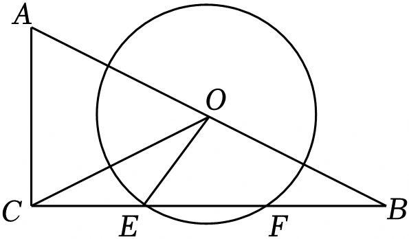

# 21 题精讲 20 · 斜边中点与圆

## 📝 题目

已知：如图，在 Rt$\triangle ABC$ 中，$\angle ACB=90°$，$AC=8$，$BC=16$，点 $O$ 为斜边 $AB$ 的中点，以 $O$ 为圆心、$5$ 为半径的圆与 $BC$ 相交于 $E$、$F$ 两点，联结 $OE$、$OC$。

(1) 求 $EF$ 的长；

(2) 求 $\angle COE$ 的正弦值。

## 🧭 思路导航（渐进提示）

- **提示 1（识别）**：圆心 $O$ 在斜边中点、弦在直角边 $BC$ 上——"圆心到弦"的距离是 (1) 的钥匙：**作 $OM\perp BC$**，它恰好是三角形的中位线，一次给出两个量；(2) 要 $\angle COE$ 的正弦，$\angle COE$ 不在任何直角三角形里，先观察 $\triangle OCE$ 三边是否有特殊关系，把角"转"出去。
- **提示 2（突破）**：$OM\perp BC$ + $AC\perp BC$ → $OM\parallel AC$，过中点 $O$ → $OM$ 是中位线：一次给两个量 $OM=4$ 与 $M$ 是 $BC$ 中点（$CM=8$）；(2) 的题眼是 $CE=CM-EM=8-3=5=OE$ → $\triangle OCE$ 等腰 → $\angle COE=\angle OCE$，把求 $\angle COE$ 换成求现成直角三角形里的 $\angle OCM$。
- **提示 3（路线）**：(1) 作 $OM\perp BC$ 于 $M$ → $EM=FM$（垂径定理）→ $OM\overset{//}{=}4$（中位线）→ Rt$\triangle OEM$ 中 $EM=\sqrt{25-16}=3$ → $EF=6$。(2) $CM=8$ → $CE=8-3=5=OE$ → $\angle EOC=\angle OCE$；Rt$\triangle OMC$ 中 $OC=\sqrt{4^2+8^2}=4\sqrt5$ → $\sin\angle OCM=\frac{OM}{OC}=\frac{1}{\sqrt5}=\frac{\sqrt5}{5}$ → $\sin\angle COE=\sin\angle OCE=\frac{\sqrt5}{5}$。

## ✍️ 详解

**(1)** 作 $OM\perp BC$，垂足为 $M$。$E$、$F$ 是 $\odot O$ 与 $BC$ 的交点，弦 $EF$ 在直线 $BC$ 上：

$$EM=FM\quad(\text{垂径定理})$$

$\angle ACB=90°$ → $AC\perp BC$，而 $OM\perp BC$ → $OM\parallel AC$（垂直于同一条直线的两直线平行）。

$O$ 是 $AB$ 中点，$OM\parallel AC$ → $M$ 是 $BC$ 中点，且

$$OM=\frac12AC=4\quad(\text{三角形中位线定理})$$

（中位线一次给出"两个产出"：长度 $OM=4$ 供 (1) 勾股用；位置 $M$ 为 $BC$ 中点、$CM=8$ 供 (2) 用——漏掉后者，(2) 的 $CE$ 就没了来源。）

Rt$\triangle OEM$ 中（$\angle OME=90°$，$OE=5$ 为半径）：

$$EM=\sqrt{OE^2-OM^2}=\sqrt{25-16}=3\quad(\text{勾股定理})$$

$$\boxed{EF=2EM=6}$$

（位置自检：$EF=6<2r=10$，"弦不超过直径" ✓；按 $CB$ 上坐标 $C(0),E(5),M(8),F(11),B(16)$ 排布，$M$ 恰为 $EF$ 中点，垂径定理适用无误。）

（备料给 (2)：垂径定理同时给出 $M$ 是弦 $EF$ 的中点，而 $OM\parallel AC$ + $O$ 为 $AB$ 中点又给出 $M$ 是 $BC$ 中点——$CM=\frac12BC=8$，这个量 (2) 马上要用。）

**(2)** 由 (1)，$M$ 是 $BC$ 中点 → $CM=\dfrac12BC=8$。

由图 $E$ 在 $C$、$M$ 之间（$E$ 是靠近 $C$ 的交点；$CE=5<CM=8$，位置自洽，减法有效）：

$$CE=CM-EM=8-3=5$$

$CE=OE=5$ → $\triangle OCE$ 等腰 → $\angle EOC=\angle OCE$（等边对等角）。

$$\angle COE=\angle OCE=\angle OCM\quad(\text{等腰换角}+\text{共线换名，三个角一线串起})$$

$E$ 在线段 $CM$ 上 → 射线 $CE$ 与射线 $CM$ 重合 → $\angle OCE=\angle OCM$。于是三个角 $\angle COE$、$\angle OCE$、$\angle OCM$ 一线串起，求 $\angle COE$ 的正弦就转成了现成直角三角形里的 $\angle OCM$。Rt$\triangle OMC$ 中（$\angle OMC=90°$）：

$$OC=\sqrt{OM^2+CM^2}=\sqrt{16+64}=4\sqrt5\quad(\text{勾股定理})$$

（$OC=4\sqrt5$ 是本题少见的无理斜边——不必急着"化到底"：$\sin=\dfrac{4}{4\sqrt5}$ 先约分再分母有理化，两步到位。）

$$\sin\angle OCM=\frac{OM}{OC}=\frac{4}{4\sqrt5}=\frac{\sqrt5}{5}\qquad(\text{正弦}=\text{对边}/\text{斜边；分母有理化}\ \frac{1}{\sqrt5}=\frac{\sqrt5}{5})$$

$$\boxed{\sin\angle COE=\sin\angle OCE=\sin\angle OCM=\frac{\sqrt5}{5}}$$

（全题只有 Rt$\triangle OMC$ 一个三角形承担计算，其余动作都是"造位置、换角"——计算集中、说明到位，正是 21 题拿满分的节奏。）

（检验：以 $C$ 为原点、$CA$ 为 $x$ 轴建系得 $O(8,4)$、$E(0,5)$、$C(0,0)$，$\cos\angle COE=\frac{\vec{CO}\cdot\vec{CE}}{OC\cdot OE}=\frac{40}{20\sqrt5}=\frac{2\sqrt5}{5}$ → $\sin^2=1-\frac45=\frac15$ ✓；$\frac{\sqrt5}5\approx0.447$，对应约 $26.6°$ 的锐角，量级合理。）

## ⚠️ 评分点与易错

- 中位线一次交出两个量：$OM=\frac12AC$ 用于 (1) 勾股，$M$ 为 $BC$ 中点（$CM=8$）用于 (2)——只写前者、(2) 就没了 $CE$ 的来源。垂径定理的落点是 $EM=FM$，故 $EF=2EM$；不写"作 $OM\perp BC$"直接用 $3$ 会被视为跳步。
- $CE=CM-EM$ 依赖"$E$ 靠近 $C$"的图形位置：另一交点 $F$ 满足 $CF=11$，取错点会得到 $CE=11\neq OE$，链条断裂——按图取舍并交代一句。
- $CE=OE=5$ 是本题设计好的"巧合"，是等腰转换（$\angle COE\to\angle OCE$）的全部依据，必须显式写出"等边对等角"。
- 正弦值的来源是 Rt$\triangle OMC$（对边 $OM$、斜边 $OC$），最终答案不带单位。
- **题源讹误说明**：原文"$OC=42+82=45$"是根号与平方记号丢失，应读作 $OC=\sqrt{4^2+8^2}=4\sqrt5$；"$\sin\angle OCM=\dfrac{OM}{OC}=\dfrac{445}{55}$"应读作 $\dfrac{4}{4\sqrt5}=\dfrac{\sqrt5}{5}$（分母有理化后 $\frac{4}{4\sqrt5}=\frac{1}{\sqrt5}=\frac{\sqrt5}{5}$）。题干条件复算自洽，无需修正。
- 两交点取舍：$E$ 靠近 $C$（$CE=5$）、$F$ 远离 $C$（$CF=CM+MF=8+3=11$），且 $CF=11<BC=16$ → 两交点都在边 $BC$ 上，与题设相符；(2) 问 $\angle COE$ 用的是**近点** $E$——取错成 $F$，则 $CF=11\neq OF=5$，等腰链条断裂。
- 位置自检：$OC=4\sqrt5\approx8.9>r=5$ → 点 $C$ 在 $\odot O$ 外，直线 $BC$ 是过 $C$ 的割线，$CE<CF$ 交点一近一远，全部与图吻合。

## 🔗 关联

- [[03-数学/知识点/九年级/圆与正多边形]]
- [[03-数学/知识点/九年级/锐角的三角比与解直角三角形]]
- 同类题：[[21-18-弧中点与垂径定理]]（垂径 + 勾股）、[[21-19-切线与等边三角形]]（圆中等腰转换）、[[21-15-斜边中线与正切]]（斜边中线起手）
