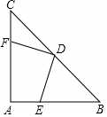

# 21 题精讲 21 · 等腰直角三角形全等

## 📝 题目

如图，在等腰直角三角形 $ABC$ 中，$\angle A=90°$，$AB=AC$，点 $D$ 是斜边 $BC$ 的中点，点 $E$、$F$ 分别为 $AB$、$AC$ 边上的点，且 $DE\perp DF$。

(1) 求证：$DF=DE$；

(2) 连接 $EF$，若 $BE=8$，$CF=6$，求 $\triangle DEF$ 的面积。

## 🧭 思路导航（渐进提示）

- **提示 1（识别）**：斜边中点 + 等腰直角三角形 → 连 $AD$，"三线合一"一次给出**垂直、角平分、$AD=CD=BD$、$45°$ 角**这一整组条件；(1) 要证的两条线段分居 $AD$ 两侧，标准的**绕 $D$ 旋转全等**模型。
- **提示 2（突破）**：$DE\perp DF$ 与 $AD\perp BC$ 各自给出一对互余的角，用"同角的余角相等"把 $\angle ADE$ 转成 $\angle CDF$，再配上 $\angle DAE=\angle C=45°$ 与 $AD=CD$，ASA 成形；(2) 中全等把已知线段"搬"到 $\triangle AEF$ 的直角边上，等腰直角 $\triangle DEF$ 再用一次勾股收尾。
- **提示 3（路线）**：(1) 连 $AD$ → $AD\perp BC$、$AD=CD$、$\angle DAE=\angle C=45°$；$\angle EDF=90°=\angle ADC$ → $\angle ADE=\angle CDF$（同角 $\angle ADF$ 的余角）→ $\triangle ADE\cong\triangle CDF$（ASA）→ $DE=DF$。(2) 全等 → $AE=CF=6$；$AB=AC$ → $BE=AF=8$；Rt$\triangle AEF$ 中 $EF=\sqrt{6^2+8^2}=10$；$\triangle DEF$ 等腰直角（$\angle EDF=90°$）→ $2DE^2=EF^2=100$ → $DE=DF=5\sqrt2$ → $S=\frac12DE\cdot DF=25$。

## ✍️ 详解

**(1)** 联结 $AD$。

$AB=AC$，$D$ 为 $BC$ 中点 → $AD\perp BC$、$AD$ 平分 $\angle BAC$、$AD$ 还是 $BC$ 边上的中线（等腰三角形三线合一）→ $\angle DAE=\frac12\angle BAC=45°$；

又 $\angle C=45°$（等腰直角三角形底角），$AD=CD$（直角三角形斜边上的中线等于斜边的一半）。

$DE\perp DF$ → $\angle EDF=90°$ → $\angle ADE+\angle ADF=90°$（注意两个直角 $\angle EDF$ 与 $\angle ADC$ **共用顶点 $D$**，才谈得上公共角 $\angle ADF$）；

$AD\perp BC$ → $\angle ADC=90°$ → $\angle CDF+\angle ADF=90°$；

$$\angle ADE=\angle CDF\quad(\text{同角的余角相等})$$

在 $\triangle ADE$ 与 $\triangle CDF$ 中（书写格式：三条件分行列出、花括号收拢，判定方法写在括号里）：

$$\begin{cases}\angle DAE=\angle C=45°\\ AD=CD\\ \angle ADE=\angle CDF\end{cases}\ \Rightarrow\ \triangle ADE\cong\triangle CDF\quad(\text{ASA：两角及夹边，边}AD\text{夹在两角之间})$$

$$\Rightarrow\ DE=DF\quad(\text{全等三角形对应边相等})\qquad\blacksquare$$

（对应关系记牢：$A\leftrightarrow C$、$D\leftrightarrow D$、$E\leftrightarrow F$，于是 $DE\leftrightarrow DF$、$AE\leftrightarrow CF$ 是两组对应边——(2) 直接取用 $AE=CF$；对应顶点写错，(2) 的线段搬运就会错位。ASA 中 $AD$ 是**夹边**：两角 $\angle DAE$、$\angle ADE$ 的公共边恰是 $AD$，判定顺序"角边角"由此得名。）

**(2)** 由 (1) $\triangle ADE\cong\triangle CDF$ → 对应边 $AE=CF=6$。（先"搬"已知：全等把 $CF=6$ 送到 $AE$ 处，等腰把 $BE=8$ 送到 $AF$ 处——两条已知线段各跨一步。）

$AB=AC$（已知）→ 两边同减：$AB-AE=AC-CF$，即

$$BE=AF=8$$

$\angle EAF=\angle BAC=90°$（$E$ 在 $AB$ 上、$F$ 在 $AC$ 上，$\angle EAF$ 就是 $\angle BAC$，直角换名即可）→ Rt$\triangle AEF$ 中（勾股定理）：

$$EF=\sqrt{AE^2+AF^2}=\sqrt{6^2+8^2}=10$$

$\triangle DEF$ 中 $DE=DF$（已证）且 $\angle EDF=90°$ → 等腰直角三角形，$EF$ 是斜边：

$$DE^2+DF^2=EF^2\quad(\text{勾股定理})\ \Rightarrow\ 2DE^2=100$$

（等腰直角三角形三边比恒为 $1:1:\sqrt2$，勾股只是它的推导过程。）

$DE>0$（边长为正）→ $DE=DF=5\sqrt2$。

（分值感：(1) 全等证明、(2) "搬线段—勾股—开方—求面积"四步，各步骤依据写全即拿满。）

（速算式：等腰直角三角形斜边 $=$ 直角边的 $\sqrt2$ 倍，$DE=\dfrac{EF}{\sqrt2}=\dfrac{10}{\sqrt2}=5\sqrt2$，与勾股展开同值；面积也可写 $S=\dfrac14EF^2=\dfrac14\times100=25$。$AE,AF,EF=6,8,10$ 全程整数，命题人留了"顺路"，别因数字太顺反而怀疑算错。若把数据对调（$BE=6,CF=8$），由同样的链条仍得 $EF=10$、$S=25$——镜像位置不改变答案。）

$$S_{\triangle DEF}=\frac12\,DE\cdot DF=\frac12\times(5\sqrt2)^2=\frac12\times50\qquad\boxed{S_{\triangle DEF}=25}$$

（检验：$AB=AC=AE+BE=6+8=14$，$AF=14-6=8$ ✓，且 $AE=6<AB=14$、$AF=8<AC=14$ → $E$、$F$ 确在边上，与题设"分别为 $AB$、$AC$ 边上的点"相符。命题人把数据设计成 $6,8,10$ 与 $8,6$ 的对调——两组 $3:4:5$，属"数据对仗"，可作检查锚点。）

## ⚠️ 评分点与易错

- "三线合一"一句话要拆开写全：垂直（$AD\perp BC$）、$45°$ 角（$\angle DAE=\angle C=45°$）、等线段（$AD=CD$）——全等三条件全从这里出。余角转换写清是"**同一个角 $\angle ADF$** 的余角"，其成立前提是两个直角 $\angle EDF$ 与 $\angle ADC$ **共用顶点 $D$**；只说"互余"不说同角，理由链不完整。
- (2) 中 $AF=BE$ 靠的是 $AB=AC$ 两边同减（$AB-AE=AC-CF$），这一步只有一行但必须有，否则 $8$ 来路不明；注意全等本身**不给** $AF=BE$，它来自等腰。
- $\triangle DEF$ 的直角在 $D$（不是 $E$ 或 $F$），面积用 $\frac12\cdot DE\cdot DF$；斜边 $EF=10$ 别误当直角边去算 $S=\frac12\times6\times8$。
- 求出 $DE=5\sqrt2$ 前要写"$DE>0$ 取正根"——$2DE^2=100$ 的负根舍去；题源数据自洽，无需修正。
- 全等的另一条路（备用/验算）：联结 $AD$ 后也可证 $\triangle BDE\cong\triangle ADF$——$BD=AD$、$\angle B=\angle DAF=45°$、$\angle BDE=\angle ADF$（同一个 $\angle BDA$ 的余角，$B$、$D$、$C$ 共线），同样给 $DE=DF$、$AE=CF$；两法取一即可，双法互验最稳。模型话：$\triangle ADE$ 绕点 $D$ 旋转 $90°$ 与 $\triangle CDF$ 重合——理解"旋转角"，$AE=CF$ 的搬运就不再是死记。
- 注意 $S_{\triangle DEF}=25$ 与 $S_{\triangle AEF}=\frac12\times6\times8=24$ **不相等**是正常的：$\triangle DEF$ 不由 $\triangle AEF$ 拼出，两块面积没有简单倍数关系，别强行"巧算"。

## 🔗 关联

- [[03-数学/知识点/九年级/相似三角形]]
- [[03-数学/知识点/九年级/锐角的三角比与解直角三角形]]
- 同类题：[[21-15-斜边中线与正切]]（斜边中线 + 余角转换）、[[21-23-尺规作图求线段]]（垂直平分线上的等距点）、[[21-22-菱形矩形与相似]]（中点 + 对角线垂直）
