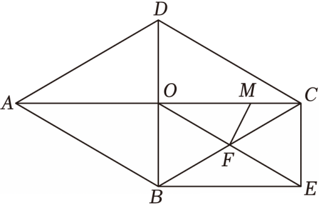

# 21 题精讲 22 · 菱形矩形与相似

## 📝 题目

如图，在菱形 $ABCD$ 中，对角线 $AC$ 与 $BD$ 相交于点 $O$，点 $F$ 是 $BC$ 的中点，联结 $OF$ 并延长到点 $E$，使得 $EF=OF$，联结 $BE$、$CE$。

(1) 求证：四边形 $OBEC$ 是矩形；

(2) 点 $M$ 在边 $OC$ 上，联结 $MF$，$\angle OBC=\angle FOC+\angle MFC$，$AC=10$，$BD=6$。求 $OM$ 的长。

## 🧭 思路导航（渐进提示）

- **提示 1（识别）**：(1) 是判定链条题：$F$ 同时平分 $BC$ 与 $OE$ → 对角线互相平分 → 平行四边形，再补一个直角；(2) 的条件 "$\angle OBC=\angle FOC+\angle MFC$" 是**翻译题**——右边像三角形外角，左边要对准矩形的某个角。
- **提示 2（突破）**：(1) 菱形给 $AC\perp BD$，即 $\angle BOC=90°$，直接封顶矩形；(2) 中 $F$ 是直角三角形 $OBC$ 斜边中点 → $OF=CF=FE=\frac12BC$，这些等长把 $\angle FOC$、$\angle OBC$、$\angle CEO$ 全部串起来；而 $\angle FOC+\angle MFC$ 恰好是 $\triangle MFC$ 的外角 $\angle FMO$（$M$ 在 $OC$ 上）。
- **提示 3（路线）**：(2) 数值准备：$OC=5$、$OB=3$ → $BC=\sqrt{34}$ → $OF=CF=FE=\frac{\sqrt{34}}2$、$OE=\sqrt{34}$。角度链：$OB\parallel CE$ 且 $OF=BF$ → $\angle OBC=\angle BOE$（等腰 $\triangle FOB$）$\ldots$ 亦可直接 $\angle OBC=\angle BCE=\angle FCE=\angle FEC=\angle CEO$；结合已知与外角 $\angle FMO=\angle FCO+\angle MFC=\angle FOC+\angle MFC=\angle OBC$ → $\angle FMO=\angle CEO$，加上对顶角 $\angle FOM=\angle EOC$ → $\triangle OMF\backsim\triangle OCE$ → $\frac{OM}{OE}=\frac{OF}{OC}$ → $OM=\frac{OE\cdot OF}{OC}=\frac{\sqrt{34}\cdot\frac{\sqrt{34}}2}{5}=\frac{17}{5}$。

## ✍️ 详解

**(1)** 菱形 $ABCD$ → $AC\perp BD$（菱形对角线互相垂直）→ $\angle BOC=90°$。

$F$ 是 $BC$ 中点 → $BF=CF$；又 $EF=OF$（已知）→ 四边形 $OBEC$ 的两条对角线 $BC$ 与 $OE$ 互相平分：

四边形 $OBEC$ 是平行四边形（对角线互相平分的四边形是平行四边形）。

又 $\angle BOC=90°$ → 平行四边形 $OBEC$ 是矩形（有一个角是直角的平行四边形是矩形）。$\blacksquare$

**(2)** 菱形对角线互相平分：

$$OC=\frac12AC=5,\qquad OB=\frac12BD=3$$

Rt$\triangle OBC$ 中（$\angle BOC=90°$，勾股定理）：

$$BC=\sqrt{OB^2+OC^2}=\sqrt{9+25}=\sqrt{34}$$

$\triangle OBC$ 是直角三角形且 $F$ 为斜边 $BC$ 中点：

$$OF=\frac12BC=\frac{\sqrt{34}}2\quad(\text{直角三角形斜边上的中线等于斜边的一半})$$

矩形 $OBEC$ 对角线相等且被 $F$ 平分 → $OE=BC=\sqrt{34}$，$OF=\frac12OE=\frac{\sqrt{34}}2$；同时 $CF=\frac12BC=\frac{\sqrt{34}}2$。

**角度翻译**（目的：证 $\angle FMO=\angle CEO$）：

- $OF=CF$ → $\triangle FOC$ 等腰 → $\angle FOC=\angle FCO$（等边对等角）；
- 已知 $\angle OBC=\angle FOC+\angle MFC=\angle FCO+\angle MFC$；
- $\angle FMO$ 是 $\triangle MFC$ 的外角（$M$ 在边 $OC$ 上，$O$、$M$、$C$ 共线）→ $\angle FMO=\angle FCM+\angle MFC=\angle FCO+\angle MFC$（三角形外角等于不相邻两内角之和）；

$$\Rightarrow\ \angle FMO=\angle OBC$$

- $FC=FE=\frac{\sqrt{34}}2$ → $\triangle FCE$ 等腰 → $\angle FCE=\angle FEC$（等边对等角），即 $\angle BCE=\angle CEO$；
- $OB\parallel CE$（矩形对边平行）→ $\angle OBC=\angle BCE$（两直线平行，内错角相等）；

$$\Rightarrow\ \angle CEO=\angle BCE=\angle OBC=\angle FMO$$

又 $\angle FOM=\angle EOC$（对顶角相等；$F$、$O$、$E$ 与 $M$、$O$、$C$ 分别共线）→

$\triangle OMF\backsim\triangle OCE$（两角分别相等的两个三角形相似）。

$$\frac{OM}{OE}=\frac{OF}{OC}\quad(\text{相似三角形对应边成比例})\ \Rightarrow\ OC\cdot OM=OE\cdot OF$$

$$5\,OM=\sqrt{34}\times\frac{\sqrt{34}}{2}=17$$

$$\boxed{OM=\frac{17}{5}}$$

（检验：$OM=3.4<OC=5$ ✓，$M$ 在线段 $OC$ 上，与题设相符。）

## ⚠️ 评分点与易错

- (1) 判定链两步都要有定理名："对角线互相平分 → 平行四边形""有一个角是直角 → 矩形"；只写"是矩形"不写依据会扣过程分。
- 等长链 $OF=CF=FE=\frac12BC$ 各有出处：斜边中线（$OF$）、中点定义（$CF$）、对角线互相平分（$FE$），别混着写。
- (2) 的核心动作是**把角度条件翻译到位**：右边 $\angle FOC+\angle MFC$ 用外角定理合成 $\angle FMO$，左边 $\angle OBC$ 用平行 + 等腰转到 $\angle CEO$——两边一对接上，相似自然出现；硬设未知数去解角反而绕远。
- 相似对应顶点 $O\leftrightarrow O$、$M\leftrightarrow E$、$F\leftrightarrow C$，比例式 $\frac{OM}{OE}=\frac{OF}{OC}$ 交叉写错会得到 $OM=\frac{85}{34}$ 一类错值；代回检验 $OM<OC$ 能拦住大部分笔误。
- 本题是本讲唯一标 ★★★★ 的题：角度翻译 + 双等腰 + 相似三段接力，任何一段的依据缺失都会被扣。
- **题源讹误说明**：原文"$BC=34$"应读作 $BC=\sqrt{34}$（勾股 $\sqrt{3^2+5^2}$ 的根号丢失）；"$OF=\cdots=\frac{34}2$"应读作 $\dfrac{\sqrt{34}}2$；最终答案"$175$"是分线丢失，应读作 $\dfrac{17}5$——由 $5\,OM=\sqrt{34}\times\dfrac{\sqrt{34}}{2}=17$ 锁定，若读作 $17.5$ 或 $175$ 均与 $OM<OC=5$ 不符。

## 🔗 关联

- [[03-数学/知识点/九年级/相似三角形]]
- [[03-数学/知识点/九年级/圆与正多边形]]
- 同类题：[[21-20-斜边中点与圆]]（斜边中线等长链）、[[21-19-切线与等边三角形]]（等腰角转换）
