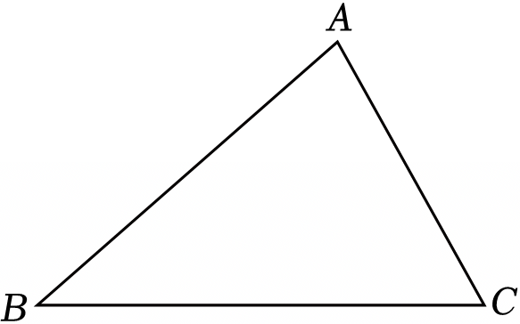

# 21 题精讲 23 · 尺规作图求线段

## 📝 题目

如图，已知在 $\triangle ABC$ 中，$BC=6$，$AC=4$，$\angle C=60°$。

(1) 尺规作图：请用无刻度的直尺和圆规，在线段 $AB$ 上作点 $D$，使得 $DB=DC$（要求：不写作法，保留作图痕迹）；

(2) 求 $AD$ 的长。

## 🧭 思路导航（渐进提示）

- **提示 1（识别）**："到线段两端距离相等的点住在**线段的垂直平分线**上"——$D$ 既要在 $AB$ 上、又要满足 $DB=DC$，所以 (1) 的全部动作就是"作 $BC$ 的垂直平分线"；(2) 里 $D$ 是这条垂直平分线被 $AB$ 截出来的点，而 $\angle C=60°$ 加上已知两边的三角形，第一反应是**作高造直角三角形**。
- **提示 2（突破）**：作 $AE\perp BC$ 于 $E$，$\angle CAE=30°$，$30°$ 角把斜边砍半得 $CE=2$；垂直平分线给出中点 $F$（$CF=3$）→ $EF=CF-CE=1$、$BE=BC-CE=4$ 两条"差线段"现形；$DF$ 与 $AE$ 同垂直于 $BC$ → 平行 → $A$ 字型相似把 $BD:BA$ 传出来，$AD$ 用减法收尾。
- **提示 3（路线）**：(2) 作 $AE\perp BC$ → $\angle CAE=30°$ → $CE=\frac12AC=2$、$AE=\sqrt{AC^2-CE^2}=2\sqrt3$；$BF=CF=3$ → $BE=4$、$EF=1$；Rt$\triangle ABE$ 中 $AB=\sqrt{12+16}=2\sqrt7$；$DF\parallel AE$ → $\triangle BDF\backsim\triangle BAE$ → $\frac{BD}{BA}=\frac{BF}{BE}=\frac34$ → $AD=AB-BD=\frac14AB=\frac{\sqrt7}2$（同源比例：$\frac{AD}{AB}=\frac{EF}{BE}=\frac14$）。

## ✍️ 详解

**(1)**（讲义补记作法；考场上只画图、保留痕迹、不写作法）

- 分别以 $B$、$C$ 为圆心，以大于 $\dfrac12BC$ 的同一长为半径作弧，两弧在 $BC$ 的上方、下方各交于一点；
- 过这两个交点作直线 $l$，则 $l$ 是线段 $BC$ 的垂直平分线；
- $l$ 与线段 $AB$ 的交点即为所求的点 $D$。

**依据**：线段垂直平分线上的点到线段两端点的距离相等 → $DB=DC$。交点确实落在线段 $AB$ 内部：(2) 将算得 $BD=\dfrac{3\sqrt7}2\approx3.97<BA=2\sqrt7\approx5.29$ ✓。

（痕迹提醒：两弧的半径必须**相同且大于 $\frac12BC$**——半径不等时两弧交点不在垂直平分线上；半径恰为 $\frac12BC$ 时两弧相切于一点，交不出上下两点。）

**(2)** 记垂直平分线 $l$ 与 $BC$ 的交点为 $F$，作 $AE\perp BC$，垂足为 $E$。

由垂直平分线定义，$F$ 是 $BC$ 的中点：

$$BF=CF=\frac12BC=3$$

（$F$ 身兼两职：垂直平分线的**垂足**与 $BC$ 的**中点**——(2) 的相似顶点与线段差全靠这个双重身份。）

在 Rt$\triangle ACE$ 中（$\angle AEC=90°$），$\angle C=60°$ → $\angle CAE=30°$（直角三角形两锐角互余）：

$$CE=\frac12AC=\frac12\times4=2\quad(30°\text{角所对的直角边等于斜边的一半})$$

$$AE=\sqrt{AC^2-CE^2}=\sqrt{16-4}=2\sqrt3\quad(\text{勾股定理})$$

$CE=2<BC=6$ → $E$ 在线段 $BC$ 上，且 $CF=3>CE=2$ → $E$ 在 $C$、$F$ 之间：

$$BE=BC-CE=6-2=4,\qquad EF=CF-CE=3-2=1$$

在 Rt$\triangle ABE$ 中（$\angle AEB=90°$，勾股定理）：

$$AB=\sqrt{AE^2+BE^2}=\sqrt{12+16}=\sqrt{28}=2\sqrt7$$

$DF\perp BC$、$AE\perp BC$ → $DF\parallel AE$（垂直于同一条直线的两直线平行）。

$F$ 在边 $BC$ 上、$D$ 在边 $AB$ 上，且 $DF\parallel AE$：

$$\triangle BDF\backsim\triangle BAE\quad(\text{判定明细：}\angle B\text{ 公共}+\ \angle BDF=\angle BAE\text{（同位角，}DF\parallel AE\text{）}\Rightarrow AA\text{；}A\text{ 字型})$$

$$\frac{BD}{BA}=\frac{BF}{BE}=\frac34\quad(\text{相似三角形对应边成比例})$$

$$AD=AB-BD=\left(1-\frac34\right)AB=\frac14\times2\sqrt7=\frac{2\sqrt7}{4}$$

$$\boxed{AD=\frac{\sqrt7}{2}}$$

（同源比例核对：$\dfrac{AD}{AB}=\dfrac{EF}{BE}=\dfrac14$——因 $AD=AB-BD$、$EF=BE-BF$，两条路径一致 ✓。位置检验：$AD=\frac{\sqrt7}2\approx1.32$，$BD=\frac{3\sqrt7}2\approx3.97$，$AD+BD=2\sqrt7=AB$ ✓。坐标复验：取 $B(0,0)$、$C(6,0)$，则 $A(4,2\sqrt3)$；垂直平分线 $x=3$ 交 $AB$ 于 $D(3,\frac{3\sqrt3}2)$，$DB=DC=\frac{3\sqrt7}2$ ✓，$AD=\frac14AB=\frac{\sqrt7}2$ ✓。两问的连接点是 $F$：它既是 (1) 作图的产物（垂足兼中点），又是 (2) 相似三角形的顶点——作图题的第 (2) 问几乎总要复用 (1) 的结论。）

## ⚠️ 评分点与易错

- **题源讹误说明**：原文比例式印作"$\dfrac{AD}{27}=\dfrac14$"（$AB=2\sqrt7$ 丢根号），答案印作"$AD=127$"。按解答自身的链条 $AD=AB\cdot\dfrac{EF}{BE}=\dfrac14\times2\sqrt7$ 重算，唯一自洽值为 $\dfrac{\sqrt7}2\approx1.32$；"$\dfrac{12}7$"、"$12\sqrt7$"、"$\dfrac{12}{\sqrt7}$"均与 $AD<AB=2\sqrt7$ 且 $AD=\dfrac14AB$ 矛盾，本讲按 $\dfrac{\sqrt7}2$ 收录。
- 尺规作图的**痕迹分**：两弧与直线都要画出；只用直尺画一条"看着垂直"的线、没有交弧痕迹，(1) 整小题不得分。
- $CE=\dfrac12AC$ 的前提是"$\angle AEC=90°$"——先作高、先有直角，才能用"$30°$ 角对边 = 斜边一半"；跳过作高直接写 $CE=2$ 会被扣依据分。
- $EF=CF-CE$、$BE=BC-CE$ 前要交代 $E$ 在线段 $BC$ 内部且 $E$ 在 $C$、$F$ 之间（$CE=2<CF=3$），否则减法无几何意义。
- 相似比方向：$\dfrac{BD}{BA}=\dfrac{BF}{BE}=\dfrac34$（小三角形比大三角形）；写倒成 $\dfrac43$ 会得到 $BD>AB$ 的荒谬结果，用"$AD>0$"即可拦住。
- 最终问的是 $AD$：算出 $BD=\dfrac{3\sqrt7}2$ 只走了四分之三，忘记"减到底"是最可惜的失分。

## 🔗 关联

- [[03-数学/知识点/九年级/锐角的三角比与解直角三角形]]
- [[03-数学/知识点/九年级/相似三角形]]
- 同类题：[[21-21-等腰直角三角形全等]]（垂直平分线与等距点）、[[21-14-勾股逆定理与平行]]（勾股 + 平行传比例）、[[21-13-梯形中的三角比]]（作高构造直角三角形）
