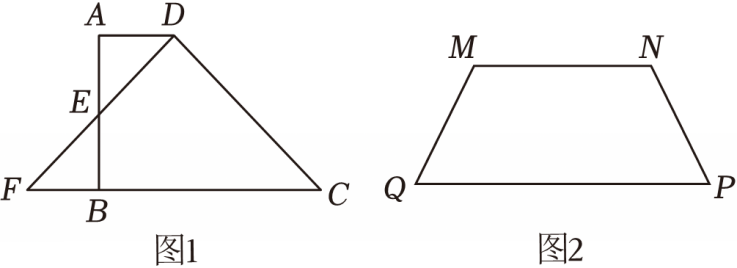

# 22 题精讲 01 · 梯形剪拼等腰三角形

## 📝 题目

某小组对分割梯形组成等腰三角形展开研究。

(1) 如图 1，梯形 $ABCD$ 中，$AD\parallel BC$，$AB\perp BC$，点 $E$ 是 $AB$ 中点，$D$ 是梯形的顶点，将 $\triangle ADE$ 绕 $E$ 旋转 180° 得到 $\triangle BFE$。若 $AD=a$，且此时 $DF=DC$，求 $BC$ 的长（用含 $a$ 的代数式表示）；

(2) 如图 2，梯形 $MNPQ$，$MN\parallel PQ$，$MQ=NP$。请设计一种方法，用一条直线或两条直线分割梯形为若干部分，再进行一系列的图形运动，拼成一个等腰三角形，在图 2 中画出图形。要求：①所得的部分不重叠、不间隙地拼；②写出等腰三角形的腰是哪条线段；③写出这一条或两条直线的顶点（模仿 (1) 中的表述：点 $E$ 是 $AB$ 中点，$D$ 是梯形的顶点）。

## 🧭 思路导航（渐进提示）

- **提示 1（识别）**：(1) 的钥匙是"旋转 180° 就是关于 $E$ 的中心对称"——$E$ 是 $AB$ 中点，所以 $A$ 落到 $B$，$D$ 落到 $F$，于是 $F$ 必在 $CB$ 的延长线上且 $BF=AD$；条件 $DF=DC$ 在喊"等腰三角形 + 三线合一"。(2) 是 (1) 的逆向设计：想让剪下的三角形旋转 180° 后恰好补到底边处，旋转中心必须选在**腰的中点**——只有这样腰的两个端点才会互换位置。
- **提示 2（突破）**：(1) 作 $DH\perp BC$ 于 $H$，矩形 $ABHD$ 把 $a$ 投到下底上（$BH=a$）；再用 $\triangle AED\cong\triangle BEF$ 得 $BF=a$；最后 $DF=DC$、$DH\perp FC$ 用三线合一得 $HC=FH=2a$。(2) 取三边中点 $J$、$K$、$T$，两条裁剪线都过 $J$：一条过 $K$、一条过 $T$，让两块小三角形分别绕 $K$、$T$ 转 180°。
- **提示 3（路线）**：(1) 作 $DH\perp BC$ → 矩形 $ABHD$ → $BH=a$；$\triangle AED\cong\triangle BEF$（ASA）→ $BF=a$ → $FH=FB+BH=2a$；$DF=DC$ + $DH\perp FC$ → $HC=FH=2a$ → $BC=BH+HC=3a$。(2) 取 $MN$、$MQ$、$PN$ 的中点 $J$、$K$、$T$ → 连 $JK$ 延长交 $PQ$ 延长线于 $L$，连 $JT$ 延长交 $QP$ 延长线于 $G$ → 沿 $JK$、$JT$ 剪成三块 → $\triangle MJK$ 绕 $K$、$\triangle NJT$ 绕 $T$ 各转 180° → 拼成 $\triangle LJG$，腰为 $JL$ 与 $JG$。

## ✍️ 详解

**(1)** 过 $D$ 作 $DH\perp BC$，垂足为 $H$。

第一步，制造矩形，把 $a$ 投到底边：

$AB\perp BC$，$AD\parallel BC$ → $\angle ABC=90°$（垂直定义），$\angle A=180°-\angle ABC=90°$（两直线平行，同旁内角互补）；

又 $\angle DHB=90°$ → 四边形 $ABHD$ 是矩形（有三个角是直角的四边形是矩形）→

$$BH=AD=a,\qquad DH\perp FC$$

第二步，用旋转全等确定 $F$ 的位置：

关于 $E$ 旋转 180°：$AE=EB$（$E$ 是 $AB$ 中点），$\angle AED=\angle FEB$（对顶角相等），$\angle A=\angle EBF=90°$ →

$$\triangle AED\cong\triangle BEF\quad(\text{ASA})\ \Longrightarrow\ BF=AD=a$$

由 $AD\parallel BC$ 且 $A$、$D$ 的像为 $B$、$F$，得 $BF\parallel AD$ → $F$ 在直线 $BC$ 上（过 $B$ 平行于 $AD$ 的直线只有直线 $BC$），且 $F$ 与 $C$ 在 $B$ 两侧 → $F$、$B$、$H$、$C$ 依次共线：

$$FH=FB+BH=a+a=2a$$

第三步，等腰三角形三线合一收尾：

在 $\triangle DFC$ 中：$DF=DC$（已知），$DH\perp FC$ → $FH=HC$（等腰三角形底边上的高与底边上的中线重合）→ $HC=2a$，故

$$BC=BH+HC=a+2a=3a$$

（互检：$HC=FH=FB+BH$，即 $HC=BF+BH=2a$；三条短线段 $FB=BH=HC$ 中前两者来自旋转与矩形，后者来自等腰——条件各司其职，无一多余。）

$$\boxed{BC=3a}$$

**(2) 作法要点**：取 $MN$、$MQ$、$PN$ 的中点 $J$、$K$、$T$；连接 $JK$ 并延长交 $PQ$ 的延长线于点 $L$，连接 $JT$ 并延长交 $QP$ 的延长线于点 $G$。沿线段 $JK$、$JT$ 剪开，得 $\triangle MJK$、$\triangle NJT$ 与五边形 $JKQPT$ 三块；将 $\triangle MJK$ 绕 $K$ 旋转 180°、$\triangle NJT$ 绕 $T$ 旋转 180°，与五边形拼成 $\triangle LJG$。答题纸上写：等腰三角形的腰是 $JL$ 与 $JG$；两条直线分别是"过 $MN$ 中点 $J$ 与 $MQ$ 中点 $K$ 的直线""过 $J$ 与 $PN$ 中点 $T$ 的直线"。

**原理说明**：设 $\triangle MJK$ 绕 $K$ 旋转 180° 后 $J$ 的像为 $J_2$，则 $\triangle QKJ_2\cong\triangle MKJ$（旋转不改变图形，$QK=KM$，$\angle QKJ_2=\angle MKJ$）→ $\angle KQJ_2=\angle KMJ=\angle QMN$（$K$、$J$ 分别在 $QM$、$MN$ 上）；由 $MN\parallel PQ$ 得 $\angle QMN=180°-\angle PQM$（同旁内角互补），即 $\angle KQJ_2$ 与 $\angle PQM$ 互补 → 射线 $QJ_2$ 恰为 $QP$ 反向延长线 → $J_2$ 落在 $PQ$ 的延长线上，而 $J_2$ 又在直线 $JK$ 上，故 $J_2$ 就是交点 $L$，两块图形无缝落位。同理 $T$ 处对称成立。又梯形是轴对称图形，$JL$ 与 $JG$ 关于对称轴镜像，$JL=JG$ → $\triangle LJG$ 是等腰三角形；其面积 $=\frac12\times LG\times h=\frac12(PQ+MN)\cdot h$ 与梯形面积相等，不多不少。

**常见错误**：

- ① 中点选成底边 $PQ$ 的中点——旋转中心不在腰上，两块三角形旋转后不能落回底边延长线；
- ② 裁剪线只画 $JK$ 不延长、不标 $L$、$G$，导致"腰是哪条线段"无法回答（腰是含延长部分的全长 $JL$、$JG$）；
- ③ 只旋转一块三角形，另一块平移——平移后直角边无法与斜腰拼齐；
- ④ 剪成部分重叠或留缝，违背"不重叠、不间隙"；
- ⑤ $K$、$T$ 用错边：$K$ 必须在腰 $MQ$ 上、$T$ 必须在腰 $PN$ 上（等腰梯形两腰对称），错放到对角线上整个方案失效。

**落位后自检两句话**（答题纸可不写，但自己要核对）：拼成的大三角形底边 $LG=LQ+QP+PG$，两段 $LQ$、$PG$ 是旋转后的三角形贴出来的，视觉上必须与底边完全共线；等腰看 $JL=JG$——两者由等腰梯形的对称轴互为镜像，画完左右对比最直观。

## ⚠️ 评分点与易错

- (1) 中 $F$ 在 $CB$ 延长线上不是读图猜的：必须由"$E$ 是 $AB$ 中点 + 旋转 180°"推出 $A\to B$、$AD\parallel BC$ → $F$ 落在直线 $BC$ 上，这一步是证明起点，跳过直接用 $BF=a$ 要扣过程分。
- "三线合一"用在 $\triangle DFC$：写全"等腰 + 底边上的高"两个条件再得 $FH=HC$；只写"显然"不给分。
- 题源解答中 (2) 仅给作法未证落位；本讲义补充了落位原理，作答时写"作法 + 腰 + 直线的顶点"即可，落位证明不要求。
- (2) 两条裁剪线**必须都过 $J$**（$MN$ 中点）：若两条线各过不同中点，中间那块不是三角形，无法一次旋转落位。
- 题目要求"写出这一条或两条直线的顶点"，模仿 (1) 的表述写清每个点的身份："$J$ 是 $MN$ 的中点""$K$ 是 $MQ$ 的中点""$T$ 是 $PN$ 的中点"——只画图不表述，②③两小问的分拿不到。
- 检验拼图是否正确最快的办法：拼成的大三角形面积 $=\frac12(\text{上底}+\text{下底})\times$ 高，与梯形面积必须相等。
- 题目允许"一条直线或两条直线"，本解答给的是两条直线的方案：阅卷时只要满足"剪得开、拼得拢、说得清"三要素即可，不必追求与他人相同，但中点必须落在腰上。
- (1) 与 (2) 是一对镜像问题：(1) 是"给定剪拼后证 $BF=a$、$HC=2a$"，(2) 是"主动选中点让旋转落位发生"——记住"腰的中点 = 旋转中心 = 底边延长一倍"这层结构，比背作法更重要。

## 🔗 关联

- [[03-数学/知识点/九年级/相似三角形]]（中位线及其逆定理的相似背景）
- 同类题：[[22-02-三角板拼平行四边形]]（图形设计 + 解直角三角形）、[[22-03-无刻度直尺构平行四边形]]（作图 + 平行线分线段）
- 方法标签：中心对称剪拼、腰中点旋转、三线合一；关键词"分割梯形拼等腰三角形"可与此题归组训练。
- 评分提醒：本题为解答题中的设计作图题，"画出图形"与"文字表述"各占一半分数，只交一张图约损失一半分值。