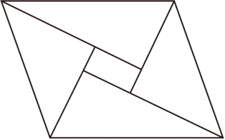

# 22 题精讲 02 · 三角板拼平行四边形

## 📝 题目

同学用两副三角板拼出了如图的平行四边形，且内部留白部分也是平行四边形（直角三角板互不重叠）。

(1) 若直角三角形斜边上的高都为 $h$，求：

① 两个直角三角形的直角边（结果用 $h$ 表示）；

② 平行四边形的底、高和面积（结果用 $h$ 表示）；

(2) 请画出同学拼出的另一种符合题意的图，要求：①不与给定的图形状相同；②画出三角形的边。

> 注：题源配图为无字母标注的实物拼图。本讲义自拟字母：大平行四边形 $ABCD$（$BC$ 为底，$A$、$D$ 在上方）；底上那块含 30° 角的三角板斜边贴在 $BC$ 上、直角顶点为 $N$、斜边上高的垂足为 $M$；腰 $AB$ 上贴等腰直角三角板，斜边贴在 $AB$ 上、直角顶点为 $P$。

## 🧭 思路导航（渐进提示）

- **提示 1（识别）**：两类三角板各两块，全部"斜边贴外边、直角顶点朝内"。题目只给了一个量——斜边上的高 $h$，所以 ① 必然是"用 $h$ 解直角三角形"；而拼图不重叠，意味着 ② 的大平行四边形既能用"底 × 高"算，也能用"四块三角形 + 留白"分块算，两条路互为验算。
- **提示 2（突破）**：等腰直角三角形的斜边上高就是斜边的中线 → 高 = 半斜边；含 30° 的板用"斜边上的高"构造的小直角三角形（含原 30° 角）先把长直角边解出来。大平行四边形的**底恰是 30° 板的斜边**，**腰恰是等腰直角板的斜边**；高用"腰长 × 夹角正弦"，夹角由两板共线的直角边读出（60° + 45°）。
- **提示 3（路线）**：① 等腰直角板：高 = 半斜边 → 斜边 $2h$、直角边 $\sqrt2 h$；30° 板：长直角边 $=2h$（由 $h=$ 长直角边 $\times\sin30°$）、短直角边 $=\frac{2\sqrt3}{3}h$。② 底 = 30° 板斜边 $=\frac{2h}{\cos30°}=\frac{4\sqrt3}{3}h$；腰 = 等腰直角板斜边 $=2h$，腰与底所成的钝角 = 60° + 45° = 105° → 高 $=2h\sin(180°-105°)=2h\sin75°=\frac{\sqrt6+\sqrt2}{2}h$ → 面积 = 底 × 高；留白矩形边长 = 相邻两板**共线直角边之差**（$2h-\sqrt2 h$ 与 $\sqrt2 h-\frac{2\sqrt3}{3}h$），再用"分块求和"验面积。(2) 把两类板的角色对调：等腰直角板斜边贴底、30° 板斜边贴腰。

## ✍️ 详解

**(1)①** 等腰直角三角板：设直角边 $a$，斜边上的高即斜边上的中线（等腰直角三角形三线合一）→ 高 $=\dfrac{a}{\sqrt2}=h$ →

$$a=\sqrt2\,h$$

即等腰直角三角板直角边为 $\sqrt2 h$，斜边为 $2h$。

含 30° 角的三角板：设直角顶点为 $E$，$\angle F=30°$，长直角边 $EF$、短直角边 $DE$、斜边 $DF$，斜边上高为 $EH=h$。在 Rt$\triangle EHF$ 中（$\angle EHF=90°$）：

$$EH=EF\cdot\sin30°\ \Longrightarrow\ h=\frac12 EF\ \Longrightarrow\ EF=2h$$

$$DE=EF\cdot\tan30°=2h\cdot\frac{\sqrt3}{3}=\frac{2\sqrt3}{3}h$$

即含 30° 角三角板两直角边为 $2h$ 与 $\dfrac{2\sqrt3}{3}h$，斜边 $DF=\dfrac{EF}{\cos30°}=\dfrac{4\sqrt3}{3}h$。

**(1)② 底**：大平行四边形的底 $BC$ 恰为 30° 板的斜边（该板斜边整段贴在底上）：

$$BC=\frac{4\sqrt3}{3}h$$

（题源另法互检：底上 30° 板直角顶点 $N$，$NM\perp BC$，$NM=h$，$\angle NBC=60°$、$\angle NCB=30°$ → $BM=\dfrac{h}{\tan60°}=\dfrac{\sqrt3}{3}h$，$CM=\dfrac{h}{\tan30°}=\sqrt3 h$ → $BC=BM+CM=\dfrac{4\sqrt3}{3}h$ ✓ 两条路一致。）

**高**：腰 $AB$ 是等腰直角板的斜边，$AB=2h$。该板直角顶点 $P$ 处一条直角边与 30° 板的直角边共线（与底成 60°），直角边与斜边夹 45° → 腰与底所成锐角 $=180°-(60°+45°)=75°$ →

$$\text{高}=AB\cdot\sin75°=2h\cdot\frac{\sqrt6+\sqrt2}{4}=\frac{\sqrt6+\sqrt2}{2}\,h$$

**面积**（底 × 高）：

$$S=\frac{4\sqrt3}{3}h\cdot\frac{\sqrt6+\sqrt2}{2}h=\left(2\sqrt2+\frac{2\sqrt6}{3}\right)h^2$$

**留白矩形**（验算）：相邻两板各有一条直角边落在同一直线上，留白边长 = 两条共线直角边之差；两方向互相垂直，故留白是矩形：

$$\text{一边}=2h-\sqrt2 h=(2-\sqrt2)h,\qquad \text{另一边}=\sqrt2 h-\frac{2\sqrt3}{3}h=\frac{3\sqrt2-2\sqrt3}{3}h$$

$$S_{留白}=(2-\sqrt2)\cdot\frac{3\sqrt2-2\sqrt3}{3}\,h^2=\frac{6\sqrt2-6-4\sqrt3+2\sqrt6}{3}\,h^2$$

分块验算：$2\cdot\dfrac12(\sqrt2 h)^2+2\cdot\dfrac12\cdot2h\cdot\dfrac{2\sqrt3}{3}h+S_{留白}=\left(2h^2+\dfrac{4\sqrt3}{3}h^2\right)+S_{留白}=\left(2\sqrt2+\dfrac{2\sqrt6}{3}\right)h^2$ ✓ 与"底 × 高"一致。

**(2) 作法要点**：把两类板角色对调——等腰直角三角板的斜边（$2h$）贴在上、下底，含 30° 角三角板的斜边（$\frac{4\sqrt3}{3}h$）贴在左、右腰，四块直角顶点都朝内，相邻板的直角边两两共线。此时底为 $2h$、腰为 $\frac{4\sqrt3}{3}h$，底角为 $45°+60°=105°$（或镜像取 $75°$），与原图（底 $\frac{4\sqrt3}{3}h$、腰 $2h$）形状不同；留白部分仍是矩形。作图时先画底边并作出底角，再依次画出四块板的斜边与直角边，最后补出留白轮廓，并画出每块三角形的边。

**原理说明**：拼图不重叠的充要结构是"每条外边恰为一板斜边 + 相邻板直角边共线"；共线直角边之差即留白边长，共线的两方向相差 90°，留白必为矩形。对调角色后该结构保持，故仍成立。

**常见错误**：① 30° 板把斜边当直角边用（斜边是 $\frac{4\sqrt3}{3}h$，不是 $2h$）；② 由高求底时用 $\text{底}=2h\tan30°$ 之类乱搭——底是斜边，用 $\frac{\text{长直角边}}{\cos30°}$；③ 大平行四边形的高误用 30° 板的高 $h$（$h$ 只是板内的高，平行四边形的高是 $\frac{\sqrt6+\sqrt2}{2}h$）；④ (2) 画成原图的平移或镜像——镜像与原图全等，属"形状相同"，不合要求。

## ⚠️ 评分点与易错

- **题源 OCR 讹误**：答案文本中"小平行四边形的高 $\frac{3\sqrt2-2\sqrt3}{3}h$""平行四边形的高 $\frac{\sqrt6+\sqrt2}{2}$"均丢根号与分数线，已按"底 × 高 = 面积"反推校正；题源解答中求底所用的点 $M$、$N$（底上 30° 板的高与垂足）与留白矩形的顶点字母重名，属原文字母复用，本讲义已分开命名。
- 两问结果互验是本题最大亮点：底 × 高 与"四块板 + 留白"求和必须相等，算不平先查 30° 板的边。
- $\sin75°$ 不是必背值：高也可由"底 × 高 = 面积"结合分块式反解，或直接用 $2h\sin75°$（竞赛外不要求化简 $\sin75°$ 时，题源给的是最终有理化的结果）。
- "平行四边形的底、高和面积"要答**两套**：大平行四边形与内部留白矩形（题源答案两者都给，漏答留白一套会扣分）。
- 数感自检：$\sqrt2 h\approx1.41h$、$\frac{2\sqrt3}{3}h\approx1.15h$、$2h$，留白两边 $\approx0.59h$ 与 $\approx0.26h$，留白面积约为大平行四边形的 $3\%$——若你算出留白占一半，必是共线边选错。

## 🔗 关联

- [[03-数学/知识点/九年级/锐角的三角比与解直角三角形]]
- 同类题：[[22-01-梯形剪拼等腰三角形]]（剪拼设计）、[[22-04-网格垂线与重心求正弦]]（网格 + 解直角三角形）；本库 22-10（一副三角板推导 15°、75° 三角比）与之同源，可互参。
