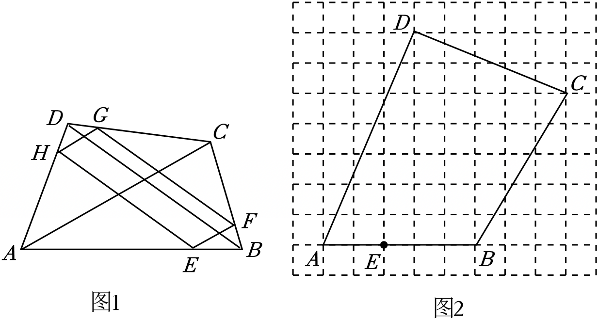

# 22 题精讲 03 · 无刻度直尺构平行四边形

## 📝 题目

我们知道"顺次联结四边形各边中点所得的四边形是平行四边形"。小明提出了如下问题：如果点 $E$、$F$、$G$、$H$ 分别在四边形 $ABCD$ 的边 $AB$、$BC$、$CD$、$AD$ 上，它们都不是中点且都不与端点重合，那么能否使四边形 $EFGH$ 仍然是平行四边形？

他给出了构造方法（如图 1）：①在 $AB$ 上任取符合条件的点 $E$，作 $EF\parallel AC$ 交 $BC$ 于 $F$；②作 $FG\parallel BD$ 交 $CD$ 于 $G$；③作 $GH\parallel AC$ 交 $AD$ 于 $H$；④联结 $HE$。

(1) 求证：四边形 $EFGH$ 是平行四边形；

(2) 如图 2，在 $10\times 9$ 的网格中，每个小正方形边长都为 1，四边形 $ABCD$ 的顶点均在格点上，点 $E$ 在边 $AB$ 上，$AE=2$。请仅用一把无刻度的直尺（只能作经过两点的直线），画一个平行四边形 $EFGH$，使点 $F$、$G$、$H$ 分别在边 $BC$、$CD$、$AD$ 上，且此平行四边形的边与 $AC$ 或 $BD$ 平行。（不写画法，画图过程用虚线，结果用实线）

## 🧭 思路导航（渐进提示）

- **提示 1（识别）**：(1) 是"给出平行条件证平行四边形"，工具只有一条——平行线分线段成比例；(2) 是 (1) 的逆用：想让四条边自动与 $AC$、$BD$ 平行，别去凑角度，而是按 (1) 证出的**比例关系**一次性定好四个分点。
- **提示 2（突破）**：三条已知平行线各给一个比例式，写出来会发现四个比**首尾相接成一个环**（$\frac{EB}{EA}=\frac{BF}{FC}=\frac{DG}{CG}=\frac{DH}{HA}$）；环闭合了，$\frac{AE}{EB}=\frac{AH}{DH}$ 就成立，从而 $EH\parallel BD$。(2) 中 $AE=2$，比例环要求 $AE:EB=AH:HD=2:3$、$BF:FC=DG:GC=3:2$，全部转化成"在网格上按 2:3、3:2 取分点"。
- **提示 3（路线）**：(1) $\frac{EB}{EA}=\frac{BF}{FC}$（$EF\parallel AC$）→ $\frac{BF}{FC}=\frac{DG}{CG}$（$FG\parallel BD$）→ $\frac{DG}{CG}=\frac{DH}{AH}$（$GH\parallel AC$）→ 链式相等得 $\frac{AE}{EB}=\frac{AH}{DH}$ → $EH\parallel BD$ → 两组对边分别平行。(2) 在网格上取辅助格点 $J$，连线 $EJ$ 交 $AD$ 于 $H$（使 $AH:HD=2:3$）；在 $CB$ 上取 $F$ 使 $CF:FB=2:3$、在 $CD$ 上取 $G$ 使 $CG:GD=2:3$（分点都落在格线交点处，直接数格）；顺次连 $EF$、$FG$、$GH$、$HE$。

## ✍️ 详解

**(1)** $EF\parallel AC$（已知），在 $\triangle BAC$ 中 $E$ 在 $BA$ 上、$F$ 在 $BC$ 上：

$$\frac{EB}{EA}=\frac{BF}{FC}\quad(\text{平行线分线段成比例})$$

同理，$FG\parallel BD$（在 $\triangle CBD$ 中）与 $GH\parallel AC$（在 $\triangle DCA$ 中）：

$$\frac{BF}{FC}=\frac{DG}{CG}\quad(\text{平行线分线段成比例})$$

$$\frac{DG}{CG}=\frac{DH}{AH}\quad(\text{平行线分线段成比例})$$

三式链式相等：

$$\frac{EB}{EA}=\frac{BF}{FC}=\frac{DG}{CG}=\frac{DH}{AH}$$

取首尾两项 $\dfrac{EB}{EA}=\dfrac{DH}{AH}$，两边同时取反比得 $\dfrac{AE}{EB}=\dfrac{AH}{DH}$；在 $\triangle ABD$ 中（$E$ 在 $AB$ 上、$H$ 在 $AD$ 上，且比例从同一顶点 $A$ 起算）：

$$EH\parallel BD\quad(\text{平行线分线段成比例定理的逆定理})$$

又 $FG\parallel BD$（已知）→ $EH\parallel FG$（平行于同一条直线的两直线平行）；

$EF\parallel AC$、$GH\parallel AC$ → $EF\parallel GH$（平行于同一条直线的两直线平行）。

两组对边分别平行 → 四边形 $EFGH$ 是平行四边形（平行四边形定义）。$\blacksquare$

（说明：比例环是本题的枢纽——三个"已知平行"给三个比例式，恰好围成一圈；任意取 $E$ 后其余三点被唯一确定，这正是 (2) 作图的理论基础。）

**(2) 作法要点**：由 (1) 的比例环，四点按同一比例 $\dfrac{EB}{EA}=\dfrac32$ 设置：$AE=2$ → $EB=3$（在网格中数出 $EB=3$，与条件吻合）。于是：

- 在 $CB$ 上取 $F$ 使 $CF:FB=2:3$；
- 在 $CD$ 上取 $G$ 使 $CG:GD=2:3$；
- 在 $AD$ 上取 $H$ 使 $AH:HD=2:3$。

网格操作（只用过两点的直线）：$CB$、$CD$ 与网格线的交点中直接数格读出 $F$、$G$（分点恰落在格线交点上）；对 $H$，取辅助格点 $J$，连接 $EJ$，它与 $AD$ 的交点记为 $H$（借网格的平行等分性，$AH:HD=2:3$）；最后顺次连接 $EF$、$FG$、$GH$、$HE$，作图过程留虚线、结果描实线。

**原理说明**：四点按比例环 $\frac{EB}{EA}=\frac{BF}{FC}=\frac{DG}{CG}=\frac{DH}{HA}$ 取定后，把 (1) 的证明倒着走一遍：比例环成立 → $\frac{AE}{EB}=\frac{AH}{DH}$ → $EH\parallel BD$，同理由 $\frac{BF}{FC}=\frac{DG}{CG}$ 得 $FG\parallel BD$、由比例的对应形式得 $EF\parallel AC$、$GH\parallel AC$ → $EFGH$ 是平行四边形，且两组对边分别与 $BD$、$AC$ 平行，正合题目"边与 $AC$ 或 $BD$ 平行"的要求。"连接 $EJ$ 截 $AD$"是无刻度直尺取定比分点的通法：利用网格线的平行性，让截点自动落在 $2:3$ 处，避免度量长度。

**常见错误**：

- ① 比例方向写反——在 $AD$ 上应是 $AH:HD=2:3$（与 $AE:EB$ 同序，从 $A$ 端数起），而在 $CB$、$CD$ 上是 $CF:FB=2:3$、$CG:GD=2:3$（从 $C$ 端数起，因为三个比例都以 $B$、$C$ 为"顶点"写出）；
- ② 试图用刻度尺量边长或用量角器凑平行，违反"无刻度直尺"规则；
- ③ 画图结果不描实线、或把辅助线 $EJ$ 也描成实线；
- ④ 取 $E$ 关于 $AB$ 中点对称的位置当 $F$——这不是按比例环取点，四边形一般不平行。

**作图自检**：连出的 $EFGH$ 中，$EF$ 与 $GH$ 应几乎平行于对角线 $AC$，$FG$ 与 $HE$ 应几乎平行于对角线 $BD$；四点若有一个比数取反，对应边会明显歪斜，从 $C$ 端与 $A$ 端的起数方向逐一核对即可定位错点。

## ⚠️ 评分点与易错

- (1) 三个比例式各要标明"在哪个三角形、哪条截线平行"，依据统一写"平行线分线段成比例"；最后 $EH\parallel BD$ 必须用**逆定理**，正逆两个定理不要混写。
- (1) 中 $EF\parallel GH$ 这组由"都平行于 $AC$"直接可得；$EH\parallel FG$ 这组才是比例环的成果——只证一组就下结论是常见失分点。
- 题源网格的具体格点坐标（$A$、$B$、$C$、$D$ 的位置与辅助格点 $J$ 的取法）未随文本给出，本讲义按"比例条件唯一确定作图"描述；figs/22-03-1.png 右图即题图，作答时直接在原图上取点连线。
- (2) 的比例 $2:3$ 不是猜的：$AE=2$ 与网格中数出的 $EB=3$ 给出 $AE:EB=2:3$，其余三点全部跟着这个比走——先在图中数出 $EB$ 再定比，是审题第一步。
- 若题目把 $AE$ 改为其他值（如 $AE=1$），方法不变：比例环的整体缩放不影响平行性，但四个分点位置全部随之移动——比例环对任意 $E$ 都闭合，这正是 (1) "任取"二字的含义。
- 检验作图：连出的 $EFGH$ 若有一组对边明显不与 $AC$（或 $BD$）平行，通常是某个分点比数反了，从 $C$ 端与 $A$ 端的起数方向逐一核对。

## 🔗 关联

- [[03-数学/知识点/九年级/相似三角形]]（平行线分线段成比例及其逆定理）
- 同类题：[[22-01-梯形剪拼等腰三角形]]（作图设计）、[[22-06-正比例函数截等分线段]]（函数视角的等分点作图）
