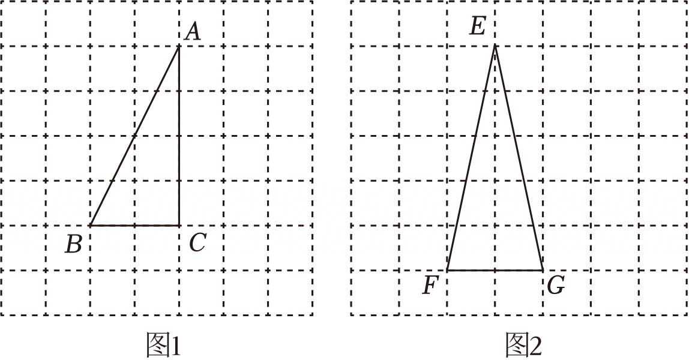

# 22 题精讲 04 · 网格垂线与重心求正弦

> 配图说明：figs/22-04-1.png 含图 1（作垂线用）与图 2（作重心用）两个网格，与本题两小问一一对应。

## 📝 题目

已知：图 1、图 2 中的网格均由边长相同的小正方形组成。点 $A$、$B$、$C$、$E$、$F$、$G$ 是网格的格点。

(1) 请利用网格，仅用无刻度的直尺完成下面的作图（不写作法，保留作图痕迹，写出作图结果）：

①在图 1 中，作出 $CD\perp AB$，垂足为点 $D$；

②在图 2 中，作出 $\triangle EFG$ 的重心 $O$；

(2) 利用②的作图结果，求 $\sin\angle OFG$ 的值。

> 注：题源文本未印格点坐标。按配图还原一组自洽坐标用于讲解：图 1 中 $B(0,0)$、$C(2,0)$、$A(2,4)$；图 2 中 $F(0,0)$、$G(2,0)$、$E(1,5)$（横、纵均以格为单位）。

## 🧭 思路导航（渐进提示）

- **提示 1（识别）**：网格作图的全部秘密是"格点向量"：一条线的方向由它的水平、竖直位移决定。①要过 $C$ 作 $AB$ 的垂线，先读出 $AB$ 的位移，再找一个与它"乘积抵消"的格点方向；②重心 = 三条中线的交点，难的不是连线而是**取中点**——水平线段的中点直接数格，斜线段的中点要借"矩形对角线互相平分"。
- **提示 2（突破）**：$AB$ 位移为右 2 上 4，即"右 1 上 2"；与之垂直的格点方向是"右 2 下 1"（可用勾股逆定理验证），所以过 $C$ 连接它左 2 上 1 的格点即可。求 $\sin\angle OFG$ 时，$O$ 在中线 $FH$ 上，$\angle OFG=\angle HFG$；把中线 $FH$ 延长到整格点 $N$（位移右 3 上 5），向 $FG$ 所在直线作垂线 $NK$，就造出以 $\angle OFG$ 为锐角的直角三角形。
- **提示 3（路线）**：① 连 $C$ 与格点 $C'$（$C$ 左 2 上 1），$CC'$ 交 $AB$ 于 $D$。② 取 $FG$ 中点 $M$（格点）、$EG$ 中点 $H$（作 $EG$ 为对角线的网格矩形的另一条对角线取中点），连 $EM$、$FH$，交点即 $O$。(2) 延长 $FH$ 至格点 $N$（$F$ 右 3 上 5），$K$ 为 $N$ 向直线 $FG$ 所作垂线的垂足：$NK=5$、$FN=\sqrt{3^2+5^2}=\sqrt{34}$ → $\sin\angle OFG=\sin\angle NFK=\dfrac{NK}{FN}=\dfrac{5}{\sqrt{34}}=\dfrac{5\sqrt{34}}{34}$。

## ✍️ 详解

**(1)① 作法要点**：在网格中取格点 $C'$（$C$ 向左 2 格、向上 1 格，即 $C'(0,1)$），连接 $CC'$，与 $AB$ 的交点即垂足 $D$，则 $CD\perp AB$，$CD$ 就是所求作的垂线。

**原理说明**：$AB$ 的位移是（右 2，上 4），方向比为 $1:2$；$CC'$ 的位移是（左 2，上 1），方向比为 $2:(-1)$。验证两方向垂直：在 $AB$ 上取格点 $U(1,2)$（$B$ 右 1 上 2），再取 $V(3,1)$（$U$ 右 2 下 1），则 $UV\parallel CC'$（位移同为（右 2，下 1））。由勾股定理：

$$BU=\sqrt{1^2+2^2}=\sqrt5,\quad UV=\sqrt{2^2+(-1)^2}=\sqrt5,\quad BV=\sqrt{3^2+1^2}=\sqrt{10}$$

$$BU^2+UV^2=5+5=10=BV^2\ \Longrightarrow\ \angle BUV=90°\quad(\text{勾股定理的逆定理})$$

故方向 $(-2,1)$ 与 $AB$ 垂直，过 $C$ 的这条格点连线就是垂线。（$D$ 落在格线交点之间、不是格点，属正常；作图时只需画出直线 $CC'$，交点自然呈现。）

一句话程序：**读方向 → 找垂直格点方向 → 连线取交点**——网格中所有的"垂线、平行、中点"作图都是这三步的循环。

**常见错误**：

- ① 想找"过 $C$ 垂直 $AB$"的现成格线——垂线一般不沿网格线，必须构造斜的格点连线；
- ② 位移读错：垂直看的是方向比（$AB$ 为 $1:2$，垂线方向为 $2:(-1)$，两方向"水平、竖直"互换并变号），不是把位移数字翻倍；
- ③ 垂足 $D$ 必须标字母并写出"$CD$ 就是所求"，只画线不写结论按 incomplete 处理；
- ④ 在图 2 中把重心画成"三边中垂线的交点"（那是外心）或"三内角平分线的交点"（那是内心），概念混淆直接零分。

**(1)② 作法要点**：取 $FG$ 的中点 $M$（$FG=2$ 且水平，$M$ 是格点）；取 $EG$ 的中点 $H$：$EG$ 位移为（右 1，下 5），中点不是格点，把 $EG$ 看作以 $(1,0)$、$(2,5)$ 为另两个顶点的网格矩形的对角线，连接另一条对角线（连接 $(1,0)$ 与 $(2,5)$ 两格点），两对角线的交点即 $H$（矩形对角线互相平分）。连接 $EM$、$FH$，两线交于 $O$，则 $O$ 为 $\triangle EFG$ 的重心，写作图结论"点 $O$ 即为所求"。

**原理说明**：重心是三条中线的交点，画两条中线即可定出交点；中点的无刻度构造依据"对角线互相平分的四边形是平行四边形"，网格矩形把斜线段中点问题化成格点连线。网格中还有一条捷径：$F$、$H$ 的连线延长后过格点 $N(3,5)$（$H$ 恰是 $FN$ 的中点），所以"连 $E$ 与 $M$、连 $F$ 与 $N$"同样得到重心——(2) 的计算正是借用这个格点 $N$。

（两条中线的交点即重心，无需画第三条；作图题只要求保留痕迹并写明"$O$ 即为所求"。）**(2)** 由②，$O$ 在中线 $FH$ 上（三角形的重心在每条中线上）→ $\angle OFG$ 与 $\angle HFG$ 是同一个角，问题转化为"求中线与底边夹角的正弦"。

延长 $FH$ 到格点 $N$：$H$ 是 $EG$ 中点，坐标为 $(1.5,\ 2.5)$，$F$、$H$、$N$ 共线且 $N(3,5)$ 恰为格点（$FN$ 的位移为右 3 上 5）。过 $N$ 作 $NK\perp FG$，垂足 $K(3,0)$ 落在射线 $FG$ 上（$FG$ 水平，$K$ 在 $G$ 外侧的延长线上），则 $\angle NFK=\angle OFG$（同角）。

在 Rt$\triangle NKF$ 中（$\angle NKF=90°$，勾股定理）：

$$FN=\sqrt{3^2+5^2}=\sqrt{9+25}=\sqrt{34},\qquad NK=5$$

$$\sin\angle OFG=\sin\angle NFK=\frac{NK}{FN}=\frac{5}{\sqrt{34}}=\frac{5\sqrt{34}}{34}\quad(\text{正弦}=\text{对边}/\text{斜边，分母有理})$$

$$\boxed{\sin\angle OFG=\frac{5\sqrt{34}}{34}}$$

（互检一：直接用 $H$ 算——$H$ 到直线 $FG$ 的距离为 $2.5$，$FH=\sqrt{1.5^2+2.5^2}=\dfrac{\sqrt{34}}{2}$，$\dfrac{2.5}{\sqrt{34}/2}=\dfrac{5}{\sqrt{34}}$ ✓。互检二：用重心坐标——$O$ 的纵坐标为 $\dfrac{0+0+5}{3}=\dfrac53$，$FO=\sqrt{1^2+(5/3)^2}=\dfrac{\sqrt{34}}{3}$，$\sin\angle OFG=\dfrac{5/3}{\sqrt{34}/3}=\dfrac{5}{\sqrt{34}}$ ✓ 三条路一致。）

## ⚠️ 评分点与易错

- **题源还原说明**：题源未印格点坐标，本讲义按配图与解答中的 $FN=\sqrt{3^2+5^2}$、$NK=5$ 还原出图 2 的一组自洽坐标；若考试原图格距不同，方法不变，只换位移读数。
- ① 的作图题只画线不计算，但"利用网格"四个字要求连线**必须经过格点**；随手画的"看起来垂直"的线不给分，垂足 $D$ 与结论"$CD$ 即为所求"都要落纸。
- ② 中 $EG$ 的中点不是格点是本题最卡的步骤："连另一条对角线"是唯一的无刻度取中点通道；直接目测中点位置属于违规操作。
- 重心性质"重心分中线为 $2:1$"不必用也能做本题，但可作快速验算：$O$ 到 $FG$ 的距离应等于 $E$ 到 $FG$ 距离的 $\dfrac13$（即 $\dfrac53$ 格），与上面互检二一致。
- (2) 的角度转化链 $\angle OFG=\angle HFG=\angle NFK$ 每一步都要有理由（重心在中线上；$N$ 在 $FH$ 延长线上；$K$ 在射线 $FG$ 上），只写数字不写角相等会被扣过程分。
- $\dfrac{5}{\sqrt{34}}$ 必须有理化成 $\dfrac{5\sqrt{34}}{34}$，这是上海卷的书写惯例；结果约为 0.86，若算出大于 1 说明边用错（正弦不超过 1）。
- 常见变式追问"$\cos\angle OFG$"或"$\tan\angle OFG$"：同一 Rt$\triangle NKF$ 里 $\cos=\dfrac{FK}{FN}=\dfrac{3}{\sqrt{34}}=\dfrac{3\sqrt{34}}{34}$、$\tan=\dfrac{NK}{FK}=\dfrac53$——一次作图，三个三角比全覆盖。
- 若改问"$\triangle EFG$ 的面积"：$S=\dfrac12\times FG\times\text{高}=\dfrac12\times2\times5=5$，与重心无关，别把 (2) 的 $O$ 用进来。
- (1)① 若题图旋转了方位（$AB$ 的位移变成其他网格向量），口诀不变：垂线方向 = 把 $AB$ 的位移"水平竖直互换、其中一个变号"。

## 🔗 关联

- [[03-数学/知识点/九年级/锐角的三角比与解直角三角形]]
- 同类题：[[22-03-无刻度直尺构平行四边形]]（无刻度直尺作图 + 比例）、[[22-05-正五边形无刻度直尺作图]]（无刻度直尺 + 正多边形对称性）
