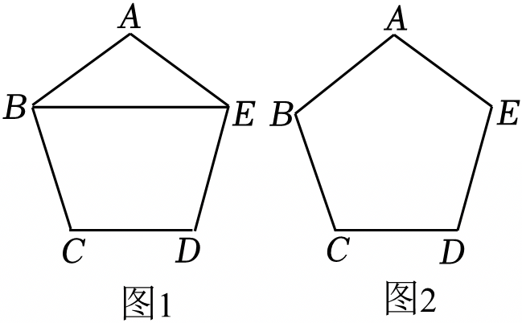

# 22 题精讲 05 · 正五边形无刻度直尺作图

## 📝 题目

已知正五边形 $ABCDE$，请仅用无刻度的直尺作图，并完成相应的任务（保留作图痕迹，不写作法）。

【初步感知】如图 1，请直接写出 $\angle ABE$ 的度数；

【实践探究】请在图 1 中作出以 $BE$ 为对角线的菱形 $ABME$，并证明你的结论；

【拓展延伸】请在图 2 正五边形 $ABCDE$ 的基础上再设计一个新的正五边形 $A_1B_1C_1D_1E_1$。（不需要证明）

## 🧭 思路导航（渐进提示）

- **提示 1（识别）**：正五边形的一切角度都从一个数派生——每个内角 $108°$。无刻度直尺作图意味着**新点必须是图中已有直线的交点**：要作"以 $BE$ 为对角线的菱形 $ABME$"，就是去找第四个顶点 $M$，它应当是两条现成对角线的交点。
- **提示 2（突破）**：$\angle ABE$ 用等腰三角形顶角 $108°$ 立得。找 $M$：菱形对边平行，$AB\parallel ME$ 提示 $M$ 在过 $E$ 且平行于 $AB$ 的直线上——图中恰有对角线 $CE$ 与 $AB$ 平行；同理 $AE\parallel BD$。于是连 $BD$、$CE$，交点即 $M$。拓展延伸则反着用"角"：把每条边向两端延长，让相邻边的延长线相交。
- **提示 3（路线）**：【初步感知】$\triangle ABE$ 中 $AB=AE$、$\angle A=108°$ → 底角 $=\dfrac{180°-108°}{2}=36°$。【实践探究】连 $BD$、$CE$ 交于 $M$ → 证 $AE\parallel BD$（$\angle EAB+\angle ABD=108°+72°=180°$）、$AB\parallel CE$（$\angle ABC+\angle BCE=108°+72°=180°$）→ $ABME$ 是平行四边形 → 邻边 $AB=AE$ → 菱形。【拓展延伸】延长五条边，相邻边所在直线的交点依次为 $A_1$、$B_1$、$C_1$、$D_1$、$E_1$，顺次连接成新的（更大的）正五边形。

## ✍️ 详解

**【初步感知】** 正五边形每个内角 $=\dfrac{(5-2)\times180°}{5}=108°$（多边形内角和公式）。

在 $\triangle ABE$ 中：$AB=AE$（正五边形各边相等）→ $\angle ABE=\angle AEB$（等边对等角）；

$$\angle ABE=\frac{180°-\angle A}{2}=\frac{180°-108°}{2}=36°$$

$$\boxed{\angle ABE=36°}$$

**【实践探究】作法要点**：连接 $BD$、$CE$，设两对角线交于点 $M$，四边形 $ABME$ 即为所求菱形（作图痕迹为两条对角线虚线；$BE$ 是菱形的一条对角线，另一条是 $AM$）。

**原理说明（证明）**：先算两个角。

在 $\triangle BCD$ 中：$BC=CD$（正五边形各边相等），$\angle BCD=108°$ → $\angle CBD=\angle CDB=36°$（等边对等角与三角形内角和）→

$$\angle ABD=\angle ABC-\angle CBD=108°-36°=72°$$

同理在 $\triangle CDE$ 中（$CD=DE$，$\angle CDE=108°$）：$\angle DCE=36°$ →

$$\angle BCE=\angle BCD-\angle DCE=108°-36°=72°$$

判定两组对边平行：

$\angle EAB+\angle ABD=108°+72°=180°$ → $AE\parallel BD$（同旁内角互补，两直线平行），即 $AE\parallel BM$（$M$ 在 $BD$ 上）；

$\angle ABC+\angle BCE=108°+72°=180°$ → $AB\parallel CE$（同理），即 $AB\parallel ME$（$M$ 在 $CE$ 上）。

两组对边分别平行 → 四边形 $ABME$ 是平行四边形（平行四边形的定义）；又

$$AB=AE\quad(\text{正五边形邻边相等})$$

→ **四边形 $ABME$ 是菱形**（有一组邻边相等的平行四边形是菱形）。$\blacksquare$

**【拓展延伸】作法要点**：把五条边 $AB$、$BC$、$CD$、$DE$、$EA$ 都向两端延长，相邻边所在直线的延长部分两两相交（例如射线 $BA$ 与射线 $CD$ 的延长线交于一点），得五个交点，按顺序记为 $A_1$、$B_1$、$C_1$、$D_1$、$E_1$，顺次连接 $A_1B_1$、$B_1C_1$、$C_1D_1$、$D_1E_1$、$E_1A_1$，即为所求的新正五边形（比原五边形大，且相对原五边形"转过"36°）。

**原理说明**：如射线 $BA$ 与 $CD$ 的延长线交于 $T$，则 $\angle TBC=180°-108°=72°$（邻补角），同理 $\angle TCB=72°$ → $\triangle TBC$ 是底角 $72°$ 的等腰三角形，星尖角 $\angle BTC=36°$。正五边形的旋转对称（绕中心转 72° 与自身重合）把五个交点彼此映到对方：五个交点到中心等距、相邻间隔 72°，故顺次连接构成正五边形（内角 $108°$）。此段题目标注"不需要证明"，理解即可。

**（三问联动）**：三问用的全是"正五边形内角 108° + 等腰三角形底角 36°/72°"这一组角：【初步感知】直接用；【实践探究】用它造平行；【拓展延伸】用它造等腰交点——抓住"108° 分解出 36° 与 72°"这把钥匙，整题贯通。

**常见错误**：

- ① 把 $M$ 取成 $BD$ 与 $AC$（或 $BE$ 与某边）的交点——先验证 $AB\parallel ME$、$AE\parallel BM$ 再落笔；
- ② 证明菱形时只证"平行四边形"不补"邻边相等"，判定链条断一半；
- ③ 用量角器量 108° 的补角来画新五边形，违反"仅用无刻度直尺"；
- ④ 新五边形只延长单侧，五个交点凑不齐，或把延长线画成对角线。

## ⚠️ 评分点与易错

- 全题的角都由"内角 108° + 等腰三角形"算出，$\angle ABD=72°$、$\angle BCE=72°$ 这两个角的推导必须写全（先写 $\triangle BCD$、$\triangle CDE$ 的底角 36°，再做差），直接引用要扣过程分。
- 平行判定用的是"同旁内角互补"，别顺手写成"内错角相等"——$\angle EAB$ 与 $\angle ABD$ 在截线 $AB$ 的同侧。
- 菱形的两个判定层次（平行四边形 → 邻边相等）是本题的过程分主体；"对角线互相垂直"这个性质不能反过来当判定用。
- 拓展延伸虽不要求证明，但交点必须取在"延长线"上并保留延长痕迹；把新五边形画成原五边形的位似缩小（往内部取点）是方向性错误。
- 自检：菱形 $ABME$ 中 $\angle BAM=108°$ 与正五边形内角一致、对角线 $BE$ 公共；若你画出的 $M$ 使 $ABME$ 出现凹角，必是交点选错。

## 🔗 关联

- [[03-数学/知识点/九年级/圆与正多边形]]（正多边形内角与对称性）
- 同类题：[[22-04-网格垂线与重心求正弦]]（无刻度直尺作图）、[[22-01-梯形剪拼等腰三角形]]（图形运动设计）
- 方法标签：正多边形定角（108°）、等腰定比（36°/72°）、"新点 = 已有直线交点"的无刻度作图通则。
