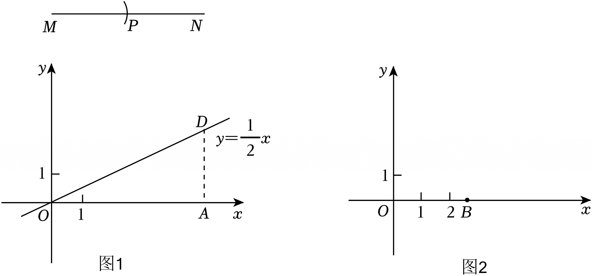

# 22 题精讲 06 · 正比例函数截等分线段

## 📝 题目

【问题背景】我们学过用尺规作图平分一条线段，小普同学想借助所学的函数知识平分线段。在图 1 中，已知线段 $MN$，他进行了如下操作：

①在平面直角坐标系 $xOy$ 中，画出函数 $y=\dfrac12x$ 的图象；

②在 $x$ 轴的正半轴上截取 $OA=MN$，过点 $A$ 作 $AD\perp x$ 轴交函数 $y=\dfrac12x$ 的图象于点 $D$；

③以点 $M$ 为圆心，$AD$ 长为半径作弧，交 $MN$ 于点 $P$。

所以点 $P$ 平分线段 $MN$。

【解决问题】

(1) 根据小普同学的做法，如果要将线段 $MN$ 三等分，那么可以借助函数 $y=\underline{\qquad}$ 的图象，在图 1 中的线段 $AD$ 上找到点 $C$，使 $AC=\dfrac13MN$，于是可作出线段 $MN$ 上的一个三等分点。（填函数解析式）

(2) 平面内的点可以用有序实数对来表示。在图 2 中，点 $B$ 在 $x$ 轴的正半轴上，$OB=b$。运用我们学过的函数知识，在图 2 中作出坐标为 $(4b,\ 2b)$ 的点 $Q$，写出画图步骤。（保留作图痕迹）

## 🧭 思路导航（渐进提示）

- **提示 1（识别）**：背景三步的灵魂是——正比例函数 $y=kx$ 的图象是一台"长度乘法器"：横坐标为 $x_0$ 的图象上的点，到 $x$ 轴的**竖直高度**恰是 $k\cdot x_0$。平分用的是 $k=\dfrac12$，那三等分该填哪个 $k$？(2) 要作出 $(4b,2b)$，就是要把已知长度 $b$ 分别放大 4 倍和 2 倍，再按"先横后纵"安放。
- **提示 2（突破）**：(1) 照抄背景结构：$AC$ 是竖直线段（在 $AD$ 上），所以 $C$ 应是"垂线与新函数图象的交点"，$AC=\dfrac13OA$ 要求 $k=\dfrac13$。(2) 两条竖直线是关键：过 $B$ 作 $y$ 轴的平行线，它与 $y=4x$、$y=2x$ 的两个交点把 $4b$、$2b$ 变成两条可截取的竖直线段；再用圆规把 $4b$ 放倒到 $x$ 轴上定横坐标，把 $2b$ 竖放到该横坐标处定纵坐标。
- **提示 3（路线）**：(1) 填 $y=\dfrac13x$：画 $y=\dfrac13x$，它与 $AD$ 交于 $C$（因 $\dfrac13MN<\dfrac12MN$，交点确在线段 $AD$ 上），$AC=\dfrac13MN$；以 $M$ 为圆心、$AC$ 为半径作弧交 $MN$ 于 $P$，$MP=\dfrac13MN$。(2) ①画 $y=2x$ 与 $y=4x$；②过 $B$ 作 $y$ 轴平行线，交 $y=4x$ 于 $C_1$、交 $y=2x$ 于 $C_2$，则 $BC_1=4b$、$BC_2=2b$；③以 $O$ 为圆心、$BC_1$ 为半径作弧交 $x$ 轴正半轴于 $E$，则 $OE=4b$，过 $E$ 作 $EF\perp x$ 轴；④以 $E$ 为圆心、$BC_2$ 为半径作弧交 $EF$ 于 $Q$，则 $Q(4b,\ 2b)$。

## ✍️ 详解

**(1)** 填：$y=\dfrac13x$。

原理：设 $OA=MN=L$。函数 $y=\dfrac13x$ 图象上横坐标为 $L$ 的点，其纵坐标为 $\dfrac13L$（正比例函数中，函数值 = $\dfrac13\times$ 自变量）。

画 $y=\dfrac13x$ 的图象，与线段 $AD$ 交于点 $C$：$AD$ 是过 $A(L,0)$ 的铅垂线段，两端高度分别 $0$ 与 $\dfrac12L$（$D$ 在 $y=\dfrac12x$ 上），而 $\dfrac13L<\dfrac12L$ → 交点 $C$ 确实落在线段 $AD$ 上，且

$$AC=\frac13L=\frac13MN$$

以 $M$ 为圆心、$AC$ 为半径作弧交 $MN$ 于 $P$（取与 $M$ 较近的交点）→ $MP=AC=\dfrac13MN$，故 $P$ 是线段 $MN$ 的一个三等分点。（若需作出第二个三等分点，再以 $P$ 为圆心、$AC$ 为半径作弧交 $MN$ 即可；本题只要求一个。）

$$\boxed{y=\frac13x}$$

**(2) 画图步骤**（直尺画线、圆规截长度）：

第一步：在同一坐标系中画出正比例函数 $y=2x$ 与 $y=4x$ 的图象；

第二步：过点 $B$ 作 $y$ 轴的平行线 $l$。设 $OB=b$，则 $l$ 上每点的横坐标均为 $b$；$l$ 与 $y=4x$ 交于 $C_1$，与 $y=2x$ 交于 $C_2$，两交点的纵坐标分别为 $4b$、$2b$（正比例函数图象上，纵坐标 = $k\times$ 横坐标），于是两条铅垂线段

$$BC_1=4b,\qquad BC_2=2b$$

第三步：以 $O$ 为圆心、$BC_1$ 长为半径作弧，交 $x$ 轴正半轴于点 $E$，则 $OE=BC_1=4b$ —— 这就是点 $Q$ 的横坐标；过 $E$ 作 $EF\perp x$ 轴；

第四步：以 $E$ 为圆心、$BC_2$ 长为半径作弧，交射线 $EF$ 于点 $Q$（取 $x$ 轴上方那点），则 $EQ=BC_2=2b$ —— 这就是点 $Q$ 的纵坐标。

由横、纵坐标的意义：$Q$ 在 $x$ 轴上方、距离 $x$ 轴 $2b$，在 $y$ 轴右侧、距离 $y$ 轴 $4b$，故

$$\boxed{Q\,(4b,\ 2b)}$$

**原理说明**：整条路线只做两种动作——"用函数图象把已知长度 $b$ 乘以 $k$"（得到竖直线段 $4b$、$2b$），"用圆规把竖直长度搬移方向"（放倒定横坐标、竖起定纵坐标）。背景中"平分"与 (1) 的"三等分"是同一原理取 $k=\dfrac12$、$k=\dfrac13$ 的特例。

**作图复核**：完成后按坐标意义检查——$Q$ 应落在第一象限，到 $y$ 轴的水平距离与到 $x$ 轴的竖直距离之比为 $4b:2b=2:1$；若 $Q$ 落在了 $E$ 的正下方或 $x$ 轴下方，是第四步取错了交点。

**常见错误**：

- ① 半径张冠李戴——放大 4 倍的高度（$BC_1$）必须放到 $x$ 轴上，放大 2 倍的高度（$BC_2$）必须竖放到 $EF$ 上，装反了得到 $(2b,4b)$；
- ② 第二段弧的圆心画成 $B$：以 $B$ 为圆心、$2b$ 为半径的弧根本够不到直线 $x=4b$（$B$ 到该直线的距离 $3b>2b$，无交点），圆心必须是 $E$；
- ③ 只画 $y=\dfrac13x$ 不与 $AD$ 相交、或把 $C$ 取在 $y=\dfrac12x$ 的图象上——$C$ 必须落在线段 $AD$ 上；
- ④ 不留作图痕迹（弧线被擦掉），步骤分丢失。

## ⚠️ 评分点与易错

- **题源讹误标注**：题源解答中"点 $C$、$D$ 的纵坐标分别为 $4b$、$2b$，以 $BD$ 为半径画弧交 $x$ 轴于 $E$，则 $OE=4b$"自相矛盾（若 $D$ 的纵坐标是 $2b$，则 $BD=2b\ne 4b$），且"以点 $B$ 为圆心、$BC$ 长为半径交 $EF$ 于 $Q$"在几何上无交点——两处均按能自洽的作法重构为"取 $4b$ 高度放倒到 $x$ 轴、$2b$ 高度竖放在过 $E$ 的垂线上"，其余步骤与答案一致。
- "写出画图步骤"是文字得分点：四步中"过 $B$ 作 $y$ 轴平行线""以 $\times$ 为圆心、$\times$ 长为半径作弧"这类尺规语言要写规范，写"画出点 $Q$"一笔带过不给满分。
- $Q$ 的横、纵坐标来源要在步骤里点明（$OE=4b$、$EQ=2b$），这是"运用函数知识"的体现，也是与普通尺规作图的区别。
- (1) 的括号要求"填函数解析式"，答案必须化成 $y=\dfrac13x$ 的完整形式，只写 $\dfrac13$ 不完整。
- 数形自检：$y=4x$ 的图象比 $y=2x$ 陡，过 $B$ 的竖直线上两者的交点必然一上一下、间距 $2b$；若你画的交点间距比 $BC_2$ 还短，说明图象画反。

## 🔗 关联

- [[03-数学/知识点/九年级/锐角的三角比与解直角三角形]]（同库；正比例函数图象性质属八年级一次函数知识）
- 同类题：[[22-03-无刻度直尺构平行四边形]]（按定比取分点）、[[22-01-梯形剪拼等腰三角形]]（作图操作题的规范表述）
