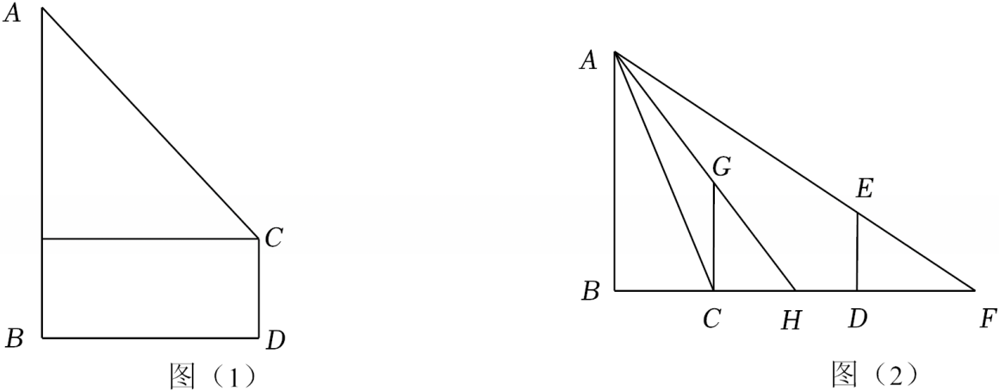

# 22 题精讲 07 · 仰角与影长测灯杆

## 📝 题目

我们经常会采用不同方法对某物体进行测量，请测量下列灯杆 $AB$ 的长。

(1) 如图 (1) 所示，将一个测角仪放置在距离灯杆 $AB$ 底部 $a$ 米的点 $D$ 处，测角仪高为 $b$ 米，从 $C$ 点测得 $A$ 点的仰角为 $\alpha$，求灯杆 $AB$ 的高度。（用含 $a$，$b$，$\alpha$ 的代数式表示）

(2) 我国古代数学家赵爽利用影子对物体进行测量的方法，在至今仍有借鉴意义。如图 (2) 所示，现将一高度为 2 米的木杆 $CG$ 放在灯杆 $AB$ 前，测得其影长 $CH$ 为 1 米；再将木杆沿着 $BC$ 方向移动 1.8 米至 $DE$ 的位置，此时测得其影长 $DF$ 为 3 米，求灯杆 $AB$ 的高度。

## 🧭 思路导航（渐进提示）

- **提示 1（识别）**：(1) 是标准"测高"模型：仪器高 $b$ 与水平距离 $a$ 把灯杆分成"下段矩形 + 上段直角三角形"两截，仰角 $\alpha$ 只管上段。(2) 灯是**点光源**（光从 $A$ 发出），同一位置杆高与影长成比例——但 $BC$（灯到木杆的距离）未知，一次比例解不出，所以题目给**两次**测量：两个比例式里都有 $BC$，消元即可。
- **提示 2（突破）**：(1) 过 $C$ 作水平线交 $AB$ 于 $E$，构造 Rt$\triangle ACE$ 与矩形 $BECD$ 的"上下分块"。(2) 认出两个"A 字型"相似：$\triangle GCH\backsim\triangle ABH$、$\triangle EDF\backsim\triangle ABF$，把两式都写成 $\dfrac{2}{AB}=\dfrac{\text{影长}}{\text{影长}+BC}$ 的形状，$BC$ 就是那个待消的元。
- **提示 3（路线）**：(1) $BE=CD=b$、$EC=BD=a$ → Rt$\triangle ACE$ 中 $AE=a\tan\alpha$ → $AB=a\tan\alpha+b$。(2) 第一次：$\dfrac{CG}{AB}=\dfrac{CH}{BH}$ → $\dfrac{2}{AB}=\dfrac{1}{1+BC}$；第二次：$\dfrac{DE}{AB}=\dfrac{DF}{BF}$ → $\dfrac{2}{AB}=\dfrac{3}{3+1.8+BC}$；两式左边相等 → 右边相等 → 解出 $BC=0.9$ → 回代得 $AB=3.8$ 米。

## ✍️ 详解

**(1)** 过 $C$ 作 $CE\perp AB$，垂足为 $E$。

由题意：$CD\perp BD$、$AB\perp BD$（仪器与灯杆都垂直于地面）→ $CD\parallel AB$；又 $CE\perp AB$ → 四边形 $BECD$ 中 $\angle EBD=\angle BEC=\angle CDB=90°$ → $BECD$ 是矩形 →

$$BE=CD=b,\qquad EC=BD=a$$

$\alpha$ 是从 $C$ 看 $A$ 的仰角 → $\angle ACE=\alpha$（仰角 = 视线与水平线的夹角）。

在 Rt$\triangle ACE$ 中（$\angle AEC=90°$）：

$$AE=EC\cdot\tan\alpha=a\tan\alpha\quad(\text{正切}=\text{对边}/\text{邻边})$$

$$AB=AE+EB=a\tan\alpha+b$$

$$\boxed{AB=(a\tan\alpha+b)\ \text{米}}$$

**(2)** 由题意：$CG=DE=2$ 米，$CD=1.8$ 米，$CH=1$ 米，$DF=3$ 米，且 $\angle ABC=\angle GCH=\angle EDF=90°$（杆与影子都垂直于地面一侧，木杆竖直、地面水平）。

第一次测量：光线 $AG$ 过 $G$ 落于 $H$，$\angle AHB=\angle GHC$（对顶角），又 $\angle ABH=\angle GCH=90°$ →

$$\triangle ABH\backsim\triangle GCH\quad(\text{两角分别相等的两个三角形相似})$$

$$\frac{CG}{AB}=\frac{CH}{BH}\ \Longrightarrow\ \frac{2}{AB}=\frac{1}{1+BC}$$

（其中 $BH=BC+CH=BC+1$。）

第二次测量：光线 $AE$ 过 $E$ 落于 $F$，$\angle F$ 为公共角，$\angle ABF=\angle EDF=90°$ →

$$\triangle ABF\backsim\triangle EDF\quad(\text{两角分别相等的两个三角形相似})$$

$$\frac{DE}{AB}=\frac{DF}{BF}\ \Longrightarrow\ \frac{2}{AB}=\frac{3}{3+1.8+BC}$$

（其中 $BF=BC+CD+DF=BC+4.8$。）

两个等式左边相同，故右边相等：

$$\frac{1}{1+BC}=\frac{3}{4.8+BC}$$

交叉相乘（$1+BC>0$，$4.8+BC>0$，允许交叉）：

$$4.8+BC=3(1+BC)\ \Longrightarrow\ 4.8+BC=3+3BC\ \Longrightarrow\ 2BC=1.8\ \Longrightarrow\ BC=0.9$$

回代第一次的比例式：

$$\frac{2}{AB}=\frac{1}{1+0.9}=\frac{1}{1.9}\ \Longrightarrow\ AB=2\times1.9=3.8$$

（互检：回代第二次 $\dfrac{2}{AB}=\dfrac{3}{3+1.8+0.9}=\dfrac{3}{5.7}$ → $AB=\dfrac{2\times5.7}{3}=3.8$ ✓ 两条路一致。）

$$\boxed{AB=3.8\ \text{米}}$$

## ⚠️ 评分点与易错

- (1) 的答案必须保留括号 $(a\tan\alpha+b)$ 米——漏写 $b$（忘加仪器高）是最高频错误；$E$ 点的构造与"矩形 → $BE=b$、$EC=a$"要写，直接写 $AE=a\tan\alpha$ 会被认为跳步。
- (2) 中 $BH$、$BF$ 的表达式是列比例式的关键：$BH=BC+CH$、$BF=BC+CD+DF$，影长本身**不是**相似比例里的底边，必须补上 $BC$；直接写 $\dfrac{2}{AB}=\dfrac{1}{1}$ 是典型错解。
- 两次相似各有两对等角（对顶角/公共角 + 直角），判定依据"两角分别相等"要点名；相似比写成 $\dfrac{CG}{AB}$ 而不是 $\dfrac{AB}{CG}$，前后要统一。
- 本题实际是中心投影（点光源）：影长随杆远离光源而变长，两次测量正是利用这一变化造方程；若当成"太阳光平行投影"（物高与影长比恒定），两次比例会互相矛盾——理解模型背景才不会列错。
- 数感自检：$AB=3.8$ 米，比木杆 2 米高但不到 2 倍；若解出 $AB=9.5$ 或 $BC$ 为负，说明比例式上下颠倒。$BC=0.9$ 米小于移动距离 1.8 米，符合"灯在杆后方不远处"的图景。

## 🔗 关联

- [[03-数学/知识点/九年级/锐角的三角比与解直角三角形]]（仰角与解直角三角形）
- [[03-数学/知识点/九年级/相似三角形]]（A 字型相似建模）
- 同类题：[[22-08-后备厢旋转60度]]（解直角三角形 + 旋转）、[[22-09-中线角平分线与正切]]（正切与相似的综合）
