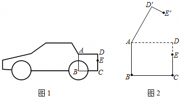

# 22 题精讲 08 · 后备厢旋转 60 度

## 📝 题目

图 1 是某小型汽车的侧面示意图，其中矩形 $ABCD$ 表示该车的后备厢。在打开后备厢的过程中，箱盖 $ADE$ 可以绕点 $A$ 逆时针方向旋转，当旋转角为 60° 时，箱盖 $ADE$ 落在 $AD'E'$ 的位置（如图 2 所示）。已知 $AD=90$ 厘米，$DE=30$ 厘米，$EC=40$ 厘米。

(1) 求点 $D'$ 到 $BC$ 的距离；

(2) 求 $E$、$E'$ 两点的距离。

## 🧭 思路导航（渐进提示）

- **提示 1（识别）**：旋转只改变位置、不改变形状——旋转后 $AD'=AD$、$\angle DAD'=60°$ 是全部已知量的入口。(1) 求"点到直线的距离"必须**作垂线**：过 $D'$ 向 $BC$ 作垂线，垂线段被 $AD$ 截成两段，上段落在含 60° 角的直角三角形里，下段恰等于矩形的竖直边 $DC$。
- **提示 2（突破）**：$E'$ 的距离问题不要去算 $E'$ 的坐标或轨迹——旋转把 $AE$ 转了 60°，所以 $AE'=AE$ 且 $\angle EAE'=60°$，"两边夹 60°"直接给出等边三角形 $\triangle AEE'$，问题化归为求原位置的 $AE$，而 $AE$ 藏在 Rt$\triangle ADE$ 里（勾股定理）。
- **提示 3（路线）**：(1) 过 $D'$ 作 $D'H\perp BC$ 于 $H$，交 $AD$ 于 $F$ → $AD'\!=\!90$、$\angle FAD'\!=\!60°$、$\angle AFD'\!=\!90°$ → $D'F=90\sin60°=45\sqrt3$；$FH=DC=DE+EC=70$ → $D'H=45\sqrt3+70$。(2) 连 $AE$、$AE'$、$EE'$：$\triangle AEE'$ 等边 → $EE'=AE$；Rt$\triangle ADE$ 中 $AE=\sqrt{90^2+30^2}=30\sqrt{10}$ → $EE'=30\sqrt{10}$ 厘米。

## ✍️ 详解

**(1)** 过点 $D'$ 作 $D'H\perp BC$，垂足为 $H$，$D'H$ 交 $AD$ 于点 $F$。

第一步，读出旋转带来的条件。由旋转性质：

$$AD'=AD=90\ \text{厘米}\quad(\text{对应点到旋转中心的距离相等})$$

$$\angle DAD'=60°\quad(\text{旋转角})$$

第二步，用矩形性质把垂线段"接"到 $AD$ 上。四边形 $ABCD$ 是矩形 → $AD\parallel BC$（矩形对边平行）；又 $D'H\perp BC$ →

$$\angle AFD'=\angle BHD'=90°\quad(\text{两直线平行，同位角相等})$$

即 $D'H\perp AD$，$F$ 落在线段 $AD$ 上。

第三步，解直角三角形求上段。在 Rt$\triangle AD'F$ 中（$\angle AFD'=90°$，$\angle FAD'=\angle DAD'=60°$）：

$$D'F=AD'\cdot\sin\angle FAD'=90\times\sin60°=90\times\frac{\sqrt3}{2}=45\sqrt3\quad(\text{正弦}=\text{对边}/\text{斜边})$$

第四步，求下段并相加。$FD\parallel HC$（$F$ 在 $AD$ 上、$H$ 在 $BC$ 上，$AD\parallel BC$），且 $FH\perp BC$ → 四边形 $FDCH$ 是矩形（有一个角是直角的平行四边形，逐角可验证）→

$$FH=DC=DE+EC=30+40=70\ \text{厘米}$$

故

$$D'H=D'F+FH=45\sqrt3+70$$

$$\boxed{D'\text{ 到 }BC\text{ 的距离为 }(45\sqrt3+70)\text{ 厘米}}$$

**(2)** 连接 $AE$、$AE'$、$EE'$。

由旋转性质：

$$AE'=AE\quad(\text{对应点到旋转中心的距离相等})，\qquad \angle EAE'=60°\quad(\text{旋转角})$$

于是 $\triangle AEE'$ 中 $AE'=AE$ 且顶角为 60° → $\triangle AEE'$ 是等边三角形（有一个角是 60° 的等腰三角形是等边三角形）→

$$EE'=AE\quad(\text{等边三角形三边相等})$$

四边形 $ABCD$ 是矩形 → $\angle ADC=90°$（矩形的四个角都是直角）→ $\angle ADE=90°$（$E$ 在边 $DC$ 上）。在 Rt$\triangle ADE$ 中（勾股定理）：

$$AE=\sqrt{AD^2+DE^2}=\sqrt{90^2+30^2}=\sqrt{8100+900}=\sqrt{9000}=30\sqrt{10}$$

$$\boxed{EE'=30\sqrt{10}\ \text{厘米}}$$

## ⚠️ 评分点与易错

- "点到直线的距离"必须以垂线段作答：不作 $D'H\perp BC$ 直接把 $70+45\sqrt3$ 写出来，没有几何过程不得分；垂足 $H$、交点 $F$ 都要标。
- $FH=DC=70$ 的依据是"$AD\parallel BC$、$AF\perp D'H$、$CH\perp D'H$ → $FH$ 与 $DC$ 是平行线间的垂线段"，写"由矩形性质/平行线间距离处处相等"均可，不能空降。
- (2) 最常见的弯路是把 $EE'$ 当旋转弧长去算 $\dfrac{60}{360}\times2\pi r$——题目问的是**两点距离（弦长）**，用等边三角形秒出；旋转角 60° 恰好造等边，是命题人留给你的捷径。
- $AE'$、$\angle EAE'$ 都来自"旋转不改变形状"，答题时写明"由旋转性质得"，这是过程分点。
- $\sqrt{9000}=30\sqrt{10}$ 要化简彻底（$9000=900\times10$）；(1) 的结果 $45\sqrt3+70$ 不能合并也不能写近似值（题目未要求精确度）。
- 数感自检：$45\sqrt3\approx77.9$，$D'H\approx147.9$ 厘米，应大于矩形高 70 厘米（$D'$ 已翻到 $AD$ 上方）；$EE'\approx94.9$ 厘米，介于 $AD=90$ 与 $AD+DE=120$ 之间，量级合理。
- 若题目改问"$E'$ 到 $BC$ 的距离"，方法完全同构：过 $E'$ 作垂线，上段用 $AE'\sin(60°-\angle EAD)$ 处理会复杂，更优是先求 $E'$ 相对 $A$ 的水平、竖直位移再相加——同一旋转背景常这样变式追问。

## 🔗 关联

- [[03-数学/知识点/九年级/锐角的三角比与解直角三角形]]（解直角三角形应用）
- 同类题：[[22-07-仰角与影长测灯杆]]（解直角三角形应用）、[[22-09-中线角平分线与正切]]（正切的几何综合）
- 方法标签：旋转不变量（$AD'=AD$、旋转角 60°）、点到直线的距离 = 垂线段、60° 等腰即等边。
- 审题提醒：题干给 $DE$、$EC$ 两条线段是为了拼出 $DC=70$（矩形竖直边），(1)(2) 各用一次——"每条已知数据都被用到"是检验理解是否到位的标尺。
