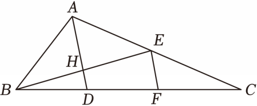

# 22 题精讲 09 · 中线角平分线与正切

## 📝 题目

如图，在 $\triangle ABC$ 中，$BE$ 为中线，$AD$ 平分 $\angle BAC$，且 $AD\perp BE$，分别交 $BE$、$BC$ 于点 $H$、$D$，$EF\perp BE$，交 $BC$ 于点 $F$，$AB=5$，$\tan\angle ABE=\dfrac34$。

(1) 求 $BE$ 的长；

(2) 求 $\tan\angle EBC$ 的值。

## 🧭 思路导航（渐进提示）

- **提示 1（识别）**：条件"角平分线 + 垂直于中线"是固定信号——$\triangle ABH\cong\triangle AEH$，$H$ 必是 $BE$ 中点（三线合一的逆向登场）。$\tan\angle ABE=\dfrac34$ 配 $AB=5$ 是标准 3-4-5 直角三角形，先在 Rt$\triangle ABH$ 里把 $BH$ 拿下，(1) 就结束了。
- **提示 2（突破）**：(2) 求 $\tan\angle EBC$，自然要在以 $B$ 为锐角顶点的直角三角形里做——$D$、$H$、$B$ 已构成 Rt$\triangle BDH$，只缺 $DH$。看平行线：$AD\perp BE$、$EF\perp BE$ → $AD\parallel EF$，配上两个中点（$H$ 是 $BE$ 中点、$E$ 是 $AC$ 中点）就能把 $DH$、$EF$、$AD$ 三条线段串成一条"中位线链"。
- **提示 3（路线）**：(1) Rt$\triangle ABH$ 中设 $AH=3k$、$BH=4k$，勾股得 $5k=AB=5$ → $BH=4$；证 $\triangle ABH\cong\triangle AEH$（ASA）→ $EH=BH=4$ → $BE=8$。(2) $AD\parallel EF$：过 $BE$ 中点 $H$ 平行于 $EF$ → $D$ 是 $BF$ 中点 → $DH=\dfrac12EF$；过 $AC$ 中点 $E$ 平行于 $AD$ → $F$ 是 $CD$ 中点 → $EF=\dfrac12AD$；于是 $AD=4DH$，而 $AD=AH+HD=3+DH$ → $DH=1$ → $\tan\angle EBC=\tan\angle DBE=\dfrac{DH}{BH}=\dfrac14$。

## ✍️ 详解

**(1)** $AD\perp BE$ 于 $H$ → $\angle AHB=90°$，在 Rt$\triangle ABH$ 中：

$$\tan\angle ABE=\frac{AH}{BH}=\frac34\quad(\text{正切}=\text{对边}/\text{邻边})$$

设 $AH=3k$，$BH=4k$（$k>0$）。由勾股定理：

$$AB=\sqrt{AH^2+BH^2}=\sqrt{(3k)^2+(4k)^2}=\sqrt{25k^2}=5k$$

$AB=5$ → $5k=5$ → $k=1$（取正根，线段长为正），故

$$AH=3,\qquad BH=4$$

$AD$ 平分 $\angle BAC$ → $\angle BAH=\angle EAH$（角平分线定义）；又 $AH=AH$（公共边），$\angle AHB=\angle AHE=90°$（$AD\perp BE$）→

$$\triangle ABH\cong\triangle AEH\quad(\text{ASA})\ \Longrightarrow\ EH=BH=4$$

$$BE=BH+EH=4+4=8\ \Longrightarrow\ \boxed{BE=8}$$

（另一写法：$AH$ 既是 $\triangle ABE$ 的角平分线又是高 → $AB=AE$ 且由三线合一 $H$ 为 $BE$ 中点，同样得 $BE=8$。）

**(2)** $EF\perp BE$，$AD\perp BE$ → $AD\parallel EF$（垂直于同一条直线的两直线平行）。

第一段折半：在 $\triangle BEF$ 中，$H$ 是 $BE$ 的中点（(1) 已证 $BH=EH$），且 $HD\parallel EF$（$D$ 在直线 $AD$ 上）→ $D$ 是 $BF$ 的中点（经过三角形一边的中点且平行于另一边的直线必平分第三边）→

$$DH=\frac12EF\quad(\text{三角形的中位线平行于第三边且等于第三边的一半})$$

第二段折半：在 $\triangle CAD$ 中，$E$ 是 $CA$ 的中点（$BE$ 是 $\triangle ABC$ 的中线），且 $EF\parallel AD$ → $F$ 是 $CD$ 的中点（同理）→

$$EF=\frac12AD\quad(\text{三角形中位线定理})$$

两段串联：

$$AD=2EF=4DH$$

又 $H$ 在线段 $AD$ 上 → $AD=AH+HD=3+DH$，代入上式：

$$3+DH=4DH\ \Longrightarrow\ 3DH=3\ \Longrightarrow\ DH=1$$

$D$ 在边 $BC$ 上 → $\angle EBC=\angle EBD$（同一个角）；在 Rt$\triangle BDH$ 中（$\angle BHD=90°$，因 $AD\perp BE$）：

$$\tan\angle EBC=\tan\angle DBE=\frac{DH}{BH}=\frac{1}{4}\quad(\text{正切}=\text{对边}/\text{邻边})$$

$$\boxed{\tan\angle EBC=\frac14}$$

## ⚠️ 评分点与易错

- **题源小误**：题源分析中把条件写成"AD 平分 $\angle ABC$"，与题干"平分 $\angle BAC$"矛盾，以题干为准（证明中用的是 $\angle BAH=\angle EAH$，属 $\angle BAC$ 的一部分）。
- (1) 的设参（$3k$、$4k$）与解出 $k=1$ 不能省；直接背"3-4-5"写 $BH=4$ 要补一句勾股依据。
- "中点 + 平行 → 中点"两处都用"过中点平行于一边必平分第三边"，这是中位线定理的逆用，别直接写"所以 DH 是中位线"——先证 $D$（或 $F$）是中点，中位线身份才成立，这是本题最大的过程分点。
- $\tan\angle EBC=\tan\angle DBE$ 的换角依据（$D$ 在边 $BC$ 上）要写；对边 $DH$、邻边 $BH$ 取自 Rt$\triangle BDH$，不要误用 Rt$\triangle BDH$ 之外的斜线段。
- 链条 $AD=4DH$ 依赖两条中位线各打对折：自检时可用坐标验证——把 $B(0,0)$、$E(8,0)$、$A(4,3)$ 放进坐标系，则 $D(4,-1)$、$F(8,-2)$，$DH=1$、$EF=2$、$AD=4$，与解答完全吻合。
- 若把 (2) 的目标误认为 $\tan\angle EBC=\dfrac{EF}{BE}$ 之类，量纲就乱了——正切必须放在一个具体的直角三角形里算。
- 本题可推广记形："角平分线 + 垂直中线"给等腰（$AB=AE$），"中线 + 双垂直平行"给中位线链——两个模型记住，同类题秒拆。

## 🔗 关联

- [[03-数学/知识点/九年级/锐角的三角比与解直角三角形]]
- [[03-数学/知识点/九年级/相似三角形]]（中位线与平行线分线段成比例）
- 同类题：[[21-12-中线角平分与垂直]]（同款"中线 + 角平分线 + 垂直"结构，21 题库）、[[22-07-仰角与影长测灯杆]]（解直角三角形应用）
- 方法标签：3-4-5 设参、角平分线 + 垂直 → 等腰、中位线链折半。
