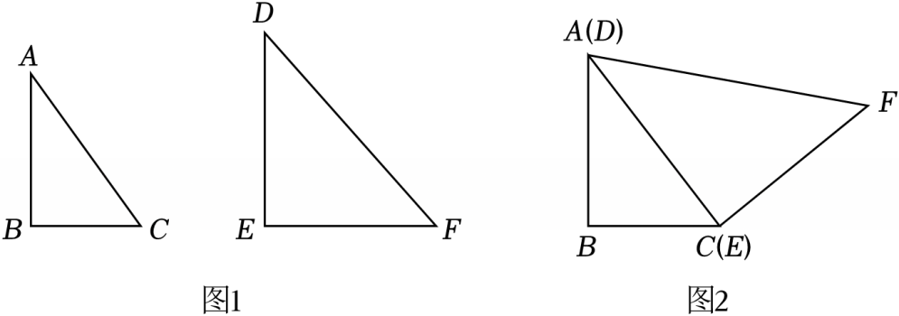

# 22 题精讲 10 · 三角板拼角求三角比

（图1：Rt$\triangle ABC$ 与 Rt$\triangle DEF$ 两块特制三角板；图2：把边 $DE$ 与 $AC$ 重合（$D$ 对 $A$、$E$ 对 $C$）后拼成的四边形 $ABCF$。）

## 📝 题目

小杰在学习了"特殊锐角的三角比"后，认为 30°、45°、60° 的三角比不必死记硬背，只需利用一副三角板就可推导出来；在这个认识的基础上，他利用一副特制的三角板，研究推导出了 15°、75° 的三角比。

(1) 计算：$\dfrac{\cot 30^\circ-\cot 45^\circ}{\tan 60^\circ+2\sin 30^\circ}$；

(2) 小杰的一副特制的三角板如图1，在 Rt$\triangle ABC$ 和 Rt$\triangle DEF$ 中，$\angle B=\angle E=90^\circ$，$\angle A=30^\circ$，$\angle D=45^\circ$，$DE=AC=2$。小杰将 Rt$\triangle ABC$ 和 Rt$\triangle DEF$ 的边 $DE$ 和 $AC$ 重合，拼接成如图2 所示的四边形 $ABCF$。请利用图2，求 $\sin 15^\circ$ 和 $\tan 75^\circ$ 的值。

## 🧭 思路导航（渐进提示）

- **提示 1（识别）**：(1) 是特殊角三角比的代入化简，分子分母都含根式，要走"分母有理化"这一步。(2) 拼好后 $\angle BAF=30^\circ+45^\circ=75^\circ$，但 $75^\circ$、$15^\circ$ 不在任何现成的直角三角形里——必须**作高**把它们"关进"一个直角三角形；而这条高 $BH$ 图上没给长度，需要另找条件把它算出来。
- **提示 2（突破）**：四边形 $ABCF$ 的面积有两种算法：按拼接原样分成两个**已知**三角形（面积都能算）；或分成 $\triangle ABF$ 与 $\triangle BCF$（前者的高就是待求的 $BH$，后者的高要作 $FG\perp BC$、用含 $30^\circ$ 角的直角三角形求）。"同一图形、两种分法"相等 → 解出 $BH$，这就是**面积法**。
- **提示 3（路线）**：(1) 代入 $\cot30^\circ=\sqrt3$、$\cot45^\circ=1$、$\tan60^\circ=\sqrt3$、$\sin30^\circ=\frac12$，分子分母同乘 $\sqrt3-1$ 有理化，得 $2-\sqrt3$。(2) ①先算全各边：$BC=1$、$AB=\sqrt3$、$AF=2\sqrt2$、$CF=2$，并拼出 $\angle BCF=150^\circ\Rightarrow\angle FCG=30^\circ\Rightarrow FG=1$；②作 $BH\perp AF$，列面积方程 $\frac{\sqrt3}{2}+2=\frac12\cdot AF\cdot BH+\frac12\cdot BC\cdot FG$，解出 $BH=\frac{3\sqrt2+\sqrt6}{4}$；③勾股求 $AH=\frac{3\sqrt2-\sqrt6}{4}$（先验 $AH<AF$）；④在 Rt$\triangle ABH$ 中 $\angle BAH=75^\circ$、$\angle ABH=15^\circ$，按定义算 $AH/AB$ 与 $BH/AH$ 并化简。

## ✍️ 详解

**(1)** 特殊角三角比（沪教版含余切）：$\cot 30^\circ=\sqrt3$，$\cot 45^\circ=1$，$\tan 60^\circ=\sqrt3$，$\sin 30^\circ=\dfrac12$。

$$\text{原式}=\frac{\sqrt3-1}{\sqrt3+1}$$

分母有理化（分子、分母同乘 $\sqrt3-1$，其中 $(\sqrt3+1)(\sqrt3-1)=3-1=2$）：

$$\text{原式}=\frac{(\sqrt3-1)^2}{(\sqrt3+1)(\sqrt3-1)}=\frac{3-2\sqrt3+1}{2}=\frac{4-2\sqrt3}{2}$$

$$\boxed{\text{原式}=2-\sqrt3}$$

**(2) 第一步：把两块三角板的边角算全。**

Rt$\triangle ABC$ 中 $\angle B=90^\circ$、$\angle A=30^\circ$、斜边 $AC=2$：

$$BC=\frac12 AC=1\quad(\text{30°角所对的直角边等于斜边的一半})$$

$$AB=\sqrt{AC^2-BC^2}=\sqrt{4-1}=\sqrt3\quad(\text{勾股定理})$$

Rt$\triangle DEF$ 中 $\angle E=90^\circ$、$\angle D=45^\circ$、$DE=2$：是等腰直角三角形 →

$$EF=DE=2,\qquad DF=\sqrt{DE^2+EF^2}=\sqrt{2^2+2^2}=2\sqrt2\quad(\text{勾股定理})$$

**第二步：读出拼接后的对应量。** $DE$ 与 $AC$ 重合、$D$ 对 $A$、$E$ 对 $C$（见图2）→

$$AF=DF=2\sqrt2,\qquad CF=EF=2$$

$$\angle CAF=\angle FDE=45^\circ,\qquad \angle ACF=\angle DEF=90^\circ\quad(\text{拼接不改变角的大小})$$

**第三步：作 $FG\perp BC$，垂足 $G$ 在 $BC$ 的延长线上，求 $\triangle BCF$ 的高 $FG$。**

$$\angle BCA=90^\circ-30^\circ=60^\circ\quad(\text{直角三角形两锐角互余})$$

$$\angle BCF=\angle BCA+\angle ACF=60^\circ+90^\circ=150^\circ$$

$$\angle FCG=180^\circ-\angle BCF=30^\circ\quad(G\ \text{在}\ BC\ \text{延长线上，} \angle BCG\ \text{是平角})$$

在 Rt$\triangle FGC$ 中（$\angle FGC=90^\circ$，斜边 $CF=2$）：

$$FG=CF\cdot\sin30^\circ=2\times\frac12=1,\qquad CG=CF\cdot\cos30^\circ=2\times\frac{\sqrt3}{2}=\sqrt3$$

**第四步：作 $BH\perp AF$ 于 $H$，用面积法列方程解 $BH$。**

整体面积（按拼接原样的两块算，$S_{\triangle ACF}=\frac12\cdot AC\cdot CF=\frac12\cdot2\cdot2=2$）：

$$S_{四边形ABCF}=S_{\triangle ABC}+S_{\triangle ACF}=\frac12\cdot1\cdot\sqrt3+2=\frac{\sqrt3}{2}+2$$

换一种分法（$\triangle ABF$ 以 $AF$ 为底、$BH$ 为高；$\triangle BCF$ 以 $BC$ 为底、$FG$ 为高——即点 $F$ 到直线 $BC$ 的距离）：

$$S_{四边形ABCF}=\frac12\cdot AF\cdot BH+\frac12\cdot BC\cdot FG=\frac12\cdot2\sqrt2\cdot BH+\frac12\cdot1\cdot1=\sqrt2\,BH+\frac12$$

两种分法算的是同一个图形的面积，故相等：

$$\sqrt2\,BH+\frac12=\frac{\sqrt3}{2}+2\ \Longrightarrow\ \sqrt2\,BH=\frac{3+\sqrt3}{2}\ \Longrightarrow\ BH=\frac{3+\sqrt3}{2\sqrt2}=\frac{(3+\sqrt3)\sqrt2}{4}$$

$$BH=\frac{3\sqrt2+\sqrt6}{4}$$

**第五步：勾股求 $AH$，并化简二次根式。**

$$BH^2=\frac{(3\sqrt2+\sqrt6)^2}{16}=\frac{18+6+2\sqrt{18\times6}}{16}=\frac{24+12\sqrt3}{16}=\frac{6+3\sqrt3}{4}$$

在 Rt$\triangle ABH$ 中（$\angle AHB=90^\circ$，勾股定理）：

$$AH^2=AB^2-BH^2=3-\frac{6+3\sqrt3}{4}=\frac{12-6-3\sqrt3}{4}=\frac{6-3\sqrt3}{4}$$

$$AH=\frac12\sqrt{6-3\sqrt3}=\frac12\sqrt{3(2-\sqrt3)}$$

由 $2-\sqrt3=\dfrac{4-2\sqrt3}{2}=\dfrac{(\sqrt3-1)^2}{2}$，且 $\sqrt3-1>0$，得 $\sqrt{2-\sqrt3}=\dfrac{\sqrt3-1}{\sqrt2}$，所以

$$AH=\frac12\cdot\sqrt3\cdot\frac{\sqrt3-1}{\sqrt2}=\frac{3-\sqrt3}{2\sqrt2}=\frac{(3-\sqrt3)\sqrt2}{4}=\frac{3\sqrt2-\sqrt6}{4}$$

（检验 $H$ 落在 $AF$ 上：$AH=\frac{3\sqrt2-\sqrt6}{4}\approx0.45<AF=2\sqrt2\approx2.83$ ✓，故射线 $AH$ 与射线 $AF$ 同向，$\angle BAH$ 就是 $\angle BAF$。）

**第六步：按三角比定义取比值。** $\angle BAF=\angle BAC+\angle CAF=30^\circ+45^\circ=75^\circ$，于是在 Rt$\triangle ABH$ 中 $\angle BAH=75^\circ$、$\angle ABH=90^\circ-75^\circ=15^\circ$（直角三角形两锐角互余）。

$$\sin15^\circ=\sin\angle ABH=\frac{AH}{AB}\ (\text{对边}/\text{斜边})=\frac{3\sqrt2-\sqrt6}{4\sqrt3}=\frac{\sqrt2(3-\sqrt3)}{4\sqrt3}$$

由 $3-\sqrt3=\sqrt3(\sqrt3-1)$，约去 $\sqrt3$：

$$\sin15^\circ=\frac{\sqrt2(\sqrt3-1)}{4}=\boxed{\dfrac{\sqrt6-\sqrt2}{4}}$$

$$\tan75^\circ=\tan\angle BAH=\frac{BH}{AH}\ (\text{对边}/\text{邻边})=\frac{3\sqrt2+\sqrt6}{3\sqrt2-\sqrt6}=\frac{3+\sqrt3}{3-\sqrt3}$$

分母有理化（分子分母同乘 $3+\sqrt3$，$(3)^2-(\sqrt3)^2=6$）：

$$\tan75^\circ=\frac{(3+\sqrt3)^2}{6}=\frac{12+6\sqrt3}{6}=\boxed{2+\sqrt3}$$

（互检：$\sin15^\circ\approx0.259$、$\tan75^\circ\approx3.732$，与三角函数表一致；又 $\tan75^\circ=1/\tan15^\circ$，两值可互相验证。）

## ⚠️ 评分点与易错

- **题源 OCR 讹误**：(1) 原文"cot30°−cot45°tan60°+2sin30°"丢了分数线，用答案 $2-\sqrt3$ 反推，应读作分式 $\dfrac{\cot30^\circ-\cot45^\circ}{\tan60^\circ+2\sin30^\circ}$；(2) 题源解答中"∠ACG＝90°"一步有误——$G$ 在 $BC$ 延长线上时，正确理由是 $\angle BCF=150^\circ$、$\angle FCG=180^\circ-150^\circ=30^\circ$。本讲按自洽重构书写，结论与题源答案一致。
- **面积法**是本题灵魂：同一个四边形两种分割列方程。漏作 $BH$、$FG$ 两条高，或漏掉 $\triangle BCF$ 的底面在 $BC$ 延长线上这一设定，是常见断点。
- 拼接对应关系要交代：$D\leftrightarrow A$、$E\leftrightarrow C$，故 $AF=DF=2\sqrt2$、$CF=EF=2$、$\angle CAF=45^\circ$、$\angle ACF=90^\circ$；$\angle BCF=150^\circ$ 与 $\angle BAF=75^\circ$ 都是"两块角相加"，直接写结果会被认为跳步。
- $BH^2$ 的展开与 $\sqrt{2-\sqrt3}=\frac{\sqrt3-1}{\sqrt2}$ 的化简是最大计算失分点；开方前先说明被开方数为正、开方取正值（边长为正）。
- 写 $\sin15^\circ=\frac{AH}{AB}$ 之前必须确认 $H$ 在线段 $AF$ 上（$AH<AF$），否则"$\angle BAH=75^\circ$"没有依据。

## 🔗 关联

- [[03-数学/知识点/九年级/锐角的三角比与解直角三角形]]（特殊角三角比、余切、构造直角三角形）
- 同类题：[[22-02-三角板拼平行四边形]]（三角板拼接图形中的解直角三角形）、[[22-09-中线角平分线与正切]]（构造直角三角形求正切值）
