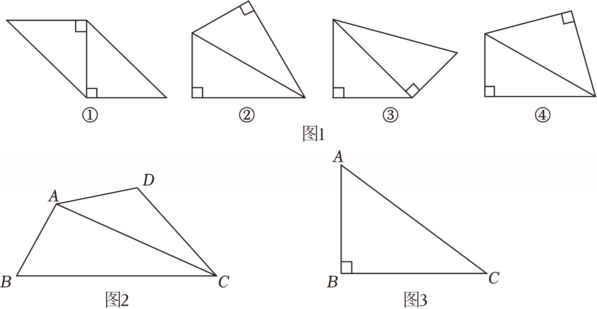

# 22 题精讲 11 · 高架噪音影响范围

## 📝 题目

如图，$MN$ 表示一段笔直的高架道路，线段 $AB$ 表示高架道路旁的一排居民楼。已知点 $A$ 到 $MN$ 的距离为 15 米，$BA$ 的延长线与 $MN$ 相交于点 $D$，且 $\angle BDN=30^\circ$。假设汽车在高架道路上行驶时，周围 39 米以内会受到噪音的影响。

(1) 过点 $A$ 作 $MN$ 的垂线，垂足为点 $H$。如果汽车沿着从 $M$ 到 $N$ 的方向在 $MN$ 上行驶，当汽车到达点 $P$ 处时，噪音开始影响这一排的居民楼，那么此时汽车与点 $H$ 的距离为多少米？

(2) 降低噪音的一种方法是在高架道路旁安装隔音板。当汽车行驶到点 $Q$ 时，它与这一排居民楼的距离 $QC$ 为 39 米（$QC\perp AB$，垂足为 $C$），那么对于这一排居民楼，高架道路旁安装的隔音板至少需要多少米长？（精确到 1 米，参考数据：$\sqrt3\approx1.7$）

## 🧭 思路导航（渐进提示）

- **提示 1（识别）**：噪音模型是"以汽车为圆心、39 米为半径的移动圆"：圆碰到居民楼就受影响。"开始影响""停止影响"就是两个**临界位置**，都翻译成"某段距离恰等于 39"——(1) 的临界是汽车到楼 $A$ 的距离，(2) 的临界是汽车到这一排楼的垂距 $QC$。
- **提示 2（突破）**：全图已知量只有 $AH=15$ 与 $39$。把每个临界位置放进一个直角三角形：Rt$\triangle APH$ 用**勾股定理**；Rt$\triangle ADH$ 与 Rt$\triangle DCQ$ 共用 $30^\circ$ 角（$D$ 处），用**锐角三角比**。最后关键是看清隔音板长就是线段 $PQ$，而 $PQ$ 是 $PH$、$DQ$、$DH$ 三条线段的**和差**（$H$ 是枢纽点）。
- **提示 3（路线）**：(1) $AP=39$、$AH=15$ → 勾股 $PH=\sqrt{39^2-15^2}=36$ 米，写答句。(2) ①Rt$\triangle ADH$ 中 $\angle ADH=30^\circ$ → $DH=AH\cdot\cot30^\circ=15\sqrt3$；②Rt$\triangle DCQ$ 中对边 $QC=39$ → $DQ=\frac{QC}{\sin30^\circ}=78$；③比较 $DH$ 与 $PH$、$DQ$ 确定点序为 $P$、$H$、$Q$ → $PQ=PH+(DQ-DH)=36+78-15\sqrt3=114-15\sqrt3\approx88.5$，按"精确到 1 米"答"约 89 米"。

## ✍️ 详解

**(1)** 由题意 $AH\perp MN$，$AH=15$ 米。汽车到达 $P$ 时噪音**开始**影响这一排楼，即汽车与这排楼中离路最近的 $A$ 幢相距恰为 39 米（这排楼沿 $AB$ 向远离道路的方向延伸、离路越来越远，$A$ 是最近点）：

$$AP=39\ \text{米}$$

在 Rt$\triangle APH$ 中（$\angle AHP=90^\circ$，勾股定理）：

$$PH=\sqrt{AP^2-AH^2}=\sqrt{39^2-15^2}=\sqrt{1521-225}=\sqrt{1296}=36\ (\text{米})$$

$$\boxed{\text{此时汽车与点 }H\text{ 的距离为 }36\ \text{米}}$$

（$P$ 在 $H$ 靠 $M$ 一侧：车从 $M$ 驶来，先在"距 $A$ 恰 39 米"处进入影响区，此位置在垂足 $H$ 之前；由 $DH=15\sqrt3\approx26<36=PH$，$P$ 甚至越过了点 $D$、在 $D$ 靠 $M$ 一侧约 10 米处，与题图一致。另：$39^2=1521$、$15^2=225$，差 $1296=36^2$ 恰为完全平方数，是命题人留的友好数据。）

**(2)** 先说明"隔音板多长"：汽车行驶在路段 $PQ$ 上时，与这一排居民楼的距离不超过 39 米（受噪音影响）；在 $P$ 左侧（离 $A$ 已超过 39 米）与 $Q$ 右侧（到这排楼的垂距超过 39 米）均不受影响。故隔音板至少需覆盖 $PQ$，即**隔音板长 = 线段 $PQ$**。

求 $DH$：在 Rt$\triangle ADH$ 中，$\angle ADH=\angle BDN=30^\circ$（射线 $DA$ 与射线 $DB$ 同向、射线 $DH$ 与射线 $DN$ 同向），$\angle AHD=90^\circ$，$AH=15$ 米：

$$DH=\frac{AH}{\tan30^\circ}=AH\cdot\cot30^\circ=15\sqrt3\ (\text{米})\quad(\tan=\text{对边}/\text{邻边})$$

（或用 $\tan30^\circ=\dfrac{\sqrt3}{3}$：$DH=\dfrac{15}{\tfrac{\sqrt3}{3}}=15\sqrt3$，两法一致。）

求 $DQ$：在 Rt$\triangle DCQ$ 中，$\angle QDC=30^\circ$，$\angle DCQ=90^\circ$（$QC\perp AB$），$\angle QDC$ 的对边 $QC=39$ 米，斜边为 $DQ$：

$$DQ=\frac{QC}{\sin30^\circ}=\frac{39}{\tfrac12}=78\ (\text{米})\quad(\sin=\text{对边}/\text{斜边})$$

确定点序：$DQ=78>15\sqrt3\approx26=DH$，故 $Q$ 在 $H$ 靠 $N$ 一侧；又 $PH=36>DH\approx26$，故 $P$ 已越过 $D$、在 $H$ 靠 $M$ 一侧。沿 $M\to N$ 点序为 $P$、$H$、$Q$：

$$HQ=DQ-DH=78-15\sqrt3\ (\text{米})$$

$$PQ=PH+HQ=36+(78-15\sqrt3)=114-15\sqrt3\ (\text{米})$$

（另一条路径核对点序：$DP=DH-PH=15\sqrt3-36\approx-10<0$，说明 $P$ 在 $D$ 靠 $M$ 一侧 10 米处，于是 $PQ=DQ-DP=78-(15\sqrt3-36)=114-15\sqrt3$，两条路径结果一致 ✓。）

代入参考数据 $\sqrt3\approx1.7$：

$$PQ\approx114-15\times1.7=114-25.5=88.5\approx89\ (\text{米})$$

沿 $MN$ 的点序与距离（单位：米）一览：

$$M\ \cdots\ P\ \xrightarrow{\ 36\ }\ H\ \xrightarrow{\ 78-15\sqrt3\approx52\ }\ Q\ \cdots\ N\qquad(\text{点 }D\text{ 夹在 }P\text{ 与 }H\text{ 之间}：DP\approx10,\ DH=15\sqrt3\approx26)$$

$$\boxed{\text{高架道路旁安装的隔音板至少约需要 }89\ \text{米}}$$

（自检：$DH=15\sqrt3\approx26<DQ=78$ ✓，点序无误；$PH=36$、$HQ\approx52$，两段都为正 ✓；"周围 39 米"与 $AH=15$ 满足 $39>15$，圆确实能碰到楼 ✓。）

## ⚠️ 评分点与易错

- 两个临界的含义不同：$P$ 处是"到楼 $A$ 的距离 = 39"（用 $AP$），$Q$ 处是"到这排楼的垂距 = 39"（用 $QC$）。若全按 $AP$ 或全按 $QC$ 处理，$PQ$ 的和差式就拼不出来。
- **线段和差的方向**是本题最大陷阱：$PQ=PH+(DQ-DH)$，前提是点序 $P$、$H$、$Q$。若误设 $P$、$Q$ 在 $H$ 同侧，会得 $DQ-DH-PH\approx16.5$ 米的错解——先用 $DH\approx26$ 与 $PH=36$、$DQ=78$ 比大小、定顺序，再列式。
- Rt$\triangle DCQ$ 中 $QC$ 是 $30^\circ$ 角的**对边**、$DQ$ 是**斜边**，用正弦；误用正切会得 $DQ=39\sqrt3\approx66.3$，整题错到底。
- $\angle ADH=30^\circ$ 的来源要交代：射线 $DA$ 与射线 $DB$ 同向、射线 $DH$ 与射线 $DN$ 同向，故 $\angle ADH=\angle BDN=30^\circ$；直接引用角度不写依据会被认为跳步。
- 参考数据只在最后一步代入：前面保留 $15\sqrt3$、$78$ 的精确值，最后才用 $\sqrt3\approx1.7$ 求近似——提前代入既累积误差又丢过程分。
- 近似计算按题给 $\sqrt3\approx1.7$：$88.5\approx89$；若用计算器 $\sqrt3\approx1.732$ 会得 $88.0\approx88$——考试以题给参考数据为准，且结果须"精确到 1 米"、答句带单位。
- 常见错答：算出 88.5 后直接写"88.5 米"收尾——"精确到 1 米"必须四舍五入到 89 米；还有把隔音板长答成 $QC$ 的（$QC$ 只是确定 $Q$ 位置的垂距，板沿道路延伸、长为 $PQ$）。
- (1) 的答句问"汽车与点 $H$ 的距离"，答 $PH=36$ 米即可，不要顺手答成 $AP=39$ 米或 $AH=15$ 米。

## 🔗 关联

- [[03-数学/知识点/九年级/锐角的三角比与解直角三角形]]（解直角三角形应用：勾股与三角比混用、点到直线的距离）
- [[03-数学/专题/第21-22题-函数与三角比应用]]
- 同类题：[[22-07-仰角与影长测灯杆]]（测高模型）、[[22-08-后备厢旋转60度]]（图形旋转中的解直角三角形）
