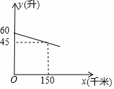

# 22 题精讲 14 · 剩余油量一次函数

（图象说明：一条下降线段，与 $y$ 轴交于 $(0,60)$，经过点 $(150,45)$；横轴 $x$（千米），纵轴 $y$（升）。）

## 📝 题目

一辆汽车在某次行驶过程中，油箱中的剩余油量 $y$（升）与行驶路程 $x$（千米）之间是一次函数关系，其部分图象如图所示。

(1) 求 $y$ 关于 $x$ 的函数关系式；（不需要写定义域）

(2) 已知当油箱中的剩余油量为 8 升时，该汽车会开始提示加油。在此次行驶过程中，行驶了 500 千米时，司机发现离前方最近的加油站有 30 千米的路程。在开往该加油站的途中，汽车开始提示加油，这时离加油站的路程是多少千米？

## 🧭 思路导航（渐进提示）

- **提示 1（识别）**：图象是一条下降直线——"剩余油量随路程均匀减少"的一次函数。(1) 是标准待定系数法：图上能读出两个点的坐标。(2) 的钥匙是把"提示加油"翻译成 $y=8$，**由函数值反求自变量**。
- **提示 2（突破）**：(1) 两点 $(0,60)$、$(150,45)$ 代入 $y=kx+b$。(2) 要理清三个里程刻度：当前位置 $x=500$、加油站位置 $x=500+30=530$、开始提示的位置 $x=?$（由 $y=8$ 解出）。"离加油站的路程"就是提示位置与加油站位置两个里程之差。
- **提示 3（路线）**：(1) 代两点得 $b=60$、$k=-\frac{1}{10}$，即 $y=-\frac{1}{10}x+60$。(2) 令 $-\frac{1}{10}x+60=8$，解得 $x=520$（开始提示的里程）；加油站位于 $530$ 千米处；相减 $530-520=10$，答"这时离加油站 10 千米"。最后用"剩 8 升还能跑 80 千米"做实际检验。

## ✍️ 详解

**(1)** 设 $y=kx+b$（$k\neq0$）。

读图：虚线标出的两个刻度给出直线上的两个点 $(0,60)$ 与 $(150,45)$。将两点坐标分别代入解析式（图象上的点满足解析式）：

$$x=0:\quad b=60$$

$$x=150:\quad 150k+b=45\ \Longrightarrow\ 150k=45-60=-15\ \Longrightarrow\ k=-\frac{15}{150}=-\frac{1}{10}$$

$$\boxed{y=-\frac{1}{10}x+60}$$

（回代另一点检验：$x=150$ 时 $y=-\frac{1}{10}\times150+60=-15+60=45$ ✓。）

（读一读系数的实际意义：截距 $b=60$ 是出发时油箱的油量 60 升；$k=-\frac{1}{10}$ 表示每行驶 1 千米耗油 $\frac{1}{10}$ 升，即每 10 千米耗油 1 升——油量随路程均匀减少，与"匀速油耗"的实际背景相符。题目不要求写定义域；按实际意义 $x\ge0$，油尽时 $y=0$ 得 $x=600$，故全程 $0\le x\le600$。）

**(2)** 三个里程刻度先列清楚，各司其职：

| 里程 $x$（千米） | 500 | 520 | 530 |
| --- | --- | --- | --- |
| 实际含义 | 司机发现加油站的位置 | 开始提示加油（$y=8$） | 加油站位置（$500+30$） |
| 剩余油量 $y$（升） | $-\frac{1}{10}\times500+60=10$ | 8 | $-\frac{1}{10}\times530+60=7$ |

第一步：求"开始提示加油"的行驶里程。提示条件是剩余油量 $y=8$，令

$$-\frac{1}{10}x+60=8$$

移项：

$$\frac{1}{10}x=52\ \Longrightarrow\ x=520$$

即行驶到 520 千米处时，剩余油量降到 8 升、汽车开始提示加油。

第二步：确定加油站的位置。行驶 500 千米时离加油站还有 30 千米，且加油站在前方，故加油站位于

$$500+30=530\ (\text{千米})\ \text{处}$$

第三步：求提示时离加油站的路程：

$$530-520=10\ (\text{千米})$$

答：在开往该加油站的途中，汽车开始提示加油，这时离加油站的路程是 10 千米。

（再从"剩油"角度核对：提示时剩 8 升、每千米耗 $\frac{1}{10}$ 升，到站又行驶 10 千米耗油 1 升，到站时剩 $8-1=7$ 升，与表中 $y(530)=7$ 一致 ✓。）

（实际检验：提示时剩油 8 升，按每千米 $\frac{1}{10}$ 升还能行驶 $8\div\frac{1}{10}=80$ 千米 $>10$ 千米，车能坚持到加油站 ✓；又 $500<520<530$，提示确实发生在"开往加油站的途中" ✓，题设自洽。）

## ⚠️ 评分点与易错

- (1) 待定系数两点别代错：$(0,60)$ 给出 $b=60$；斜率 $k=\frac{45-60}{150-0}=-\frac{1}{10}$，符号为负（油在减少）。结果漏负号或化简 $\frac{15}{150}$ 出错都直接失分。
- (2) 的三个里程刻度要分清：当前 $500$、加油站 $530$（**加** 30 不是减）、提示点 $520$（由 $y=8$ 反解）。把"30 千米"误当成油量可支撑的路程、或用 $500-30=470$ 定加油站位置，都是审题错误。
- 图象只画了"部分"：油尽点 $x=600$（$y=0$）在图外，但心算要有数；到站时刻 $y=7$ 升 $>0$，与"能到达加油站"一致。
- 语义检查是好习惯：斜率 $-0.1$ 升/千米（每 10 千米耗 1 升）、截距 60 升（满油）若与常识矛盾，先查符号与取点。
- "由函数值反求自变量"是 (2) 的核心动作：已知 $y=8$ 解 $x=520$，方向别反（不要拿 500 或 530 代进去算 $y$）。
- 应用题作答闭环：答案"10 千米"要有答句与单位；再加上"剩余油还能跑 80 千米"的背景检验，既防错又符合"定义域与实际背景要自洽"的评分要求。
- (1) 明说"不需要写定义域"，但 (2) 的隐含检查不能省：$x=520$ 落在途中 $(500,530)$ 内，解才有实际意义。

## 🔗 关联

- [[03-数学/知识点/00-六至八年级核心公式定理总表]]（一次函数 $y=kx+b$、斜率与截距的实际意义）
- [[03-数学/专题/第21-22题-函数与三角比应用]]
- 同类题：[[22-17-车速与车流密度]]（同为"已知函数值反求自变量"）、[[22-15-绿化养护费方案比较]]（待定系数求解析式）、[[21-01-储水机加水函数]]（一次函数实际应用）
