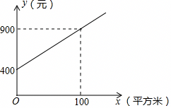

# 22 题精讲 15 · 绿化养护费方案比较

（图象说明：甲公司的一条上升直线，与 $y$ 轴交于 $(0,400)$，经过点 $(100,900)$；横轴 $x$（平方米），纵轴 $y$（元）。）

## 📝 题目

甲、乙两家绿化养护公司各自推出了校园绿化养护服务的收费方案。

甲公司方案：每月的养护费用 $y$（元）与绿化面积 $x$（平方米）是一次函数关系，如图所示。

乙公司方案：绿化面积不超过 1000 平方米时，每月收取费用 5500 元；绿化面积超过 1000 平方米时，每月在收取 5500 元的基础上，超过部分每平方米收取 4 元。

(1) 求如图所示的 $y$ 与 $x$ 的函数解析式（不要求写出定义域）；

(2) 如果某学校目前的绿化面积是 1200 平方米，试通过计算说明：选择哪家公司的服务，每月的绿化养护费用较少。

## 🧭 思路导航（渐进提示）

- **提示 1（识别）**：甲是一条直线（待定系数法，图上读两点）；乙是**阶梯计费**——"1000 平方米以内一口价 5500 元，超出部分按 4 元/平方米另算"。(2) 是方案比较：把 $x=1200$ 分别代入两家计费式，算出金额再比大小。
- **提示 2（突破）**：甲的截距 400 别丢——不绿化也要付 400 元基础费。乙必须先判断 1200 落在哪一段：$1200>1000$，走"超出段"，且只对**超出部分** $(1200-1000)$ 平方米按 4 元计费。
- **提示 3（路线）**：(1) 设 $y=kx+b$，代 $(0,400)$、$(100,900)$ 得 $y=5x+400$。(2) 甲：$5\times1200+400=6400$ 元；乙：$5500+4\times(1200-1000)=6300$ 元；比较 $6300<6400$，答"选乙公司，每月少 100 元"。可再用临界面积 $x=1100$ 互检结论。

## ✍️ 详解

**(1)** 设 $y=kx+b$（$k\neq0$）。

由图象，直线经过 $(0,400)$ 与 $(100,900)$，将两点坐标代入解析式（待定系数法）：

$$x=0:\quad b=400$$

$$x=100:\quad 100k+b=900\ \Longrightarrow\ 100k=900-400=500\ \Longrightarrow\ k=5$$

$$\boxed{y=5x+400}$$

（回代检验：$x=100$ 时 $y=5\times100+400=900$ ✓。）

（系数的实际意义：截距 400 是每月的固定基础费用；斜率 5 表示绿化面积每增加 1 平方米，月费用增加 5 元。题目不要求写定义域，按实际意义 $x\ge0$。）

**(2)** 绿化面积 $x=1200$ 平方米。

**甲公司**：代入 (1) 的解析式：

$$y_{甲}=5\times1200+400=6000+400=6400\ (\text{元})$$

**乙公司**：先判断所在段：$1200>1000$，按"超出部分每平方米 4 元"计费，超出面积为 $1200-1000=200$ 平方米：

$$y_{乙}=5500+4\times(1200-1000)=5500+4\times200=5500+800=6300\ (\text{元})$$

（乙的计费写成函数是分段形式：$0\le x\le1000$ 时 $y_{乙}=5500$；$x>1000$ 时 $y_{乙}=5500+4(x-1000)=4x+1500$。本题 $x=1200$ 落在第二段，代入化简后的 $4x+1500$ 也得 $4\times1200+1500=6300$ 元，两法一致 ✓。）

**比较**：

| 方案 | 计算 | 每月费用 |
| --- | --- | --- |
| 甲公司 | $5\times1200+400$ | 6400 元 |
| 乙公司 | $5500+4\times(1200-1000)$ | 6300 元 |

$$6300<6400$$

即乙公司的费用较少，每月便宜 $6400-6300=100$ 元。

答：选择乙公司的服务，每月的绿化养护费用较少（6300 元 < 6400 元，每月少 100 元）。

（互检：令 $5x+400=5500+4(x-1000)$，即 $5x+400=4x+1500$，解得 $x=1100$——绿化面积为 1100 平方米时两家费用相等；本题 $1200>1100$，故面积越大乙越便宜，与结论一致 ✓。）

## ⚠️ 评分点与易错

- 乙的阶梯计费是本题陷阱：超出部分按 $(1200-1000)=200$ 平方米计 4 元/平方米，**不能**写成 $5500+4\times1200$，也不能只答 800 元忘加基础费 5500。
- 甲的截距 400 不能丢：把甲写成 $y=5x$ 会让 (2) 算出 6000 元、错选甲——两处错误恰好"抵消"成错误结论，最隐蔽。
- 结论只对 $x=1200$ 成立：若绿化面积是 1000 平方米，甲 $5\times1000+400=5400$ 元 $<$ 乙 $5500$ 元，结论反过来应选甲——方案比较必须代入具体面积计算，不能笼统地说"哪家始终便宜"。
- 计算细节：$4\times200=800$ 别算成 $480$；$5\times1200=6000$ 之后别丢基础费 400。
- 方案比较题的作答格式：分别列式计算 → 写出比较式（$6300<6400$）→ 结论句点名"选哪家"并给出差额，三步缺一不可，只算不比、只比不答都要扣分。
- (1) 的定义域虽不要求，读图取点要准：$(0,400)$ 是纵截距，$(100,900)$ 是虚线标注的点；$k=\frac{900-400}{100-0}=5$。
- 延伸一步：若把 (2) 改问"绿化面积多大时选甲、多大时选乙"，就要比较两个函数（甲 $5x+400$，乙的分段式），临界点是 $x=1100$——本题只问一点，代入比较即可，不必写全分段讨论。

## 🔗 关联

- [[03-数学/知识点/00-六至八年级核心公式定理总表]]（一次函数 $y=kx+b$ 与截距、斜率）
- [[03-数学/专题/第21-22题-函数与三角比应用]]
- 同类题：[[22-12-加油卡折扣优惠]]（阶梯/折扣计费）、[[22-14-剩余油量一次函数]]（待定系数求解析式）、[[21-01-储水机加水函数]]（一次函数实际应用）
