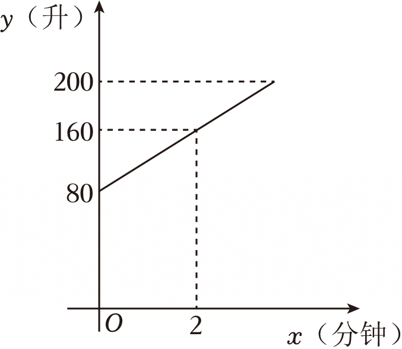

# 22 题精讲 16 · 储水机加水函数

（图象说明：一条从 $(0,80)$ 出发、经过 $(2,160)$ 的上升线段，$y$ 轴刻度 80、160、200，$x$ 轴刻度 2。）

> 注：本讲与 [[21-01-储水机加水函数]] 为同一真题（21、22 两套题库重复收录），两讲详解互补，可对照阅读。

## 📝 题目

某品牌储水机的容量是 200 升，当加水加满时，储水机会自动停止加水。已知加冷水量 $y$（升）和时间 $x$（分钟）的图象如图所示，加水过程中，水的温度 $t$（摄氏度）和 $x$（分钟）的关系：

$$t=\frac{20x+100}{x+2}$$

(1) 求 $y$ 与 $x$ 的函数关系式，并写出定义域；

(2) 求储水机中的水加满时，储水机内水的温度。

## 🧭 思路导航（渐进提示）

- **提示 1（识别）**：$y$-$x$ 图象是线段——"累计加水量随时间均匀增加"的一次函数。第 (2) 问的钥匙是先问：**加满 200 升发生在第几分钟**？再把唯一的温度公式 $t(x)$ 用上。
- **提示 2（突破）**：图上有两个带刻度的点 $(0,80)$、$(2,160)$——纵截距 80 是机内**原有**水量，斜率就是"每分钟加水量"。定义域的上界不能凭感觉写，必须由"容量 200 升、加满即停"列方程解出。
- **提示 3（路线）**：(1) 每分钟加水量 $(160-80)\div2=40$ 升/分钟 → 待定系数得 $y=40x+80$；令 $y=200$ 解得 $x=3$ → 定义域 $0\le x\le3$。(2) "加满"即 $x=3$，代入 $t=\dfrac{20x+100}{x+2}$：分子 $20\times3+100=160$、分母 $3+2=5$，得 $t=32$ 摄氏度，写答句。

## ✍️ 详解

**(1)** 读图：图象是线段，经过 $(0,80)$ 与 $(2,160)$——开机时机内已有水 80 升，2 分钟末累计加水 160 升。

加水是匀速的，每分钟加水量即图象的斜率：

$$(160-80)\div2=40\ (\text{升/分钟})$$

设 $y=kx+b$（$k\neq0$），代入两点（待定系数法）：

$$x=0:\quad b=80$$

$$x=2:\quad 2k+b=160\ \Longrightarrow\ 2k=80\ \Longrightarrow\ k=40$$

故

$$y=40x+80$$

**求定义域**：左端从开始加水算起，$x\ge0$；右端由"容量 200 升、加满自动停止"确定，令

$$40x+80=200\ \Longrightarrow\ 40x=120\ \Longrightarrow\ x=3$$

代回检验：$x=3$ 时 $y=40\times3+80=200$，恰好加满 ✓，超过 3 分钟水就会溢出，故 $x$ 不能大于 3。

$$\boxed{y=40x+80\quad(0\le x\le3)}$$

（注意 $y$ 是**累计**加水量：实际加水总量为 $200-80=120$ 升；"容量 200"是水箱的口径上限，不是 $y$ 的初值。）

**(2)** 由 (1)，"水加满"对应 $x=3$。温度 $t$ 是时间 $x$ 的函数，把 $x=3$ 代入公式，分子、分母分别计算：

$$\text{分子}=20\times3+100=60+100=160,\qquad \text{分母}=3+2=5\neq0$$

$$t=\frac{160}{5}=32\ (\text{摄氏度})$$

$$\boxed{\text{储水机中的水加满时，储水机内水的温度为 }32\ \text{摄氏度}}$$

（背景检验：水温随加冷水单调下降且降幅越来越小，逐格趋近冷水温度，与"加冷水降温"的实际过程一致 ✓；总量验算 $80+40\times3=200$ 升，恰为容量 ✓。）

| $x$（分钟） | 0 | 1 | 2 | 3 |
| --- | --- | --- | --- | --- |
| $y$（升，累计加水） | 80 | 120 | 160 | 200 |
| $t$（摄氏度） | 50 | 40 | 35 | 32 |

## ⚠️ 评分点与易错

- **题源 OCR 讹误**：原文"$t=20x+100x+2$"丢了分数线，应读作 $t=\dfrac{20x+100}{x+2}$。自检：$t(3)=\frac{160}{5}=32$ 与题源答案吻合；若误读为 $t=20x+\frac{100}{x+2}$，则 $t(3)=85$，与答案矛盾，双重排除。
- **定义域是采分点**：只答 $y=40x+80$ 不写 $0\le x\le3$ 要扣分；上界必须由 $40x+80=200$ 解出并交代"加满即停"，不能直接把容量 200 当成 $x$ 的上界。
- 常见错定义域：$0\le x\le200$（把容量当时间）、$0\le x\le120$（把实际加水总量当时间）——定义域约束的是 $x$（分钟），上界由方程解出。
- $y$ 是累计加水量，别把截距丢掉写成 $y=40x$——"$80$"是机内原有水量，截距有实际意义。
- (2) 的自变量是加满时刻 $x=3$，不是把 $y=200$ 代进 $t$——$t$ 只随 $x$ 变化，与 $y$ 之间没有直接关系式；分母 $x+2$ 在 $0\le x\le3$ 内恒正，代入前可交代"分母不为零"。
- 应用题闭环：答句"32 摄氏度"带单位；$x$、$y$、$t$ 的单位（分钟、升、摄氏度）在设句与读图中交代清楚。

## 🔗 关联

- [[03-数学/知识点/00-六至八年级核心公式定理总表]]（一次函数 $y=kx+b$ 与截距）
- [[03-数学/专题/第21-22题-函数与三角比应用]]
- 同类题：[[21-01-储水机加水函数]]（同题另解，21 题库典例 1）、[[22-14-剩余油量一次函数]]（一次函数实际应用）、[[22-17-车速与车流密度]]（求定义域 + 代值计算）
