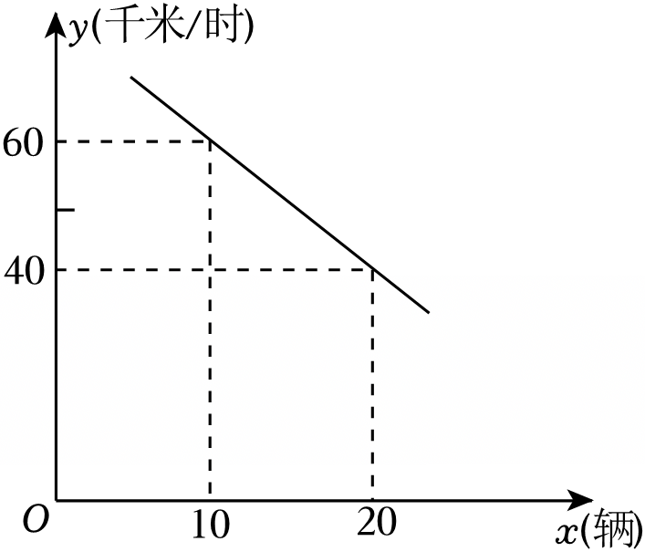

# 22 题精讲 17 · 车速与车流密度

（图象说明：一条下降直线，经过 $(10,60)$ 与 $(20,40)$，画到与 $x$ 轴相交为止；横轴 $x$（辆），纵轴 $y$（千米/时）。）

## 📝 题目

某地区交通管理部门通过对道路流量的大数据分析可知，某高架路上车辆的平均速度 $y$（千米/时）与高架路上每百米车的数量 $x$（辆）的关系如图所示。

(1) 求 $y$ 关于 $x$ 的函数解析式，并写出 $x$ 的取值范围；

(2) 如果某时刻监测到这一高架路上车辆的平均速度为 30 千米/时。

① 求该时刻高架路上每百米车的数量；

② 如果车辆的平均速度小于 20 千米/时，高架路将严重拥堵，需启动限流措施。而此刻开始这一高架路上每百米车辆数每 4 分钟增加 1 辆，为了避免严重拥堵，那么最晚几分钟需启动限流措施？

## 🧭 思路导航（渐进提示）

- **提示 1（识别）**：图象是下降直线——"车越密、车速越慢"。(1) 是待定系数法**加定义域**：上界不是图上随便读的，要由"平均速度不能为负"令 $y\ge0$ 解出来。(2) 的①②都是**已知函数值反求自变量**。
- **提示 2（突破）**：①把 $y=30$ 代入解析式解 $x$；②先把"严重拥堵"翻译成临界方程 $y=20$，解出临界车辆数，再与①的当前车辆数作差——差出的"辆数"乘以"每 4 分钟 1 辆"的增速，就是最晚启动时间。
- **提示 3（路线）**：(1) 代 $(10,60)$、$(20,40)$ 解得 $k=-2$、$b=80$，即 $y=-2x+80$；令 $y\ge0$ 得 $0\le x\le40$。①令 $-2x+80=30$ 得 $x=25$，答"25 辆"。②令 $-2x+80=20$ 得 $x=30$（临界，$y=20$ 还不算"小于 20"）；从 25 辆涨到 30 辆要增 5 辆，$(30-25)\times4=20$ 分钟，答"最晚 20 分钟需启动限流措施"。

## ✍️ 详解

**(1)** 设 $y$ 关于 $x$ 的函数解析式为 $y=kx+b$（$k$、$b$ 为常数，且 $k\neq0$）。

由图象，直线经过 $(10,60)$ 和 $(20,40)$，代入得方程组（待定系数法）：

$$\begin{cases}10k+b=60\\ 20k+b=40\end{cases}$$

两式相减：$20k+b-(10k+b)=40-60$，即 $10k=-20$，得

$$k=-2$$

把 $k=-2$ 代入 $10k+b=60$：$-20+b=60$，得

$$b=80$$

$$y=-2x+80$$

**求 $x$ 的取值范围**：$x$ 是车辆数，$x\ge0$；平均速度不能为负，即 $y\ge0$：

$$-2x+80\ge0\ \Longrightarrow\ 2x\le80\ \Longrightarrow\ x\le40$$

$$\boxed{y=-2x+80\quad(0\le x\le40)}$$

（$x=40$ 时 $y=0$：每百米挤进 40 辆时车流速度降到 0，彻底堵死——这正是图象画到 $x$ 轴为止的原因；$k=-2<0$ 表示每百米每多 1 辆车，平均速度下降 2 千米/时。）

**(2)①** 该时刻 $y=30$，代入解析式反求 $x$：

$$-2x+80=30\ \Longrightarrow\ 2x=50\ \Longrightarrow\ x=25$$

答：该时刻高架路上每百米车的数量为 25 辆。

**②** 求拥堵的临界车辆数：令 $y=20$（再密就要"小于 20"了）：

$$-2x+80=20\ \Longrightarrow\ 2x=60\ \Longrightarrow\ x=30$$

即每百米车辆数达到 30 辆时，平均速度恰降到 20 千米/时（此时还未"小于 20"，但再增 1 辆即严重拥堵）。

由①，当前每百米车辆数为 25 辆；从"此刻"起每 4 分钟增加 1 辆，增加到 30 辆需增加

$$30-25=5\ (\text{辆})$$

所需时间：

$$(30-25)\times4=20\ (\text{分钟})$$

即第 20 分钟末每百米车辆数恰达到 30 辆、车速恰降到 20 千米/时；一旦超过 20 分钟，$x>30$、$y<20$，严重拥堵。故限流措施必须在 20 分钟内（含第 20 分钟末）启动。

答：最晚 20 分钟需启动限流措施。

（自检：$y=-2x+80$ 中 $x$ 由 25 增至 30，$y$ 由 30 降至 20，变化量 $-2\times5=-10$ 千米/时，与解析式一致 ✓。）

## ⚠️ 评分点与易错

- **定义域是采分点**：只写 $x\ge0$ 或只写 $x\le40$ 都不完整；上界必须写出"令 $y\ge0$（速度非负）解得 $x\le40$"这一步，这是本题与普通待定系数题的区别。
- ①②的动作都是"代 $y$ 解 $x$"，方向别反；$-2x+80=30$ 的移项与 $-2x=30-80=-50$ 的符号是计算易错点（$x=25$ 而不是 $-25$）。
- ② 的时间 = **增量的辆数** × 每辆用时：$(30-25)\times4=20$ 分钟；误用 $30\times4$ 或 $(30+25)\times4$ 都是审题错误。边界表述要准：第 20 分钟末 $y=20$，还谈不上"小于 20"，故"最晚 20 分钟"成立。
- 结论句要写"最晚 20 分钟需启动限流措施"——问的是时间，答句必须落到"分钟"上并说明理由（$x=30$ 是临界）。
- 实际背景自检：$k=-2<0$ 与"车越密越慢"一致；$0\le25<30\le40$，①②的解都落在定义域内 ✓。

## 🔗 关联

- [[03-数学/知识点/00-六至八年级核心公式定理总表]]（一次函数 $y=kx+b$、由 $y\ge0$ 定定义域）
- [[03-数学/专题/第21-22题-函数与三角比应用]]
- 同类题：[[22-14-剩余油量一次函数]]（反求自变量的同类模型）、[[22-16-储水机加水函数]]（定义域由实际背景确定）、[[22-15-绿化养护费方案比较]]（一次函数决策问题）
