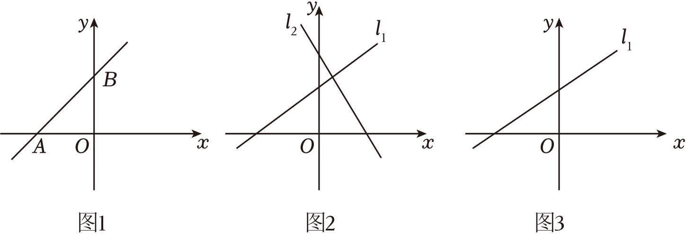

# 22 题精讲 18 · 直线与坐标轴围成三角形面积探究

（图1：直线交 $x$ 轴负半轴于 $A$、交 $y$ 轴正半轴于 $B$；图2：上升的 $l_1$ 与下降的 $l_2$，均交 $y$ 轴正半轴；图3：只画出 $l_1$，$l_2$ 由自己补画。）

## 📝 题目

一个数学兴趣小组尝试探究一次函数图象与两坐标轴所围成三角形面积的问题。为了较为全面地研究这个问题，他们准备把它分成两种类型问题来分别进行研究：

类型Ⅰ：一条直线 $y=kx+b$（$k$、$b$ 都不为 0）与两条坐标轴所围成的三角形面积大小；

类型Ⅱ：两条直线 $l_1:y_1=k_1x+b_1$ 和 $l_2:y_2=k_2x+b_2$（$k_1\neq k_2$、$b_1\neq b_2$ 且都不为零）与坐标轴所围成的三角形的面积、直线 $l_1$ 与两条坐标轴所围成的三角形面积、直线 $l_2$ 与两条坐标轴所围成的三角形面积之间的关系。

(1) 如图1，请你帮助小组求出 $\triangle ABO$ 的面积 $S$（用含 $k$ 和 $b$ 的式子表示）。

(2) 将直线 $l_1$ 与两条坐标轴所围成的三角形面积记为 $S_1$，直线 $l_2$ 与两条坐标轴所围成的三角形面积记为 $S_2$，直线 $l_1$、$l_2$ 和 $x$ 轴所围成的三角形面积记为 $S_x$，它们和 $y$ 轴所围成的三角形面积记为 $S_y$。

i）在图2 中已经画出了直线 $l_1$ 和 $l_2$ 大致图象的一种情况，那么关于这两个一次函数的 $k$ 和 $b$ 符号选项正确的是____。

(A) $k_1>0$，$b_1>0$，$k_2>0$，$b_2>0$；（B）$k_1>0$，$b_1>0$，$k_2<0$，$b_2<0$；

（C）$k_1>0$，$b_1<0$，$k_2<0$，$b_2>0$；（D）$k_1>0$，$b_1>0$，$k_2<0$，$b_2>0$．

此时 $S_1$、$S_2$、$S_x$ 和 $S_y$ 之间的关系式是____。

ii）如图3，保持直线 $l_1$ 不变，改变直线 $l_2$ 中 $k_2$ 和 $b_2$ 的符号（不考虑 $|k_2|$ 和 $|b_2|$ 的大小），请在图中画出直线 $l_2$ 的大致图象，此时 $S_1$、$S_2$、$S_x$ 和 $S_y$ 之间的关系式是____。

## 🧭 思路导航（渐进提示）

- **提示 1（识别）**：(1) 是"截距 → 直角边"的翻译：直线与 $y$ 轴交点的纵坐标是 $b$，与 $x$ 轴交点的横坐标是 $-\frac{b}{k}$；围成的是**直角三角形**，两直角边长是两个截距的**绝对值**——$k$、$b$ 符号不定，绝对值不能丢。
- **提示 2（突破）**：(2)i）由图象特征反读符号："上升/下降"定 $k$ 的正负，"交 $y$ 轴正/负半轴"定 $b$ 的正负；四个面积 $S_1$、$S_2$、$S_x$、$S_y$ 的顶点要各自数清楚。ii）"改变 $k_2$、$b_2$ 的符号"= 由"$k_2<0$、$b_2>0$"变为"$k_2>0$、$b_2<0$"，补画的 $l_2$ 要画得比 $l_1$ 陡，让交点落在第一象限。
- **提示 3（路线）**：(1) 令 $x=0$、$y=0$ 求两个交点 → $S=\frac12\cdot\left|\frac{b}{k}\right|\cdot|b|=\frac{b^2}{2|k|}$。(2)i）读图选 D；关系式 $S_1+S_2=S_x+S_y$——取一组符合符号的具体直线（如 $y=x+1$ 与 $y=-x+2$）算四个面积验证，并借"割补"理解。ii）补画 $l_2$（上升、交 $y$ 轴负半轴、比 $l_1$ 陡）；关系式 $S_1-S_2=S_x-S_y$——用 $y=x+1$ 与 $y=2x-1$ 同法验证。

## ✍️ 详解

**(1)** 直线 $y=kx+b$（$k\neq0$，$b\neq0$）与两坐标轴的交点：

令 $x=0$，得 $y=b$，交 $y$ 轴于 $B(0,\ b)$；

令 $y=0$，则 $kx+b=0$，由 $k\neq0$ 可解得 $x=-\dfrac{b}{k}$，交 $x$ 轴于 $A\left(-\dfrac{b}{k},\ 0\right)$。

如图1，$\angle AOB=90^\circ$（两坐标轴互相垂直），$\triangle ABO$ 是直角三角形，两直角边长为交点坐标的绝对值：

$$OA=\left|-\frac{b}{k}\right|=\frac{|b|}{|k|},\qquad OB=|b|$$

由三角形面积公式（底 × 高 ÷ 2）：

$$S=\frac12\cdot OA\cdot OB=\frac12\cdot\frac{|b|}{|k|}\cdot|b|$$

$$\boxed{S=\frac{b^2}{2|k|}}$$

（若限定图1 所示情形 $k>0$、$b>0$，可写成 $S=\dfrac{b^2}{2k}$；作为"类型Ⅰ"的一般结论，$k$、$b$ 符号不定，绝对值不可丢——这正是本题第一个采分点。）

**(2)i）读图2 定符号**：$l_1$ 从左向右上升 → $k_1>0$；与 $y$ 轴交于正半轴 → $b_1>0$。$l_2$ 下降 → $k_2<0$；与 $y$ 轴交于正半轴 → $b_2>0$。

$$\text{故选 } \boxed{\text{D}}$$

（排除法：A 中 $l_2$ 应上升，与图不符；B 中 $b_2<0$、C 中 $b_1<0$，均与"交 $y$ 轴正半轴"矛盾。）

**关系式**：$S_1$、$S_2$、$S_x$、$S_y$ 的顶点分别为——$S_1$：$O$、$(0,b_1)$、$\left(-\frac{b_1}{k_1},0\right)$；$S_2$：$O$、$(0,b_2)$、$\left(-\frac{b_2}{k_2},0\right)$；$S_x$：$l_1$、$l_2$ 与 $x$ 轴的三个交点；$S_y$：$l_1$、$l_2$ 与 $y$ 轴的三个交点。

取一组符合 D 的具体直线验证：$l_1:y=x+1$，$l_2:y=-x+2$，交点 $P\left(\frac12,\frac32\right)$（在 $x$ 轴上方；事实上由交点纵坐标 $y_P=\dfrac{k_1b_2-k_2b_1}{k_1-k_2}$，分子 $>0$、分母 $>0$，D 的符号条件保证 $P$ 恒在 $x$ 轴上方）：

$$S_1=\frac12\times1\times1=\frac12;\qquad S_2=\frac12\times2\times2=2$$

$$S_x=\frac12\times\left|2-(-1)\right|\times\frac32=\frac12\times3\times\frac32=\frac94;\qquad S_y=\frac12\times\left|2-1\right|\times\frac12=\frac14$$

$$S_1+S_2=\frac52,\qquad S_x+S_y=\frac94+\frac14=\frac52\ \checkmark$$

（割补理解：$S_x$ 被 $y$ 轴切成两块，与"轴三角形"相比一多一少，多出的部分恰是 $S_y$——移项即得等式；D 的符号条件（一升一降、截距同正）保证这个割补关系不被破坏。）

$$\boxed{S_1+S_2=S_x+S_y}$$

**ii）** 改变 $k_2$、$b_2$ 的符号后：$k_2>0$，$b_2<0$——$l_2$ 上升、与 $y$ 轴交于**负**半轴。

**补画 $l_2$**（在图3 中）：过 $y$ 轴负半轴上一点作上升直线，且画得比 $l_1$ 陡，使 $l_1$ 与 $l_2$ 的交点 $P$ 落在第一象限（$l_2$ 不与 $l_1$ 平行、不过原点，因为 $k_1\neq k_2$、$b_2\neq0$）。

**关系式**（同法验证）：保持 $l_1:y=x+1$，取 $l_2:y=2x-1$（$k_2=2>0$，$b_2=-1<0$，交点：$x+1=2x-1$，得 $P(2,3)$，在第一象限 ✓）：

$$S_1=\frac12;\qquad S_2=\frac12\times\left|-\frac12\right|\times\left|-1\right|=\frac14$$

$$S_x=\frac12\times\left|\frac12-(-1)\right|\times3=\frac12\times\frac32\times3=\frac94;\qquad S_y=\frac12\times\left|1-(-1)\right|\times2=\frac12\times2\times2=2$$

$$S_1-S_2=\frac12-\frac14=\frac14,\qquad S_x-S_y=\frac94-2=\frac14\ \checkmark$$

$$\boxed{S_1-S_2=S_x-S_y}$$

（一般性说明：若把 $l_2$ 画得比 $l_1$ 平缓，交点将落到第三象限，此时等式改写为 $S_2-S_1=S_x-S_y$；两种画法下统一写成 $\left|S_1-S_2\right|=\left|S_x-S_y\right|$。题源按"交点在第一象限"的画法记作 $S_1-S_2=S_x-S_y$。）

## ⚠️ 评分点与易错

- **(1) 的绝对值**：$k$、$b$ 符号不定，$S=\dfrac{b^2}{2|k|}$ 中的 $|k|$ 不能丢（$b^2$ 天然非负，但 $\left|-\frac{b}{k}\right|$ 这一步必须写）。题源解答把图1 中 $A$、$B$ 两点标注互换（写作 $A(0,b_1)$、$B\left(-\frac{b_1}{k_1},0\right)$），与图1 不符——不影响面积结果，但答题时应以图为准，此为题源小疵。
- 求交点的两步"令 $x=0$"、"令 $y=0$"要写全，除以 $k$ 前交代 $k\neq0$；直角边长 = 截距的绝对值，不是带符号的截距。
- (2) 的符号判断口诀：升降定 $k$（升正降负），$y$ 轴交点位置定 $b$（上正下负）；四个选项逐一对照，别只看一条直线。
- 面积关系式**不要死记**：记住四个三角形的顶点构成，考场上取一组符合符号的具体直线（如 $y=x+1$ 配 $y=-x+2$、$y=2x-1$）现场算一遍最稳；验证时交点坐标要用两直线方程联立求出。
- ii）补图三要素：过 $y$ 轴负半轴、上升、与 $l_1$ 相交（不平行、不过原点）；画成与 $l_1$ 平行或过原点违反题设 $k_1\neq k_2$、$b_2\neq0$。

## 🔗 关联

- [[03-数学/知识点/00-六至八年级核心公式定理总表]]（一次函数图象、截距与升降）
- [[03-数学/专题/第21-22题-函数与三角比应用]]
- 同类题：[[21-10-反比例与三角形面积]]（函数图象与坐标轴围成三角形面积）、[[21-04-截距与平移余弦]]（截距的几何意义）、[[22-17-车速与车流密度]]（一次函数图象信息读取）
