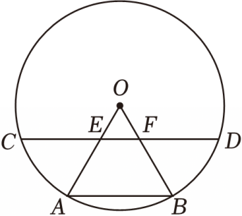

# 23 题精讲 01 · 弦与半径交点上的相似

## 📝 题目

如图，在 $\odot O$ 中，$AB$ 和 $CD$ 是弦，半径 $OA$、$OB$ 分别交 $CD$ 于点 $E$、$F$，且 $CE=DF$。

(1) 求证：$AB\parallel CD$；

(2) 若 $AB=BD$，联结 $AF$，求证：$AB^2=BF\cdot OB$。

## 🧭 思路导航（渐进提示）

- **提示 1（识别）**：$CE=DF$ 是弦上的一对等线段，而 $OC=OD$（半径）随时待命——"两组边 + 等腰底角"指向**全等开路**；(2) 的目标是"平方 = 乘积"，第一反应把它读成比例式 $\frac{AB}{OB}=\frac{BF}{AB}$，即要证 **△BAF∽△BOA**。
- **提示 2（突破）**：(1) 由等腰 $\triangle OCD$ 的底角配 $CE=DF$ 做 **SAS 全等**得 $OE=OF$；再用 $OA=OB$ 凑"两边成比例 + 夹角相等"做 **SAS 相似**拉出平行。(2) 中 $AB=BD$ 是**等弦**——先翻译成等圆心角 $\angle AOB=\angle DOB$，再借一次全等把角搬到 $A$ 处；最后用 (1) 的平行产生内错角，凑齐 AA。
- **提示 3（路线）**：(1) 联结 $OC$、$OD$：等腰底角相等 + $CE=DF$ → △OCE≌△ODF（SAS）→ $OE=OF$；结合 $OA=OB$ 得 $\frac{OE}{OA}=\frac{OF}{OB}$，夹角 $\angle EOF$ 与 $\angle AOB$ 是同一个角 → △OEF∽△OAB → $\angle OEF=\angle OAB$ → $EF\parallel AB$ → $CD\parallel AB$。(2) 等弦 → $\angle AOB=\angle DOF=\angle COE$；联结 $AF$：△AOF≌△DOF（SAS）→ $\angle EAF=\angle OCE$，配对顶角得 △OEC∽△FEA → $\angle COE=\angle AFE$；(1) 的平行给内错角 $\angle AFE=\angle FAB$ → $\angle FAB=\angle AOB$，加 $\angle ABF$ 为同一个角 → △BAF∽△BOA → 比例式收口。

## ✍️ 详解

**(1)** 联结 $OC$、$OD$。

$OC=OD$（同圆的半径相等）→ $\angle OCD=\angle ODC$（等边对等角）。

$E$、$F$ 在线段 $CD$ 上 → 射线 $CE$ 与 $CD$ 重合、射线 $DF$ 与 $DC$ 重合。

→ $\angle OCE=\angle OCD=\angle ODC=\angle ODF$（等量代换）。

在 $\triangle OCE$ 与 $\triangle ODF$ 中：$OC=OD$，$\angle OCE=\angle ODF$，$CE=DF$ → $\triangle OCE\cong\triangle ODF$（SAS）。

→ $OE=OF$（全等三角形对应边相等）。

$OA=OB$（同圆的半径相等）→ $\dfrac{OE}{OA}=\dfrac{OF}{OB}$（等量代换）。

$E$ 在 $OA$ 上、$F$ 在 $OB$ 上 → $\angle EOF=\angle AOB$（同一个角）。

→ $\triangle OEF\backsim\triangle OAB$（两边对应成比例且夹角相等）。

→ $\angle OEF=\angle OAB$（相似三角形对应角相等）→ $EF\parallel AB$（同位角相等，两直线平行）。

又 $E$、$F$ 在直线 $CD$ 上 → $AB\parallel CD$（过直线外一点有且只有一条直线与已知直线平行）。$\blacksquare$

**(2)** $AB=BD$ → $\overset{\frown}{AB}=\overset{\frown}{BD}$（同圆中，等弦对等弧）→ $\angle AOB=\angle DOB$（等弧所对的圆心角相等）。

$F$ 在线段 $OB$ 上 → $\angle DOB=\angle DOF$（同一个角）。

由(1) $\triangle OCE\cong\triangle ODF$ → $\angle COE=\angle DOF$（全等三角形对应角相等）。

$$\angle AOB=\angle DOF=\angle COE\quad(\text{等量代换})$$

在 $\triangle AOF$ 与 $\triangle DOF$ 中：$OA=OD$（半径相等），$\angle AOF=\angle DOF$（已证），$OF=OF$（公共边）→ $\triangle AOF\cong\triangle DOF$（SAS）。

→ $\angle OAF=\angle ODF$（全等三角形对应角相等）。

$\angle ODF=\angle ODC=\angle OCD=\angle OCE$（等边对等角；$E$、$F$ 在线段 $CD$ 上）。

$E$ 在线段 $OA$ 上 → 射线 $AE$ 与 $AO$ 重合 → $\angle EAF=\angle OAF$（同一个角）→ $\angle EAF=\angle OCE$（等量代换）。

又 $\angle OEC=\angle AEF$（对顶角相等）→ $\triangle OEC\backsim\triangle FEA$（两角对应相等）。

→ $\angle COE=\angle AFE$（相似三角形对应角相等）。

由(1) $EF\parallel AB$ → $\angle AFE=\angle FAB$（两直线平行，内错角相等）→ $\angle FAB=\angle AOB$（等量代换）。

在 $\triangle BAF$ 与 $\triangle BOA$ 中：$\angle FAB=\angle AOB$（已证），$\angle ABF=\angle OBA$（同一个角，$F$ 在 $OB$ 上）→ $\triangle BAF\backsim\triangle BOA$（两角对应相等）。

→ $\dfrac{AB}{OB}=\dfrac{BF}{AB}$（相似三角形对应边成比例）。

$$\Rightarrow\ \boxed{AB^2=BF\cdot OB}\qquad\blacksquare$$

**（自洽检验）**：由同一组相似还有 $\dfrac{AF}{OA}=\dfrac{AB}{OB}$，而 $OA=OB$ → $AF=AB$；这与 △AOF≌△DOF 给出的 $AF=DF$、以及已知 $AB=BD$ 彼此相容，证明链条无冲突。

## ⚠️ 评分点与易错

- 全等 △OCE≌△ODF 的"夹角"是等腰 △OCD 的底角——先写"$E$、$F$ 在 $CD$ 上、射线重合"再换角，直接写 $\angle OCE=\angle ODF$ 会被判依据缺失。
- 相似 △OEF∽△OAB 中 $\angle EOF=\angle AOB$ 是**同一个角**（$E$ 在 $OA$、$F$ 在 $OB$ 上），不是对顶角；这里用的是"两边成比例且夹角相等"，别误写成 SAS 全等。
- (2) 的角传递链长：等弦 → 等弧 → 等圆心角 → 全等对应角，每一环都要落笔依据；题源把"$\angle AOB=\angle FAB=\angle AFE$"一笔带过，实际还隔着 △OEC∽△FEA 这一步，答题要补全。
- $\angle AFE=\angle FAB$ 必须显式引用 (1) 的 $EF\parallel AB$——大题第 (2) 问用第 (1) 问结论要声明"由(1)"。
- 收口比例式 $\frac{AB}{OB}=\frac{BF}{AB}$ 的对应顶点顺序是 B↔B、A↔O、F↔A，顺序写错乘积式就变形了。

## 🔗 关联

- [[03-数学/专题/第23题-几何论证]] · [[03-数学/知识点/九年级/相似三角形]] · [[03-数学/知识点/九年级/圆与正多边形]]
- 同类题：[[23-02-弦中点与垂径]]（圆内全等开路）、[[23-04-等腰三角形外接圆]]（等弦对等角）、[[21-18-弧中点与垂径定理]]
- 提示：图中 $CD$ 位于 $O$ 与 $AB$ 之间（$C$、$E$、$F$、$D$ 依次排列），第 (2) 问在此图上联结 $AF$ 即可作答。
