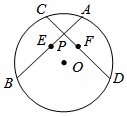

# 23 题精讲 02 · 弦中点、垂径与矩形判定

## 📝 题目

如图，在 $\odot O$ 中，弦 $AB$ 等于弦 $CD$，且相交于点 $P$，$E$、$F$ 分别为 $AB$、$CD$ 的中点。

(1) 求证：$OP\perp EF$；

(2) 联结 $AF$、$AC$、$CE$，若 $AF\parallel OP$，求证：四边形 $AFEC$ 是矩形。

## 🧭 思路导航（渐进提示）

- **提示 1（识别）**：两个"中点"是钥匙——弦的中点 + 圆心，先想到**等腰三角形三线合一 / 垂径定理**给直角；(2) 的 $AF\parallel OP$ 是"平行截比例"的信号，目标定成**先平行四边形、再升级矩形**。
- **提示 2（突破）**：(1) 用两次 **HL**：Rt△OEB≌Rt△OFD 得 $OE=OF$，Rt△OPE≌Rt△OPF 得 $PE=PF$——两组"到线段两端等距的点"拉出 $OP$ 是 $EF$ 的垂直平分线。(2) 设 $EF$ 交 $OP$ 于 $J$，则 $J$ 是 $EF$ 中点；$P$ 在直线 $AE$ 上且 $PJ\parallel AF$ → **A 字型相似**把 $P$ 变成 $AE$ 的中点；于是 $PA=PE=PC=PF$ 四线全等，对角线互相平分 + 对角线相等。
- **提示 3（路线）**：(1) $AB=CD$ → $BE=DF$（等量之半）；$OE\perp AB$、$OF\perp CD$（三线合一）→ Rt△OEB≌Rt△OFD（HL）→ $OE=OF$；再 Rt△OEP≌Rt△OFP（HL）→ $PE=PF$；$O$、$P$ 都在 $EF$ 的垂直平分线上 → $OP\perp EF$。(2) 由(1) $OP$ 垂直平分 $EF$ → $EJ=JF$；$PJ\parallel AF$ → △EPJ∽△EAF → $EP=\frac12EA$，且 $P$ 在线段 $AE$ 上 → $PA=PE$；又 $AE=CF$、$PE=PF$ → $PA=PC$、$PC=PF$ → 对角线 $AE$、$CF$ 互相平分 → 平行四边形；加 $EA=CF$（对角线相等）→ 矩形。

## ✍️ 详解

**(1)** 联结 $OP$、$OE$、$OF$。

$E$、$F$ 分别为 $AB$、$CD$ 的中点 → $AE=EB=\dfrac12AB$，$CF=FD=\dfrac12CD$（中点定义）。

$AB=CD$ → $BE=DF$（等量的同分量相等）。

$OA=OB$，$E$ 为 $AB$ 中点 → $OE\perp AB$（等腰三角形三线合一）→ $\angle OEB=90°$。

同理 $OF\perp CD$ → $\angle OFD=90°$（垂直定义）。

在 Rt$\triangle OEB$ 与 Rt$\triangle OFD$ 中：$OB=OD$（同圆半径相等），$BE=DF$（已证）→ Rt$\triangle OEB\cong$Rt$\triangle OFD$（HL）。

→ $OE=OF$（全等三角形对应边相等）。

在 Rt$\triangle OEP$ 与 Rt$\triangle OFP$ 中：$OP=OP$（公共边），$OE=OF$（已证）→ Rt$\triangle OEP\cong$Rt$\triangle OFP$（HL）。

→ $PE=PF$（全等三角形对应边相等）。

$OE=OF$ → 点 $O$ 在 $EF$ 的垂直平分线上；$PE=PF$ → 点 $P$ 在 $EF$ 的垂直平分线上（与线段两个端点距离相等的点在这条线段的垂直平分线上）。

两点确定一条直线 → $OP$ 垂直平分 $EF$ → $OP\perp EF$。$\blacksquare$

**(2)** 联结 $AC$，设 $EF$ 交 $OP$ 于点 $J$。

$AE=CF=\dfrac12AB=\dfrac12CD$（中点定义 + 等量的同分量相等）。

由(1)：$PE=PF$ 且 $OE=OF$ → $OP$ 垂直平分 $EF$ → $EJ=JF$（垂直平分线平分该线段）。

$A$、$E$、$P$、$B$ 共线 → $P$ 在直线 $AE$ 上；$PJ\parallel AF$（即 $OP\parallel AF$）。

→ $\triangle EPJ\backsim\triangle EAF$（平行于三角形一边的直线截其他两边，所得的三角形与原三角形相似）。

$$\frac{EP}{EA}=\frac{EJ}{EF}=\frac12\ \Rightarrow\ EP=\frac12EA$$

由 $J$ 在线段 $EF$ 上，知 $P$ 在线段 $EA$ 上（平行线在两边的同侧截得对应点）→ $PA=EA-EP=\dfrac12EA$ → $PA=PE$（等式性质）。

$PE=PF$（(1)已证），$AE=CF$（已证）→ $PA=AE-PE=CF-PF=PC$（等量减等量，差相等）。

→ $PA=PE=PC=PF$（等量代换）。

$PA=PE$ → $P$ 平分 $AE$；$PC=PF$ → $P$ 平分 $CF$ → 四边形 $AFEC$ 的两条对角线 $AE$、$CF$ 互相平分。

→ 四边形 $AFEC$ 是平行四边形（对角线互相平分的四边形是平行四边形）。

又 $EA=CF$（已证）→ 平行四边形 $AFEC$ 的两条对角线相等 → 四边形 $AFEC$ 是矩形（对角线相等的平行四边形是矩形）。$\blacksquare$

**（自洽检验）**：四条线段 $PA=PE=PC=PF$ 说明 $P$ 是 $A$、$E$、$C$、$F$ 四点共同的"等距中心"——与"对角线互相平分且相等"的结论互相印证；若 $AB\ne CD$，$AE\ne CF$，矩形结论即失效，可见 $AB=CD$ 用在两处、缺一不可。

## ⚠️ 评分点与易错

- (1) 两次 HL 缺一不可：第一次给 $OE=OF$，第二次给 $PE=PF$；只证一组就断言 $OP\perp EF$，"两个等距点定垂直平分线"就塌了。
- 直角来源写清楚：$OE\perp AB$ 用的是**等腰三角形三线合一**（$OA=OB$ + 中点），不必搬垂径定理全文。
- (2) 中"$P$ 在线段 $AE$ 上"这一位置必须交代（题源直接写 $\therefore EP=PA$，跳过了 △EPJ∽△EAF 这一步）；没有这步，$EP=\frac12EA$ 推不出 $PA=PE$。
- 结论链两段式：对角线互相平分 → 平行四边形；再加对角线相等 → 矩形。跳过平行四边形直接判矩形要扣分。
- $AB=CD$ 在本题用了两次（(1) 中 $BE=DF$、(2) 中 $AE=CF$），每次都要写"等量的同分量相等"的代换过程。

## 🔗 关联

- [[03-数学/专题/第23题-几何论证]] · [[03-数学/知识点/九年级/圆与正多边形]]（垂径定理推论）· [[03-数学/知识点/九年级/相似三角形]]（A 字型）
- 同类题：[[23-01-弦与半径交点相似]]（圆内全等）、[[23-05-半圆相交弦与菱形]]（平行四边形 → 菱形）、[[23-10-矩形与相似全等]]（矩形判定逆向用）
