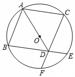

# 23 题精讲 03 · 等弦、垂直平分线与菱形

## 📝 题目

已知：如图，$AB$、$AC$ 是 $\odot O$ 的两条弦，且 $AB=AC$，$D$ 是 $AO$ 延长线上一点，联结 $BD$ 并延长交 $\odot O$ 于点 $E$，联结 $CD$ 并延长交 $\odot O$ 于点 $F$。

(1) 求证：$BD=CD$；

(2) 如果 $AB^2=AO\cdot AD$，求证：四边形 $ABDC$ 是菱形。

（图中 $D$ 位于圆内、$AO$ 的延长线上，$E$、$F$ 分别是 $BD$、$CD$ 的延长线与 $\odot O$ 的交点。）

## 🧭 思路导航（渐进提示）

- **提示 1（识别）**：$AB=AC$（弦等）与 $OB=OC$（半径）是两组"到 $B$、$C$ 两端等距的点"——**垂直平分线模型**的标志；(2) 的 $AB^2=AO\cdot AD$ 是乘积式 → 改写成比例式走**母子型相似**（公共角夹两边）。
- **提示 2（突破）**：(1) 两点定直线：$A$、$O$ 各在 $BC$ 的垂直平分线上 → 直线 $AO$ 就是垂直平分线，$D$ 在其延长线上顺手继承。(2) 把 $AB^2=AO\cdot AD$ 改写为 $\frac{AB}{AO}=\frac{AD}{AB}$，夹角 $\angle BAO=\angle DAB$（同一个角）→ △ABO∽△ADB；等腰 $\triangle OAB$ 把 $\angle ABO$ 换成 $\angle OAB$，即可导出 $AB=BD$。
- **提示 3（路线）**：(1) 联结 $BC$：$AB=AC$ → $A$ 在 $BC$ 垂直平分线上；$OB=OC$ → $O$ 也在其上；两点确定一条直线 → $AO$ 垂直平分 $BC$；$D$ 在 $AO$ 延长线上 → $BD=CD$（垂直平分线性质）。(2) 比例式 + 公共角 → △ABO∽△ADB → $\angle ABO=\angle ADB$；$OA=OB$ → $\angle OAB=\angle OBA$ → $\angle DAB=\angle BDA$ → $AB=BD$（等角对等边）；加上(1)的 $BD=CD$ 与已知 $AB=AC$ → 四边相等 → 菱形（四条边都相等的四边形）。答题时按小问顺序写，(2) 引用 (1) 结论须声明"由(1)"。

## ✍️ 详解

**(1)** 联结 $BC$。

$AB=AC$ → 点 $A$ 在 $BC$ 的垂直平分线上（与线段两个端点距离相等的点在这条线段的垂直平分线上）。

$OB=OC$（同圆的半径相等）→ 点 $O$ 也在 $BC$ 的垂直平分线上（到 $B$、$C$ 距离相等的点同理）。

两点确定一条直线 → 直线 $AO$ 是 $BC$ 的垂直平分线（过 $A$、$O$ 两点的直线唯一）。

$D$ 在 $AO$ 的延长线上 → $D$ 在直线 $AO$ 上 → $D$ 在 $BC$ 的垂直平分线上。

→ $BD=CD$（垂直平分线上的点到线段两端点的距离相等）。$\blacksquare$

（注：$E$、$F$ 两点保证了 $BD$、$CD$ 的延长线与圆相交、图形完备，但 $BD=CD$ 与它们无关——分清"图形要素"与"论证要素"能避免无效书写。）

**(2)** 由 $AB^2=AO\cdot AD$：$\dfrac{AB}{AO}=\dfrac{AD}{AB}$（比例的基本性质，$AB$ 为中间比）。

$\angle BAO=\angle DAB$（同一个角：$D$ 在 $AO$ 延长线上，射线 $AD$ 与射线 $AO$ 重合）。

在 $\triangle ABO$ 与 $\triangle ADB$ 中：$\dfrac{AB}{AO}=\dfrac{AD}{AB}$（已证），$\angle BAO=\angle DAB$（已证）。

→ $\triangle ABO\backsim\triangle ADB$（两边对应成比例且夹角相等）→ $\angle ABO=\angle ADB$（相似三角形对应角相等）。

$OA=OB$（同圆半径相等）→ $\angle OAB=\angle OBA$（等边对等角）。

→ $\angle DAB=\angle BDA$（等量代换）→ $BD=AB$（等角对等边）。

由(1) $BD=CD$（已证），又已知 $AB=AC$。

→ $AB=BD=DC=CA$（等量代换）→ 四边形 $ABDC$ 是菱形（四条边都相等的四边形是菱形）。$\blacksquare$

**（角度链复盘）**：设 $\angle ABO=\alpha$，则 $\angle ADB=\alpha$（相似对应角）→ $\angle OAB=\alpha$（等边对等角）→ $\angle DAB=\alpha=\angle BDA$ → $AB=BD$。全链只用一个未知角，复习时可在图上依次标注。

**（另证对照）**：(1) 也可走全等——$AO$ 平分 $\angle BAC$（等腰三角形三线合一，$AB=AC$）→ $\angle BAD=\angle CAD$；加 $AB=AC$、$AD=AD$（公共边）→ △ABD≌△ACD（SAS）→ $BD=CD$。两条路均可，正文写法更贴近"圆中等弦"的主题。

**（自洽检验）**：相似 △ABO∽△ADB 还有第三组对应比 $\dfrac{AB}{AD}=\dfrac{BO}{DB}$；代入 $BD=AB$ 得 $AB^2=BO\cdot AD$，与已知 $AB^2=AO\cdot AD$ 相容（$BO=OA$）——条件与结论互为印证，链条无矛盾。

绕序 $A\to B\to D\to C$ 下四条边恰为 $AB$、$BD$、$DC$、$CA$，与"四边相等"的判定对齐；若只推出 $AB=BD$ 而忘记回用 (1) 的 $BD=CD$，四边不齐，结论不成立——(1)(2) 是接力关系。

图形上还可反向检验：菱形 $ABDC$ 的对角线 $AD$ 与 $BC$ 应互相垂直平分，而 (1) 恰好给出 $AO\perp BC$（$AD$ 与 $AO$ 同线）——结论与图形互洽。

## ⚠️ 评分点与易错

- (1) 必须"两点定直线"：只说 $A$（或只说 $O$）在垂直平分线上不够，结论要落在"**直线 $AO$ 是 $BC$ 的垂直平分线**"上，再继承给 $D$。
- (2) 比例式对应顺序：$\frac{AB}{AO}=\frac{AD}{AB}$，夹角是 $\angle BAO=\angle DAB$；若误写 $\frac{AB}{AD}=\frac{AO}{AB}$，相似对应错位，$\angle ABO$ 对出来的就是别的角。
- 四边形绕序是 $A\to B\to D\to C$，四条边为 $AB$、$BD$、$DC$、$CA$；用"四边相等"判定即可，**不需要**证对角线垂直。
- "$\angle BAO$ 与 $\angle DAB$ 是同一个角"是母子相似的夹角依据，源于 $D$ 在 $AO$ 延长线上——这句话别漏。
- 本题最忌把(2)的乘积式当成相交弦定理去算长度：这里是纯比例式，走相似走角，不动弦长数值。

## 🔗 关联

- [[03-数学/专题/第23题-几何论证]] · [[03-数学/知识点/九年级/相似三角形]]（母子型相似）· [[03-数学/知识点/九年级/圆与正多边形]]（等弦、半径）
- 同类题：[[23-05-半圆相交弦与菱形]]（菱形判定）、[[23-01-弦与半径交点相似]]（等弦翻译）、[[21-08-等腰与垂直平分线]]
- 题源 $E$、$F$ 两点在本题证明中未用到（仅界定 $BD$、$CD$ 的延长线），作图时照题联结即可，不必强行使用。
- 若把 (2) 的条件换成 $AB^2=AO\cdot AD$ 且 $D$ 在 $OA$ 的延长线上（$O$、$A$ 之间），同样的相似不再成立——注意"延长线"方向是本题成立的前提。
