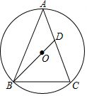

# 23 题精讲 04 · 等腰三角形的外接圆

## 📝 题目

如图，$\triangle ABC$ 中，$AB=AC$，$\odot O$ 是 $\triangle ABC$ 的外接圆，$BO$ 的延长线交边 $AC$ 于点 $D$。

(1) 求证：$\angle BAC=2\angle ABD$；

(2) 当 $\triangle BCD$ 是等腰三角形时，求 $\angle BCD$ 的大小；

(3) 当 $AD=2$，$CD=3$ 时，求边 $BC$ 的长。

## 🧭 思路导航（渐进提示）

- **提示 1（识别）**：$AB=AC$ + $O$ 是外心——"等腰 + 外心在顶角的对称线上"是主结构，(1) 只需把 $\angle BAC$ 拆成两半；(2) 说"等腰"却不说谁等于谁——**必分类**，公共枢纽是 △ABD 的外角；(3) 已知两段求第三边，走"平行转移 + 设参双勾股"。
- **提示 2（突破）**：(1) 联结 $OA$：$A$、$O$ 都在 $BC$ 垂直平分线上 → $AO$ 平分顶角，配 $OA=OB$ 换角。(2) 设 $\angle ABD=\alpha$，则外角 $\angle BDC=\angle ABD+\angle BAC=3\alpha$，三类讨论（$BD=CB$ / $CD=CB$ / $DB=DC$）都用它表出三内角；第三类会导出矛盾。(3) 作 $AE\parallel BC$ 交 $BD$ 延长线于 $E$：一次相似把 $BC$ 换成 $AE$，再用 $H=AO\cap BC$ 把 $AE$ 与 $BH$ 挂钩，设 $AO=4a$、$OH=3a$，两个直角三角形共用 $BH$ 列方程。
- **提示 3（路线）**：(1) $OA=OB$ → $\angle ABO=\angle BAO$；$AO$ 垂直平分 $BC$ → $\angle BAO=\angle CAO$ → $\angle BAC=2\angle BAO=2\angle ABD$。(2) ① $BD=CB$：$\angle BCD=\angle BDC=3\alpha$、$\angle DBC=2\alpha$，$8\alpha=180°$ → $\angle BCD=67.5°$；② $CD=CB$：$\angle CBD=\angle CDB=3\alpha$、$\angle BCD=4\alpha$，$10\alpha=180°$ → $\angle BCD=72°$；③ $DB=DC$：推出 $\alpha=0°$ 矛盾，不存在。(3) △ADE∽△CDB → $AE=\frac23BC=\frac43BH$；△AOE∽△HOB → $AO:OH=4:3$，设 $AO=OB=4a$、$OH=3a$；$AB^2-AH^2=OB^2-OH^2$ 解 $a$，回代 $BC=2BH$。

## ✍️ 详解

**(1)** 联结 $OA$。

$OA=OB$（同圆半径相等）→ $\angle ABO=\angle BAO$（等边对等角）。

$AB=AC$ → 点 $A$ 在 $BC$ 的垂直平分线上；$OB=OC$ → 点 $O$ 也在 $BC$ 的垂直平分线上；两点确定一条直线 → $AO$ 垂直平分 $BC$ → $\angle BAO=\angle CAO$（等腰三角形三线合一，$AO$ 平分顶角）。

→ $\angle BAC=\angle BAO+\angle CAO=2\angle BAO=2\angle ABO$（等量代换）。

$D$ 在 $BO$ 的延长线上 → $\angle ABO=\angle ABD$（同一个角）→ $\angle BAC=2\angle ABD$。$\blacksquare$

**(2)** 设 $\angle ABD=\alpha$，则 $\angle BAC=2\alpha$（由(1)）；$AB=AC$ → $\angle ABC=\angle ACB$（等边对等角）。

$\angle BDC=\angle ABD+\angle BAC=3\alpha$（三角形外角定理：$\angle BDC$ 是 $\triangle ABD$ 的外角）。按等腰三角形的腰分三类：

① 若 $BD=CB$：$\angle BDC=\angle BCD$（等边对等角）→ $\angle BCD=3\alpha$；$\angle DBC=\angle ACB-\angle ABD=3\alpha-\alpha=2\alpha$（等式性质）。

内角和：$\angle DBC+\angle BCD+\angle BDC=2\alpha+3\alpha+3\alpha=180°$（三角形内角和定理）→ $\alpha=22.5°$ → $\angle BCD=67.5°$。

② 若 $CD=CB$：$\angle CBD=\angle CDB=3\alpha$（等边对等角 + 外角定理）→ $\angle BCD=\angle ACB=\angle ABC=\angle ABD+\angle CBD=\alpha+3\alpha=4\alpha$。

内角和：$4\alpha+3\alpha+3\alpha=180°$ → $\alpha=18°$ → $\angle BCD=72°$。

③ 若 $DB=DC$：$\angle DBC=\angle DCB$（等边对等角）。又 $\angle DCB=\angle ACB=\angle ABC=\angle ABD+\angle DBC$（$D$ 在线段 $AC$ 上）→ $\angle DBC=\alpha+\angle DBC$ → $\alpha=0°$，矛盾 → 此情形不存在（此时 $D$ 与 $A$ 重合，$\triangle BCD$ 退化为线段）。

综上，$\angle BCD$ 的大小为 $67.5°$ 或 $72°$。

**(3)** $AC=AD+CD=5$，$AB=AC$ → $AB=5$（等量代换）。

作 $AE\parallel BC$ 交 $BD$ 的延长线于点 $E$。

$\angle ADE=\angle CDB$（对顶角相等）；$\angle DAE=\angle DCB$（两直线平行，内错角相等）→ $\triangle ADE\backsim\triangle CDB$（两角对应相等）→ $\dfrac{AE}{BC}=\dfrac{AD}{CD}=\dfrac23$（相似三角形对应边成比例）。

$AO$ 垂直平分 $BC$（由(1)），设垂足为 $H$，则 $AH\perp BC$ 且 $BH=HC$ → $BC=2BH$ → $AE=\dfrac23BC=\dfrac43BH$（等量代换）。

$\angle AOE=\angle HOB$（对顶角相等：$A$、$O$、$H$ 共线，$E$、$O$、$B$ 共线）；$\angle AEO=\angle HBO$（两直线平行，内错角相等）→ $\triangle AOE\backsim\triangle HOB$（两角对应相等）→ $\dfrac{AO}{OH}=\dfrac{AE}{HB}=\dfrac43$（相似三角形对应边成比例）。

设 $AO=OB=4a$，则 $OH=3a$，$AH=AO+OH=7a$（等式性质）。

$BH^2=AB^2-AH^2=OB^2-OH^2$（勾股定理：Rt$\triangle ABH$ 与 Rt$\triangle OBH$ 共用直角边 $BH$）：

$$25-49a^2=16a^2-9a^2\ \Rightarrow\ 25=56a^2\ \Rightarrow\ a^2=\frac{25}{56}$$

$BH^2=OB^2-OH^2=7a^2=\dfrac{25}{8}$ → $BH=\sqrt{\dfrac{25}{8}}=\dfrac{5}{2\sqrt2}=\dfrac{5\sqrt2}{4}$（线段长取正值）→

$$\boxed{BC=2BH=\frac{5\sqrt2}{2}}$$

## ⚠️ 评分点与易错

- (2) 必须三类讨论齐全：等腰三角形没指明哪两条边相等；漏类扣分，第③类还要给出"不存在"的理由（推出矛盾）。
- 外角定理 $\angle BDC=\angle ABD+\angle BAC=3\alpha$ 是三类讨论的公共起点，先把 △BCD 三个内角全用 $\alpha$ 表出再求和，别跳步写"8α""10α"的来源。
- (3) 的 $AE\parallel BC$ 一线两用：先 △ADE∽△CDB 定 $AE:BC$，再 △AOE∽△HOB 把比例搬到半径上；设参 $a$ 要在图上标注清楚。
- "双勾股共直角边"方程 $AB^2-AH^2=OB^2-OH^2$ 是本讲核心模型：$AB=5$ 来自 $AC=AD+CD$，别用错斜边。
- 题源(3)中"$AO:OH=AE:BH=4:3$"省略了 △AOE∽△HOB 的过程与依据，作答需补全；最后 $BH$ 只取正根。

## 🔗 关联

- [[03-数学/专题/第23题-几何论证]] · [[03-数学/知识点/九年级/圆与正多边形]]（外接圆、圆心与弦）· [[03-数学/知识点/九年级/相似三角形]]
- 同类题：[[23-09-圆内接四边形求半径]]（外接圆 + 设参勾股求线段）、[[23-01-弦与半径交点相似]]（等弦对等角）
