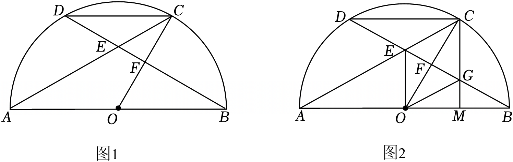
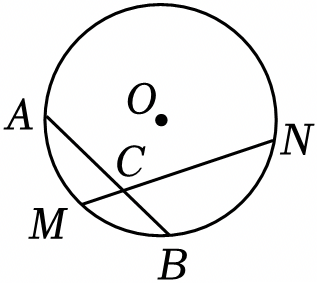

# 23 题精讲 05 · 半圆相交弦与菱形

## 📝 题目

已知 $AB$ 是半圆 $O$ 的直径，弦 $AC$、$BD$ 交于点 $E$，$OC$ 与 $BD$ 交于点 $F$，满足 $\dfrac{DE}{BE}=\dfrac{CE}{AE}=\dfrac12$。

(1) 求证：$OC\perp BD$；

(2) 如图 2，$M$ 是 $OB$ 的中点，$CM$ 与 $BD$ 交于点 $G$，求证：四边形 $CEOG$ 是菱形。

## 🧭 思路导航（渐进提示）

- **提示 1（识别）**：$\frac{DE}{BE}=\frac{CE}{AE}=\frac12$ 是"两对线段成比例 + 对顶角"——**母子型 SAS 相似**（△CED∽△AEB）直接开路；(2) 要判菱形，路线锁定"先平行四边形（对角线互相平分），再对角线垂直"。
- **提示 2（突破）**：(1) 相似给出 $\frac{CD}{AB}=\frac12$ 与 $\angle CDE=\angle ABE$；而 $\frac{BO}{AB}=\frac12$（半径是直径之半）→ $CD=BO$——把弦长换成**半径**，才能和 △OBF 拼 **AAS 全等**，得 $F$ 平分 $BD$，再用等腰 △OBD 三线合一收垂直。(2) $M$ 在直径上 → $A$、$O$、$M$ 共线，$\frac{AE}{AC}=\frac{AO}{AM}=\frac23$ → 又一次 SAS 相似得 $OE\parallel CM$；平行 + (1) 的 $CF=OF$ 通过 △FEO∽△FGC 把 $F$ 变成 $EG$ 的中点。
- **提示 3（路线）**：(1) △CED∽△AEB（两边成比例且夹角相等）→ $\frac{CD}{AB}=\frac12$、$\angle CDE=\angle ABE$；$BO=\frac12AB$ → $CD=BO$；△CDF≌△OBF（AAS：两角 + $CD=OB$）→ $DF=BF$；$OB=OD$ → $OF\perp BD$（三线合一）→ $OC\perp BD$。(2) $OM=\frac12OA$ → $\frac{AO}{AM}=\frac23=\frac{AE}{AC}$，夹角 $\angle EAO=\angle CAM$（$A$、$O$、$M$ 共线）→ △EAO∽△CAM → $OE\parallel CM$；由平行得 △FEO∽△FGC → $\frac{FE}{FG}=\frac{FO}{FC}=1$ → $FE=FG$；对角线 $CO$、$EG$ 互相平分 → 平行四边形；加 $CO\perp EG$（由(1)）→ 菱形。

## ✍️ 详解

**(1)** 在 $\triangle CED$ 与 $\triangle AEB$ 中：$\dfrac{CE}{AE}=\dfrac{DE}{BE}=\dfrac12$（已知），$\angle CED=\angle AEB$（对顶角相等）。

→ $\triangle CED\backsim\triangle AEB$（两边对应成比例且夹角相等）。

→ $\dfrac{CD}{AB}=\dfrac12$，$\angle CDE=\angle ABE$（相似三角形对应边成比例、对应角相等）。

$O$ 为 $AB$ 中点，$AB$ 为直径 → $BO=\dfrac12AB$（半径等于直径的一半）→ $\dfrac{CD}{AB}=\dfrac{BO}{AB}$（等量代换）。

→ $CD=BO$（比例性质）。

在 $\triangle CDF$ 与 $\triangle OBF$ 中：$\angle CDF=\angle OBF$（已证；$E$、$F$ 在线段 $BD$ 上，射线 $DF$、$BF$ 与射线 $DB$ 重合），$\angle CFD=\angle OFB$（对顶角相等），$CD=OB$（已证）。

→ $\triangle CDF\cong\triangle OBF$（AAS）→ $DF=BF$（全等三角形对应边相等）。

$OB=OD$（同圆的半径相等），$F$ 平分 $BD$ → $OF\perp BD$（等腰三角形三线合一）。

$F$ 在线段 $OC$ 上 → $OC\perp BD$（过交点的同一条垂线）。$\blacksquare$

**(2)** $M$ 是 $OB$ 的中点，$OB=OA$（半径）→ $OM=\dfrac12OA$（中点定义）。

→ $AM=AO+OM=\dfrac32AO$（等式性质）→ $\dfrac{AO}{AM}=\dfrac23$。

$\dfrac{CE}{AE}=\dfrac12$ → $AC=AE+EC=\dfrac32AE$ → $\dfrac{AE}{AC}=\dfrac23$（等式性质）→ $\dfrac{AE}{AC}=\dfrac{AO}{AM}$（等量代换）。

$\angle EAO=\angle CAM$（同一个角：$A$、$O$、$M$ 都在直径 $AB$ 上 → 射线 $AO$ 与 $AM$ 重合；$E$ 在线段 $AC$ 上）。

→ $\triangle EAO\backsim\triangle CAM$（两边对应成比例且夹角相等）。

→ $\angle AEO=\angle ACM$（相似三角形对应角相等）→ $OE\parallel CM$（同位角相等，两直线平行）。

$OE\parallel CG$（$G$ 在线段 $CM$ 上）→ $\angle FEO=\angle FGC$，$\angle FOE=\angle FCG$（两直线平行，内错角相等）。

→ $\triangle FEO\backsim\triangle FGC$（两角对应相等）→ $\dfrac{FE}{FG}=\dfrac{FO}{FC}$（相似三角形对应边成比例）。

由(1) $\triangle CDF\cong\triangle OBF$ → $CF=OF$（全等三角形对应边相等）→ $\dfrac{FE}{FG}=1$（比例性质）。

→ $FE=FG$，即 $F$ 平分 $EG$（线段中点的定义）。

又 $CF=OF$ → $F$ 平分 $CO$ → 四边形 $CEOG$ 的两条对角线 $CO$ 与 $EG$ 互相平分。

→ 四边形 $CEOG$ 是平行四边形（对角线互相平分的四边形是平行四边形）。

又 $CO\perp EG$（由(1) $OC\perp BD$，而 $E$、$G$ 都在线段 $BD$ 上）→ 四边形 $CEOG$ 是菱形（对角线互相垂直的平行四边形是菱形）。$\blacksquare$

**（自洽检验）**：图中 $OE\perp BD$ 且过 $E$（$E$ 在 $BD$ 上），与图 2 中 $EO$ 画成竖直、$BD$ 画成斜线相吻合；(1) 的全等同时给出 $CF=OF$ 与 $DF=BF$ 两条中点信息，(2) 用前者、(1) 的垂直用后者，两问衔接自然。

## ⚠️ 评分点与易错

- 相似 △CED∽△AEB 的对应顶点顺序（C↔A、E↔E、D↔B）决定 $\frac{CD}{AB}=\frac12$ 与 $\angle CDE=\angle ABE$ 两个结论，顺序写错后面全错。
- "$CD=BO$"是全题枢纽：把弦长换成半径，才能充当 △CDF≌△OBF（AAS）的一组对应边；垂直的落点用等腰 △OBD 三线合一，别只写"所以垂直"。
- (2) 中 $\angle EAO=\angle CAM$ 的理由是 **$A$、$O$、$M$ 共线（都在直径上）**——这一点必须写出来，不能默认。
- 题源把"$\frac{CF}{OF}=\frac{FG}{EF}$"直接写出，实际需要 $OE\parallel CM$ 先行、再证 △FEO∽△FGC，两步都不能省。
- 判菱形走"平行四边形 + 对角线垂直"双条件：前者需要 $F$ 同时平分 $CO$ 与 $EG$（一半来自(1)的全等，一半来自本题的相似），要显式引用"由(1)"。

## 🔗 关联

- [[03-数学/专题/第23题-几何论证]] · [[03-数学/知识点/九年级/相似三角形]]（母子型、A 字型）· [[03-数学/知识点/九年级/圆与正多边形]]（直径、半径）
- 同类题：[[23-02-弦中点与垂径]]（弦中点全等）、[[23-03-等弦与菱形判定]]（菱形判定）、[[21-16-半圆中的弧与正切]]
