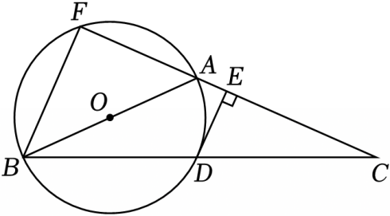

# 23 题精讲 06 · 直径所对圆周角与切线

## 📝 题目

如图，在 $\triangle ABC$ 中，$AB=AC$，以 $AB$ 为直径的 $\odot O$ 交 $BC$ 于点 $D$，过点 $D$ 作 $DE\perp AC$，垂足为点 $E$，延长 $CA$ 交 $\odot O$ 于点 $F$，联结 $BF$。

(1) 求证：$DE$ 是 $\odot O$ 的切线；

(2) 联结 $OE$，若 $BF=2\sqrt5$，$FC=10$，求 $OE$ 的长。

## 🧭 思路导航（渐进提示）

- **提示 1（识别）**："以 $AB$ 为直径"给直角（直径所对圆周角），"$DE\perp AC$"给垂直；证切线的标准动作是**连半径、证垂直、指外端**。(2) 给两条弦长求 $OE$——先解出三角形（方程思想），再在直角三角形里勾股收口。
- **提示 2（突破）**：(1) 连 $OD$，用 $AB=AC$ 把 $\angle ODB$ 换成 $\angle C$ 得 $OD\parallel AC$，垂直顺势传递。(2) 关键辅助线：**延长 $DO$ 交 $BF$ 于 $H$**，凑"三个直角"证 $DEFH$ 是矩形 → $DE=FH$；再用 $OB=OF$ + $OH\perp BF$ 得 $H$ 平分 $BF$（等腰三线合一）；最后在 Rt△ABF 中用 $BF^2+AF^2=AB^2$ 解出 $AB$。
- **提示 3（路线）**：(1) $OD=OB$ → $\angle ODB=\angle OBD$；$AB=AC$ → $\angle OBD=\angle C$ → $OD\parallel AC$（同位角）→ $DE\perp OD$ → 切线（过半径外端垂直半径）。(2) $\angle AFB=90°$（直径圆周角）+ $\angle HDE=90°$（平行传递）+ $\angle DEF=90°$ → 矩形 $DEFH$ → $DE=FH$、$\angle DHF=90°$；等腰 △OBF 中 $OH\perp BF$ → $BH=FH=\frac12BF=\sqrt5$；Rt△ABF：$AB^2=(10-AB)^2+(2\sqrt5)^2$ 解 $AB=6$；$OD=3$，Rt△ODE 中 $OE=\sqrt{3^2+(\sqrt5)^2}=\sqrt{14}$。

## ✍️ 详解

**(1)** 联结 $OD$，则 $OD=OB$（同圆的半径相等）→ $\angle ODB=\angle OBD$（等边对等角）。

$AB=AC$ → $\angle ABC=\angle ACB$（等边对等角）。

$D$ 在线段 $BC$ 上 → $\angle OBD=\angle ABC$（同一个角）→ $\angle ODB=\angle ACB$（等量代换）。

→ $OD\parallel AC$（同位角相等，两直线平行）。

$DE\perp AC$ → $\angle DEC=90°$（垂直定义）→ $\angle ODE=\angle DEC=90°$（两直线平行，内错角相等）。

$OD$ 是 $\odot O$ 的半径，$DE$ 过半径外端 $D$，且 $DE\perp OD$ → $DE$ 是 $\odot O$ 的切线（经过半径外端并且垂直于这条半径的直线是圆的切线）。$\blacksquare$

**(2)** 联结 $OE$，延长 $DO$ 交 $BF$ 于点 $H$。

$AB$ 是直径，$F$ 在 $\odot O$ 上 → $\angle AFB=90°$（直径所对的圆周角是直角）。

射线 $FE$ 与 $FA$ 重合（$E$ 在线段 $AC$ 上）、射线 $FH$ 与 $FB$ 重合（$H$ 在线段 $BF$ 上）→ $\angle EFH=\angle AFB=90°$（同一个角）。

由(1) $OD\parallel AC$，且 $DE\perp AC$ → $DE\perp OD$（垂直于平行线中的一条，必垂直于另一条）。

→ $\angle HDE=90°$（$H$ 在 $DO$ 的延长线上，垂直定义）。

又 $\angle DEF=90°$（$DE\perp AC$，垂直定义）→ 四边形 $DEFH$ 有三个角是直角 → 四边形 $DEFH$ 是矩形（有三个角是直角的四边形是矩形）。

→ $DE=FH$，$\angle DHF=90°$（矩形的对边相等、四个角都是直角）。

$OB=OF$（半径相等），$OH\perp BF$（由 $\angle DHF=90°$，$O$、$D$、$H$ 共线）→ $BH=FH$（等腰三角形三线合一：底上的高也是中线）。

→ $BH=FH=\dfrac12BF=\dfrac12\times2\sqrt5=\sqrt5$（等式性质）。

$FC=FA+AC=10$，$AC=AB$ → $AF=10-AB$（等式性质）。

在 Rt$\triangle ABF$ 中（$\angle AFB=90°$）：$AB^2=AF^2+BF^2$（勾股定理）。

$$AB^2=(10-AB)^2+(2\sqrt5)^2=100-20AB+AB^2+20$$

→ $20AB=120$ → $AB=6$（两边消去 $AB^2$，化为一次方程，唯一解）。

$OD=\dfrac12AB=3$（$O$ 为 $AB$ 中点，半径），$DE=FH=\sqrt5$（已证）。

在 Rt$\triangle ODE$ 中（$\angle ODE=90°$ 已证）：$OE=\sqrt{OD^2+DE^2}=\sqrt{9+5}=\sqrt{14}$（勾股定理）。

$$\boxed{OE=\sqrt{14}}$$

**（验算）**：$AB=6$、$AF=4$，则 $BF^2=AB^2-AF^2=36-16=20$ → $BF=2\sqrt5$ ✓；$FC=FA+AC=4+6=10$ ✓；再 $DE=\sqrt5<OD=3$、$OE=\sqrt{14}\approx3.74$ 量级合理。

## ⚠️ 评分点与易错

- 题源 OCR 讹误标注：原卷文本 "BF=25" 应读作 $BF=2\sqrt5$、"OE=…=14" 应读作 $\sqrt{14}$——以代入方程 $(2\sqrt5)^2=20$ 后自洽为准。
- 证切线三要素齐全：连半径（联结 $OD$）、证垂直（$\angle ODE=90°$）、指外端（$D$ 在圆上）；只写垂直不连半径不得分。
- 矩形 $DEFH$ 的三个直角各有出处：$\angle EFH$（直径圆周角）、$\angle HDE$（平行 + 垂直传递）、$\angle DEF$（垂直定义），逐一标依据。
- $BH=FH=\frac12BF$ 用等腰 △OBF 三线合一，前提是 $OH\perp BF$——这句依据常被漏写。
- 解 $AB$ 的方程时 $AB^2$ 两边消去化为一次方程；若解出负值或两个根，回头检查线段关系 $AF=10-AB$ 是否用对。

## 🔗 关联

- [[03-数学/专题/第23题-几何论证]] · [[03-数学/知识点/九年级/圆与正多边形]]（切线判定、直径圆周角）· [[03-数学/知识点/九年级/锐角的三角比与解直角三角形]]（勾股定理）
- 同类题：[[23-07-垂径定理与正弦]]（圆中勾股计算）、[[21-19-切线与等边三角形]]、题源课后巩固同型题（原卷第 6 题）
- 延伸对照：同一张图可派生三角比小问——如在 Rt△ODE 中再算 $\tan\angle EOD=\dfrac{DE}{OD}=\dfrac{\sqrt5}{3}$，或 $\sin\angle OED=\dfrac{OD}{OE}=\dfrac{3\sqrt{14}}{14}$，口径与本讲一致。
