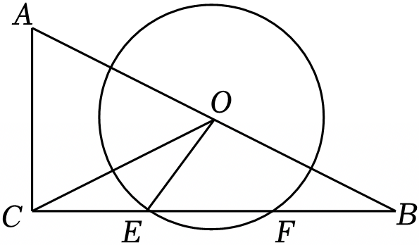

# 23 题精讲 07 · 垂径定理与正弦

## 📝 题目

已知：如图，在 Rt$\triangle ABC$ 中，$\angle ACB=90°$，$AC=8$，$BC=16$，点 $O$ 为斜边 $AB$ 的中点，以 $O$ 为圆心、5 为半径的圆与 $BC$ 相交于 $E$、$F$ 两点，联结 $OE$、$OC$。

(1) 求 $EF$ 的长；

(2) 求 $\angle COE$ 的正弦值。

（注：$M$ 是解答中自设的辅助点——"作 $OM\perp EF$ 于 $M$"是作答时必须补写的动作，题目不直接给出。第 (2) 问"求角的正弦值"允许直接用锐角三角比定义，无须求出角的度数。）

## 🧭 思路导航（渐进提示）

- **提示 1（识别）**：半径 5 + 弦 $EF$——**垂径定理的"弦心距"结构**，标准动作是过圆心作弦的垂线；(2) 求 $\angle COE$ 的正弦，先看这个角能否**换成一个位置更好算的等角**。
- **提示 2（突破）**：作 $OM\perp EF$ 于 $M$，则 $OM\parallel AC$（同垂直于 $BC$）→ $OM$ 是中位线，$OM$、$CM$ 一次全出；Rt△OEM 勾股出 $EM$。(2) 注意 $CE=CM-EM=5=OE$（恰好等于半径！）→ △OCE 等腰 → $\angle COE=\angle OCE$，把目标角换成 Rt△OMC 里的 $\angle OCM$。
- **提示 3（路线）**：(1) $OM\perp BC$、$AC\perp BC$ → $OM\parallel AC$；$O$ 为 $AB$ 中点 → $OM$ 是中位线 → $OM=\frac12AC=4$、$CM=\frac12BC=8$；$OM\perp$ 弦 $EF$ → $EM=FM$（垂径定理），Rt△OEM 中 $EM=\sqrt{5^2-4^2}=3$ → $EF=6$。(2) $CE=8-3=5=OE$ → $\angle EOC=\angle ECO$（等边对等角）；Rt△OMC 中 $OC=\sqrt{4^2+8^2}=4\sqrt5$，$\sin\angle OCM=\frac{OM}{OC}=\frac{\sqrt5}{5}$，即为所求。

## ✍️ 详解

**(1)** 作 $OM\perp EF$ 于点 $M$。

$E$、$F$ 在线段 $BC$ 上 → $OM\perp BC$；又 $AC\perp BC$（$\angle ACB=90°$）。

→ $OM\parallel AC$（同位角相等：$\angle OMB=\angle ACB=90°$）。

$O$ 为 $AB$ 的中点，$OM\parallel AC$ → $OM$ 是 $\triangle ABC$ 的中位线（三角形中位线的定义）。

→ $OM=\dfrac12AC=\dfrac12\times8=4$（三角形中位线定理）。

→ $CM=\dfrac12BC=\dfrac12\times16=8$（中位线所在的直线过 $BC$ 中点，$M$ 即 $BC$ 中点）。

$OM\perp EF$，$EF$ 是 $\odot O$ 的弦 → $EM=FM$（垂径定理：垂直于弦的直径平分弦）。

在 Rt$\triangle OME$ 中（$\angle OME=90°$，$OE=5$ 为斜边即半径）：

$$EM=\sqrt{OE^2-OM^2}=\sqrt{5^2-4^2}=3\quad(\text{勾股定理})$$

$$\boxed{EF=EM+FM=2EM=6}$$

**(2)** $CE=CM-EM=8-3=5$（等式性质），而 $OE=5$（半径）。

→ $CE=OE$ → $\triangle OCE$ 是等腰三角形（等腰三角形的定义）。

→ $\angle EOC=\angle ECO$（等边对等角）；$E$、$M$、$C$ 共线 → $\angle ECO$ 即 $\angle MCO$（同一个角）。

在 Rt$\triangle OMC$ 中（$\angle OMC=90°$）：

$$OC=\sqrt{OM^2+CM^2}=\sqrt{16+64}=\sqrt{80}=4\sqrt5\quad(\text{勾股定理})$$

$$\sin\angle OCM=\frac{OM}{OC}=\frac{4}{4\sqrt5}=\frac{\sqrt5}{5}\quad(\text{锐角正弦定义：对边与斜边的比；分母有理化})$$

$\angle COE=\angle OCE=\angle OCM$（已证，同一个角）→

$$\boxed{\sin\angle COE=\frac{\sqrt5}{5}}$$

**（验算）**：$EM=3<OE=5$ ✓（垂足 $M$ 落在弦 $EF$ 内部）；$CE=5$ 恰为半径，故 △OCE 中 $OE=CE=5$、第三边 $OC=4\sqrt5\approx8.94$，满足 $5+5>8.94$ ✓。

**（对照检查）**：Rt△OMC 中 $\cos\angle OCM=\dfrac{CM}{OC}=\dfrac{8}{4\sqrt5}=\dfrac{2\sqrt5}{5}$，与 $\sin\angle OCM=\dfrac{\sqrt5}{5}$ 满足 $\sin^2+\cos^2=\dfrac45+\dfrac15=1$ ✓，两个三角比互恰。

## ⚠️ 评分点与易错

- 中位线给两个结论：$OM=\frac12AC$ **和** $M$ 为 $BC$ 中点（$CM=\frac12BC$）；只用前者会卡死 (2)。
- $M$ 是弦 $EF$ 的中点（垂径定理），$M$ 是 $BC$ 的中点（中位线推论）——两个"中点"来源不同，别混写依据。
- $CE=OE$（弦上分段恰好等于半径）是 (2) 的钥匙，发现不了就换不出角；这一步要写"等边对等角"而不是默认。
- 正弦定义：$\angle OCM$ 的对边是 $OM=4$、斜边是 $OC=4\sqrt5$；先约分再分母有理化，结果写 $\frac{\sqrt5}{5}$（不要保留 $\frac{1}{\sqrt5}$ 原样）。
- $E$、$M$、$C$ 共线才能把 $\angle OCE$ 换成 $\angle OCM$，正文要点一句"同一个角"。

## 🔗 关联

- [[03-数学/专题/第23题-几何论证]] · [[03-数学/知识点/九年级/圆与正多边形]]（垂径定理）· [[03-数学/知识点/九年级/锐角的三角比与解直角三角形]]（正弦定义）
- 同类题：[[23-08-弧中点与圆周角]]（圆中解直角三角形）、[[21-05-中线作高正切]]（中线 + 三角比）
- 常见追问：若改求 $\tan\angle COE$，则 $\tan\angle ECO=\dfrac{OM}{CM}=\dfrac{4}{8}=\dfrac12$——同一张图可把正弦、正切各练一遍。
- 顺带一提：由直角三角形斜边中线定理，$OC=\dfrac12AB=\dfrac12\sqrt{8^2+16^2}=4\sqrt5$，与详解 (2) 中勾股算得的 $OC$ 一致——两条路互相检验。