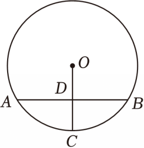

# 23 题精讲 08 · 弧中点与圆周角

## 📝 题目

在 $\odot O$ 中，点 $C$ 是弧 $AB$ 的中点，$OC$ 交弦 $AB$ 于点 $D$，且 $D$ 是 $OC$ 的中点。

(1) 求 $\angle AOD$ 的度数；

(2) 延长 $AO$ 交 $\odot O$ 于点 $E$，联结 $EC$ 交 $AB$ 于点 $F$，如果 $AE=8$，求 $FB$ 的长。

（注：第 (2) 问需自行补画辅助图形——延长 $AO$ 得直径 $AE$、联结 $BE$ 与 $EC$，$F$ 是 $EC$ 与 $AB$ 的交点。）

## 🧭 思路导航（渐进提示）

- **提示 1（识别）**："弧中点 + 过中点的半径"→ 垂径定理推论给垂直；$D$ 又是 $OC$ 中点 → $OD=\frac12OA$——直角三角形里"直角边是斜边一半"是 **30° 角**的信号。(2) 出现直径 $AE$ → 直径所对圆周角是直角，配 30° 角就是"斜边的一半"。
- **提示 2（突破）**：(1) Rt△OAD 中 $OD:OA=1:2$ → $\angle AOD=60°$。(2) 造一条**角的链**：$\angle OAB=30°$ → $\angle AOB=120°$ → $\angle COB=60°$ → 圆周角 $\angle CEB=30°$；在 Rt△ABE 中 $BE=\frac12AE=4$；最后 $F$ 在 $EC$、$AB$ 上，Rt△FBE 中用 $\tan30°$ 收口。
- **提示 3（路线）**：(1) 联结 $OA$：$OC\perp AB$（平分弧的半径垂直于弧所对的弦）→ Rt△AOD；$OD=\frac12OC=\frac12OA$ → $\angle OAD=30°$（直角边等于斜边一半，则它所对的锐角为 30°）→ $\angle AOD=60°$。(2) 直径 $AE$ → $\angle ABE=90°$；$\angle OAB=30°$（互余）→ $\angle AOB=120°$（内角和），$\angle COB=120°-60°=60°$ → $\angle CEB=\frac12\angle COB=30°$（圆周角定理）；$BE=\frac12AE=4$（30° 角所对直角边等于斜边的一半）；Rt△FBE 中 $\tan\angle FEB=\frac{FB}{BE}$，$\angle FEB=\angle CEB=30°$ → $FB=4\times\frac{\sqrt3}{3}=\frac{4\sqrt3}{3}$。

## ✍️ 详解

**(1)** 联结 $OA$。

$C$ 是弧 $AB$ 的中点，$OC$ 是半径 → $OC\perp AB$（平分弧的半径垂直于弧所对的弦，垂径定理的推论）。

$OC$ 交 $AB$ 于 $D$ → $\angle ADO=90°$（$D$ 为垂足，垂直定义）。

$D$ 是 $OC$ 的中点 → $OD=\dfrac12OC$（中点定义）。

$OC=OA$（同圆的半径相等）→ $OD=\dfrac12OA$（等量代换）。

在 Rt$\triangle AOD$ 中，直角边 $OD$ 等于斜边 $OA$ 的一半 → $\angle OAD=30°$（在直角三角形中，如果一条直角边等于斜边的一半，那么这条直角边所对的锐角等于 $30°$）。

$$\boxed{\angle AOD=90°-\angle OAD=60°}\quad(\text{直角三角形两锐角互余})$$

**(2)** 联结 $BE$。

$AE$ 是 $\odot O$ 的直径 → $\angle ABE=90°$（直径所对的圆周角是直角）。

在 Rt$\triangle AOD$ 中：$\angle OAB=90°-\angle AOD=30°$（两锐角互余）。

$OA=OB$ → $\angle OAB=\angle OBA=30°$（等边对等角）。

→ $\angle AOB=180°-30°-30°=120°$（三角形内角和定理）。

$D$ 在线段 $OC$ 上 → $\angle AOC=\angle AOD=60°$（同一个角）。

→ $\angle COB=\angle AOB-\angle AOC=120°-60°=60°$（等式性质）。

$\angle CEB=\dfrac12\angle COB=30°$（圆周角定理：一条弧所对的圆周角等于它所对的圆心角的一半）。

在 Rt$\triangle ABE$ 中，$\angle EAB=\angle OAB=30°$ → $BE=\dfrac12AE=\dfrac12\times8=4$（在直角三角形中，30° 角所对的直角边等于斜边的一半）。

$F$ 在线段 $EC$ 上 → $\angle FEB=\angle CEB=30°$（同一个角）。

$F$ 在线段 $AB$ 上 → $\angle FBE=\angle ABE=90°$（同一个角）→ △FBE 是直角三角形。

$$\tan\angle FEB=\frac{FB}{BE}\ (\text{正切定义：对边与邻边的比})$$

$$\Rightarrow\ FB=BE\cdot\tan30°=4\times\frac{\sqrt3}{3}=\frac{4\sqrt3}{3}$$

$$\boxed{FB=\frac{4\sqrt3}{3}}$$

**（验算）**：$FB=\frac{4\sqrt3}{3}\approx2.31<BE=4<AB$（$AB=AE\cos30°=4\sqrt3\approx6.93$）✓，$F$ 落在线段 $AB$ 上与题设相符；弧中点结构下 $AB=2R\sin60°$、$R=OA=\frac12AE=4$，即 $AB=4\sqrt3$ 与上式一致 ✓。

## ⚠️ 评分点与易错

- "平分弧的半径垂直于弧所对的弦"是垂径定理推论，表述完整；垂直的落点是 $D$，要点明。
- (1) 用"直角边 = 斜边一半 ⟺ 所对锐角 30°"前，先说明三角形是直角三角形（垂直在先、判定在后，顺序别反）。
- (2) 角的链 $\angle COB=60° \to \angle CEB=30°$ 用**圆周角定理**；$\angle AOC=\angle AOD$ 的理由是 $D$ 在射线 $OC$ 上，一句话点明。
- 收口在 Rt△FBE：$FB$ 是对边、$BE$ 是邻边，用**正切**；若误用正弦会得 $FB=2$，务必核对定义。
- 题库未收录本题第 (2) 问的配图（$E$、$F$ 的图），作答时按文字补辅助线（联结 $BE$、延长 $AO$），不影响论证。

## 🔗 关联

- [[03-数学/专题/第23题-几何论证]] · [[03-数学/知识点/九年级/圆与正多边形]]（垂径定理推论、圆周角定理）· [[03-数学/知识点/九年级/锐角的三角比与解直角三角形]]（特殊角三角比）
- 同类题：[[23-07-垂径定理与正弦]]（弦心距 + 三角比）、[[21-18-弧中点与垂径定理]]（弧中点同型）
- 延伸对照：本题 (1) 的 60° 一旦确定，$\triangle OAB$ 的形状（顶角 120°、底角 30° 的等腰三角形）随之确定——"先定型、再算长"是这类题的通用节奏。
