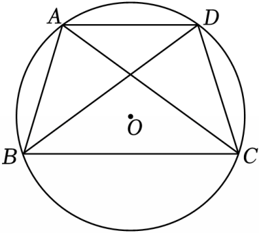

# 23 题精讲 09 · 圆内接四边形与半径

## 📝 题目

已知，四边形 $ABCD$ 内接于 $\odot O$，$AC=BD$。

(1) 求证：$AD\parallel BC$；

(2) 小明说：四边形 $ABCD$ 一定是等腰梯形。你认为他的说法正确吗？为什么？

(3) 如图，已知 $AB=10$，$AC=BC=13$，求 $\odot O$ 的半径。

## 🧭 思路导航（渐进提示）

- **提示 1（识别）**：$AC=BD$ 是"两条**对角线**相等"——在圆里先翻译成弧，再翻译成圆周角；(2) 是"判断 + 说理"题，要找"另一种可能"；(3) 求半径 → 标准套路：**找垂足、设 $r$、列勾股方程**。
- **提示 2（突破）**：(1) 等弦 → 等弧 → $\angle ABC=\angle BCD$（各对着一条对角线的弧），配圆内接四边形对角互补推同旁内角。(2) 再借一对同弧圆周角 $\angle ABD=\angle ACD$ 相减，得 $CD=AB$——于是 $AB\parallel CD$ 也可能成立 → 平行四边形，而圆内接平行四边形是矩形。(3) $AC=BC$ → $C$ 在 $AB$ 垂直平分线上，$O$ 也在 → 直线 $CO$ 垂直平分 $AB$：先勾股算 $CE$，再设 $r$ 用 $OE=CE-r$ 列方程。
- **提示 3（路线）**：(1) $\overset{\frown}{AC}=\overset{\frown}{BD}$ → $\angle ABC=\angle BCD$；圆内接四边形 → $\angle BAD+\angle BCD=180°$ → $\angle BAD+\angle ABC=180°$ → $AD\parallel BC$。(2) $\angle ABD=\angle ACD$（同弧 $\overset{\frown}{AD}$）→ 相减得 $\angle DBC=\angle ACB$ → $\overset{\frown}{DC}=\overset{\frown}{AB}$ → $CD=AB$；若 $AB\parallel CD$ 则为平行四边形，内接于圆 → 矩形——反例成立，小明说法不正确。(3) $AE=\frac12AB=5$、Rt△AEC 中 $CE=12$；设半径 $r$，$OE=12-r$，Rt△AEO 中 $(12-r)^2+5^2=r^2$ → $r=\frac{169}{24}$。

## ✍️ 详解

**(1)** $AC=BD$ → $\overset{\frown}{AC}=\overset{\frown}{BD}$（同圆中，等弦对等弧）。

→ $\angle ABC=\angle BCD$（同弧所对的圆周角相等：$\angle ABC$ 对 $\overset{\frown}{AC}$，$\angle BCD$ 对 $\overset{\frown}{BD}$）。

四边形 $ABCD$ 内接于 $\odot O$ → $\angle BAD+\angle BCD=180°$（圆内接四边形的对角互补）。

→ $\angle BAD+\angle ABC=180°$（等量代换）→ $AD\parallel BC$（同旁内角互补，两直线平行）。$\blacksquare$

**(2)** 小明的说法不正确。理由如下：

$\angle ABD=\angle ACD$（同弧 $\overset{\frown}{AD}$ 所对的圆周角相等）。

由(1) $\angle ABC=\angle BCD$ → $\angle ABC-\angle ABD=\angle BCD-\angle ACD$（等式性质），即 $\angle DBC=\angle ACB$。

→ $\overset{\frown}{DC}=\overset{\frown}{AB}$（同圆中，等圆周角对等弧）→ $CD=AB$（等弧对等弦）。

于是四边形 $ABCD$ 满足 $AD\parallel BC$（由(1)）且 $AB=CD$，分两种可能讨论：

若 $AB\parallel CD$：$ABCD$ 是平行四边形（两组对边分别平行）；又 $\angle BAD+\angle BCD=180°$（圆内接四边形对角互补），而平行四边形对角相等（$\angle BAD=\angle BCD$）→ $\angle BAD=90°$。

→ $ABCD$ 是矩形（有一个角是直角的平行四边形是矩形），不是等腰梯形。

若 $AB$ 与 $CD$ 不平行：则 $ABCD$ 是等腰梯形（两腰相等的梯形）。

两种情形都能满足全部已知条件（例如任一圆内接矩形的两条对角线都相等），故"一定是等腰梯形"不正确。$\blacksquare$

**(3)** 联结 $OA$、$OB$、$OC$，设直线 $CO$ 交 $AB$ 于点 $E$。

$CA=CB$ → 点 $C$ 在 $AB$ 的垂直平分线上（到线段两端点距离相等的点在这条线段的垂直平分线上）。

$OA=OB$（同圆半径相等）→ 点 $O$ 也在 $AB$ 的垂直平分线上；两点确定一条直线 → 直线 $CO$ 垂直平分 $AB$。

→ $AE=\dfrac12AB=\dfrac12\times10=5$，$\angle AEC=90°$（线段垂直平分线的定义）。

在 Rt$\triangle AEC$ 中：$CE=\sqrt{AC^2-AE^2}=\sqrt{13^2-5^2}=\sqrt{144}=12$（勾股定理）。

设 $\odot O$ 的半径为 $r$，则 $OA=OC=r$（半径）；由图示，$O$ 在线段 $CE$ 上 → $OE=CE-OC=12-r$（等式性质）。

在 Rt$\triangle AEO$ 中（$\angle AEO=90°$）：$OE^2+AE^2=OA^2$（勾股定理）。

$$(12-r)^2+5^2=r^2\ \Rightarrow\ 144-24r+r^2+25=r^2\ \Rightarrow\ 24r=169\ \Rightarrow\ r=\frac{169}{24}$$

（检验：$r=\frac{169}{24}\approx7.04$，满足 $r>0$ 且 $OE=12-r>0$，符合题意。）

$$\boxed{r=\frac{169}{24}}$$

## ⚠️ 评分点与易错

- "等弦 → 等弧 → 等圆周角"这条翻译链要用两条定理分别落笔（等弦对等弧；同弧所对圆周角相等），不能一口气跳过去。
- (2) 是"判断 + 说理"：先明确表态（不正确），再给**反例**——矩形；只画图举反例不推理、或漏说"两种可能"，都要扣分。
- (2) 最常见的错误：由 $AD\parallel BC$ 且 $AB=CD$ 直接断言等腰梯形——忽略了 $AB\parallel CD$ 也可能成立（平行四边形/矩形这一支），分类必须穷尽。
- (3) 设参前先交代"$O$ 在线段 $CE$ 上"（图示位置）；方程 $(12-r)^2+25=r^2$ 展开后 $r^2$ 消去化为一次方程，解出后检验 $0<r<12$。
- 题库配图仅给出四边形的基本位置，(3) 的辅助线（联结 $OA$、$OB$、$OC$，延长 $CO$ 交 $AB$ 于 $E$）按题意文字补画即可。

## 🔗 关联

- [[03-数学/专题/第23题-几何论证]] · [[03-数学/知识点/九年级/圆与正多边形]]（圆内接四边形、垂径）· [[03-数学/知识点/九年级/相似三角形]]
- 同类题：[[23-04-等腰三角形外接圆]]（外接圆 + 设参勾股求线段）、[[23-01-弦与半径交点相似]]（等弦导角）
