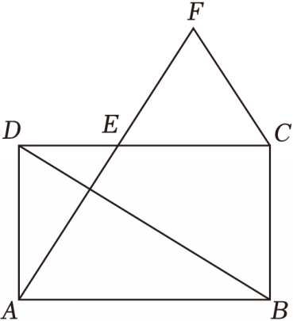

# 23 题精讲 10 · 矩形中的相似与全等

## 📝 题目

如图，在矩形 $ABCD$ 中，$E$ 为边 $CD$ 上一点，且 $AE\perp BD$，垂足为点 $P$。

(1) 求证：$AD^2=DE\cdot DC$；

(2) $F$ 为线段 $AE$ 延长线上一点，且满足 $EF=CF=\dfrac12BD$，求证：$CE=AD$。

（注：$P$ 是 $AE$ 与 $BD$ 的垂足，题目原文未命名，解答中自行命名并标图；第 (2) 问还需联结 $AC$ 构造对角线交点 $O$。）

## 🧭 思路导航（渐进提示）

- **提示 1（识别）**：矩形 + $AE\perp BD$ 是"**双垂直**"结构——母子相似（射影定理型）模型的矩形变体；(1) 的 $AD^2=DE\cdot DC$ 中 $DC=AB$ 可替换，先找同时含 $AD$、$DE$ 的相似三角形。(2) 的 $EF=CF=\frac12BD$ 是"三线段同长"——矩形对角线的一半恰好也是 $\frac12BD$，**交点 $O$ 是等长桥梁**。
- **提示 2（突破）**：(1) 两次互余把 $\angle ABD$ 换成 $\angle DAE$，凑 △ADE∽△BAD（AA），比例式交叉即乘积式。(2) 连 $AC$ 交 $BD$ 于 $O$：$OA=OD=\frac12BD=EF=CF$ 四线全等 → $\triangle OAD$、$\triangle FCE$ 都是等腰三角形 → 两对底角相等；再由(1)的互余关系补上 $\angle ODA=\angle FEC$，走 **AAS 全等**把 $CE$ 换成 $AD$。
- **提示 3（路线）**：(1) $\angle BAD=\angle ADE=90°$；Rt△BAD 中 $\angle ABD+\angle ADB=90°$，Rt△APD 中 $\angle DAE+\angle ADB=90°$ → $\angle ABD=\angle DAE$（同角的余角相等）→ △ADE∽△BAD → $\frac{AD}{BA}=\frac{DE}{AD}$ → $AD^2=DE\cdot BA=DE\cdot DC$。(2) 矩形对角线相等且互相平分 → $OA=OD=\frac12BD$，加已知 → $OA=OD=EF=CF$ → 等腰底角 $\angle ODA=\angle OAD$、$\angle FEC=\angle FCE$；由(1)互余两次得 $\angle ODA=\angle AED$，加对顶角 $\angle FEC=\angle AED$ → 四角全等 → △ODA≌△FEC（AAS：两组角 + $OD=FE$）→ $CE=AD$。

## ✍️ 详解

**(1)** 矩形 $ABCD$ → $\angle BAD=90°$，$\angle ADE=90°$，$AB=DC$（矩形的四个角都是直角，对边相等）。

→ $\angle ABD+\angle ADB=90°$（直角三角形两锐角互余）。

$AE\perp BD$ 于 $P$ → $\angle APD=90°$（垂直定义）→ $\angle DAE+\angle ADP=90°$（直角三角形两锐角互余，$\angle ADP$ 即 $\angle ADB$）。

→ $\angle ABD=\angle DAE$（同角的余角相等）。

$\angle ADE=\angle BAD=90°$（已证）。

在 $\triangle ADE$ 与 $\triangle BAD$ 中：$\angle ADE=\angle BAD$，$\angle DAE=\angle ABD$ → $\triangle ADE\backsim\triangle BAD$（两角对应相等）。

$$\frac{AD}{BA}=\frac{DE}{AD}\ (\text{相似三角形对应边成比例，对应顶点 A\leftrightarrow B、D\leftrightarrow A、E\leftrightarrow D})$$

$$\Rightarrow\ AD^2=DE\cdot BA=DE\cdot DC\ (\text{等量代换：}AB=DC)\qquad\blacksquare$$

**(2)** 联结 $AC$，设 $AC$ 交 $BD$ 于点 $O$。

矩形对角线相等且互相平分 → $OA=OC=OB=OD=\dfrac12BD$（矩形的性质）。

已知 $EF=CF=\dfrac12BD$ → $OA=OD=EF=CF$（等量代换）。

$OA=OD$ → $\angle ODA=\angle OAD$（等边对等角）。

$EF=CF$ → $\angle FEC=\angle FCE$（等边对等角）。

由(1)：$\angle ABD=\angle DAE$；在 Rt$\triangle ADE$ 中 $\angle DAE+\angle AED=90°$（两锐角互余）。

在 Rt$\triangle APD$ 中 $\angle DAE+\angle ADB=90°$（两锐角互余）→ $\angle ADB=\angle AED$（同角的余角相等），即 $\angle ODA=\angle AED$。

$\angle FEC=\angle AED$（对顶角相等：$A$、$E$、$F$ 共线，$D$、$E$、$C$ 共线）。

→ $\angle ODA=\angle OAD=\angle FEC=\angle FCE$（等量代换）。

在 $\triangle ODA$ 与 $\triangle FEC$ 中：$\angle ODA=\angle FEC$（已证），$\angle OAD=\angle FCE$（已证），$OD=FE$（已证）。

→ $\triangle ODA\cong\triangle FEC$（AAS：两角及其中一角的对边对应相等）。

$$\Rightarrow\ DA=EC\ (\text{全等三角形对应边相等})\ \Rightarrow\ \boxed{CE=AD}\qquad\blacksquare$$

**（自洽检验）**：等长桥 $\frac12BD$ 同时刻画了三条线段——$OA$、$OD$（矩形对角线一半）与 $EF$、$CF$（题设），桥断则(2)全塌；(1) 的乘积式也可用 $DE\cdot DC$ 估算量级：$DE<DC$、$AD<DC$ 时 $AD^2=DE\cdot DC$ 与图示（$E$ 偏向 $D$ 一侧）一致。

**（两问关系复盘）**：(1) 的两组互余角（$\angle ABD=\angle DAE$ 与 $\angle ADB=\angle AED$）在 (2) 中原样复用——把 (1) 的角标在图上不擦，(2) 就只剩"等腰底角 + 对顶角 + AAS 全等"三步。

## ⚠️ 评分点与易错

- (1) 是"射影定理型"相似的矩形版：两组角相等的依据（互余 + 同角的余角相等）必须写出，不能直接引用射影定理当结论。
- (2) 题源把 $\angle ADB=\angle AED$ 一笔带过，实际由 Rt△ADE 与 Rt△APD 各自互余再"同角的余角相等"得到，作答要补全这两步。
- 对顶角 $\angle FEC=\angle AED$ 的前提是 $A$、$E$、$F$ 与 $D$、$E$、$C$ 分别共线——$E$ 在 $CD$ 上、$F$ 在 $AE$ 延长线上，开头顶一句。
- 等长桥 $OA=OD=\frac12BD=EF=CF$ 依赖**矩形对角线相等且互相平分**，这句性质要完整写出。
- 全等用 AAS：对应关系 O↔F、D↔E、A↔C，其中 $OD$ 与 $FE$ 是等角 $\angle OAD$、$\angle FCE$ 的对边——对应顶点顺序写清，避免对应错位。

## 🔗 关联

- [[03-数学/专题/第23题-几何论证]] · [[03-数学/知识点/九年级/相似三角形]]（母子型/射影型、AAS 全等）
- 同类题：[[23-02-弦中点与垂径]]（对角线互相平分的用法）、[[23-05-半圆相交弦与菱形]]（先相似/全等再判特殊四边形）；题型 2 后续各讲（典例 11-20，四边形与相似）与本讲同族
