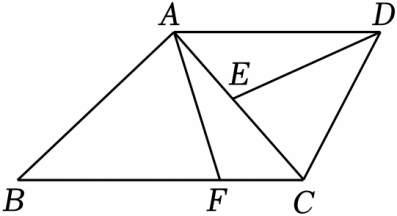

# 23 题精讲 11 · 梯形中的全等相似链

## 📝 题目

**1.**（题库典例 11）如图，在梯形 $ABCD$ 中，$AD\parallel BC$，点 $F$、$E$ 分别在线段 $BC$、$AC$ 上，且 $\angle FAC=\angle ADE$，$AC=AD$。

（1）求证：$DE=AF$；

（2）若 $\angle ABC=\angle CDE$，求证：$AF^2=BF\cdot CE$。

> [!tip]- 💡 思路导航
> "一角一边"补上平行给的内错角就是 ASA 全等开路，先把要证的两条线段焊成等长；（2）的等积式是比例中项形状，把其中一个因式换成全等给的等线段，就归约为一对三角形的相似——全等的对应角都不在目标三角形内，各取一次邻补角是唯一的换角动作。

> [!success]- ✅ 详解 · 评分点 · 易错 · 关联
> **详解**：
>
> **（1）**$AD\parallel BC$（已知）→ $\angle DAC=\angle ACB$（两直线平行，内错角相等）。
>
> $F$ 在线段 $BC$ 上 → 射线 $CF$ 与射线 $CB$ 重合。
>
> → $\angle ACF=\angle ACB$（同一个角）→ $\angle DAC=\angle ACF$（等量代换）。
>
> 在 $\triangle ACF$ 与 $\triangle DAE$ 中：
>
> $\angle FAC=\angle ADE$（已知），
>
> $AC=DA$（已知），
>
> $\angle ACF=\angle DAE$（已证）。
>
> → $\triangle ACF\cong\triangle DAE$（两角及其夹边对应相等，ASA）。
>
> → $AF=DE$（全等三角形对应边相等）。$\blacksquare$
>
> **（2）**由（1）$\triangle ACF\cong\triangle DAE$ → $\angle AFC=\angle DEA$（全等三角形对应角相等）。
>
> $F$ 在线段 $BC$ 上 → $\angle AFB$ 与 $\angle AFC$ 互为邻补角（邻补角定义）。
>
> $E$ 在线段 $AC$ 上 → $\angle DEC$ 与 $\angle DEA$ 互为邻补角（邻补角定义）。
>
> → $\angle AFB=\angle DEC$（等角的补角相等）。
>
> $\angle ABF=\angle ABC$（同一个角：$F$ 在线段 $BC$ 上，射线 $BF$ 与射线 $BC$ 重合）。
>
> → $\angle ABF=\angle CDE$（等量代换：已知 $\angle ABC=\angle CDE$）。
>
> 在 $\triangle ABF$ 与 $\triangle CDE$ 中：$\angle ABF=\angle CDE$（已证），$\angle AFB=\angle DEC$（已证）。
>
> → $\triangle ABF\backsim\triangle CDE$（两角对应相等的两个三角形相似）。
>
> → $\dfrac{AF}{CE}=\dfrac{BF}{DE}$（相似三角形对应边成比例；对应顶点 $A\leftrightarrow C$、$B\leftrightarrow D$、$F\leftrightarrow E$）。
>
> → $AF\cdot DE=BF\cdot CE$（比例性质：外项积等于内项积）。
>
> 由（1）$DE=AF$ → $AF\cdot DE=AF\cdot AF$（等量代换）。
>
> 即 $AF^2=BF\cdot CE$（等式性质）。$\blacksquare$
>
> **（证后小结）**：本题结构是"ASA 全等开路 → 邻补角换角 → AA 相似 → 等线段代换成比例中项"四步。
>
> 其中两次"同一个角"与一次"等角的补角相等"是最小的书写单元，都是阅卷采分点，不可合并省略。
>
> **（自洽检验）**：题图中 $E$ 在线段 $AC$ 上、$F$ 在线段 $BC$ 上，保证（2）里两组邻补角都存在；若把条件放宽到延长线上，则邻补角须换成对顶角来同化，比例式最终形式不变——这正是本题限定"在线段上"的原因。
>
> **易错**：
> - （1）必须先写"$F$ 在 $BC$ 上 → $\angle ACF$ 与 $\angle ACB$ 是同一个角"，把内错角搬到 $F$ 处再进 ASA；直接写"$\angle ACF=\angle DAC$"会缺一步依据。
> - 全等对应顶点顺序是 $A\leftrightarrow D$、$C\leftrightarrow A$、$F\leftrightarrow E$：$AF$ 的对应边是 $DE$。顺序写错，（2）的代换就接不上。
> - （2）从 $\angle AFC=\angle DEA$ 到 $\angle AFB=\angle DEC$ 要写"邻补角 + 等角的补角相等"两步，跳步会被认为依据不足。
> - 结论 $AF^2=BF\cdot CE$ 的唯一入口是把 $AF^2$ 拆成 $AF\cdot DE$（用（1）），不要试图引入勾股或长度计算——本题是纯论证题，无条件求长度。
> - 题源点评提到"勾股定理"，实际解答全程未用，属点评冗余；以解答过程为准。
>
> **关联**：[[03-数学/专题/第23题-几何论证]] · [[03-数学/知识点/九年级/相似三角形]]（A 字型、两角对应相等）；同类题：[[23-10-矩形与相似全等]]（同为"全等开路 + 相似收尾"）、[[25-02-梯形外接圆与比例中项]]（比例中项形状的等积式）、[[25-11-直角梯形全等与等腰]]（梯形背景的全等）。
