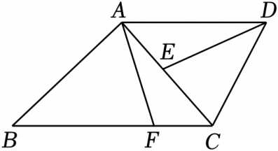

# 23 题精讲 11 · 梯形中的全等相似链

## 📝 题目

如图，在梯形 $ABCD$ 中，$AD\parallel BC$，点 $F$、$E$ 分别在线段 $BC$、$AC$ 上，且 $\angle FAC=\angle ADE$，$AC=AD$。

(1) 求证：$DE=AF$；

(2) 若 $\angle ABC=\angle CDE$，求证：$AF^2=BF\cdot CE$。

## 🧭 思路导航（渐进提示）

- **提示 1（识别）**：$\angle FAC=\angle ADE$ 与 $AC=AD$ 恰好是"一角一边"，再补一个角就是全等——这是**全等开路**题：先用 ASA 把 $DE$ 与 $AF$ 焊成等长。(2) 要证的 $AF^2=BF\cdot CE$ 是比例中项形状，即 $\frac{AF}{CE}=\frac{BF}{AF}$，把其中一个 $AF$ 换成与它相等的 $DE$，就变成一对三角形相似的比例式。
- **提示 2（突破）**：(1) 缺的那个角由 $AD\parallel BC$ 提供——$\angle DAC$ 与 $\angle ACB$ 是内错角，而 $F$ 在 $BC$ 上，$\angle ACF$ 就是 $\angle ACB$ 本身。(2) 全等给的对应角 $\angle AFC=\angle DEA$ 都不是 $\triangle ABF$、$\triangle CDE$ 的内角，各取一次**邻补角**恰好得到 $\angle AFB=\angle DEC$，这是本题唯一的"换角"动作。
- **提示 3（路线）**：(1) $AD\parallel BC$ → $\angle DAC=\angle ACB=\angle ACF$（内错角 + 同一个角）；$\triangle ACF$ 与 $\triangle DAE$ 中用"角–边–角"（$\angle FAC=\angle ADE$、$AC=DA$、$\angle ACF=\angle DAE$）证全等 → $AF=DE$。(2) 由(1)的对应角取邻补角得 $\angle AFB=\angle DEC$；配上已知 $\angle ABC=\angle CDE$（即 $\angle ABF=\angle CDE$）→ $\triangle ABF\backsim\triangle CDE$ → $\frac{AF}{CE}=\frac{BF}{DE}$ → $AF\cdot DE=BF\cdot CE$，代入 $DE=AF$ 收尾。

## ✍️ 详解

**(1)** $AD\parallel BC$（已知）→ $\angle DAC=\angle ACB$（两直线平行，内错角相等）。

$F$ 在线段 $BC$ 上 → 射线 $CF$ 与射线 $CB$ 重合。

→ $\angle ACF=\angle ACB$（同一个角）→ $\angle DAC=\angle ACF$（等量代换）。

在 $\triangle ACF$ 与 $\triangle DAE$ 中：

$\angle FAC=\angle ADE$（已知），

$AC=DA$（已知），

$\angle ACF=\angle DAE$（已证）。

→ $\triangle ACF\cong\triangle DAE$（两角及其夹边对应相等，ASA）。

→ $AF=DE$（全等三角形对应边相等）。$\blacksquare$

**(2)** 由(1) $\triangle ACF\cong\triangle DAE$ → $\angle AFC=\angle DEA$（全等三角形对应角相等）。

$F$ 在线段 $BC$ 上 → $\angle AFB$ 与 $\angle AFC$ 互为邻补角（邻补角定义）。

$E$ 在线段 $AC$ 上 → $\angle DEC$ 与 $\angle DEA$ 互为邻补角（邻补角定义）。

→ $\angle AFB=\angle DEC$（等角的补角相等）。

$\angle ABF=\angle ABC$（同一个角：$F$ 在线段 $BC$ 上，射线 $BF$ 与射线 $BC$ 重合）。

→ $\angle ABF=\angle CDE$（等量代换：已知 $\angle ABC=\angle CDE$）。

在 $\triangle ABF$ 与 $\triangle CDE$ 中：$\angle ABF=\angle CDE$（已证），$\angle AFB=\angle DEC$（已证）。

→ $\triangle ABF\backsim\triangle CDE$（两角对应相等的两个三角形相似）。

→ $\dfrac{AF}{CE}=\dfrac{BF}{DE}$（相似三角形对应边成比例；对应顶点 $A\leftrightarrow C$、$B\leftrightarrow D$、$F\leftrightarrow E$）。

→ $AF\cdot DE=BF\cdot CE$（比例性质：外项积等于内项积）。

由(1) $DE=AF$ → $AF\cdot DE=AF\cdot AF$（等量代换）。

即 $AF^2=BF\cdot CE$（等式性质）。$\blacksquare$

**（证后小结）**：本题结构是"ASA 全等开路 → 邻补角换角 → AA 相似 → 等线段代换成比例中项"四步。

其中两次"同一个角"与一次"等角的补角相等"是最小的书写单元，都是阅卷采分点，不可合并省略。

**（自洽检验）**：题图中 $E$ 在线段 $AC$ 上、$F$ 在线段 $BC$ 上，保证(2)里两组邻补角都存在；若把条件放宽到延长线上，则邻补角须换成对顶角来同化，比例式最终形式不变——这正是本题限定"在线段上"的原因。

## ⚠️ 评分点与易错

- (1) 必须先写"$F$ 在 $BC$ 上 → $\angle ACF$ 与 $\angle ACB$ 是同一个角"，把内错角搬到 $F$ 处再进 ASA；直接写"$\angle ACF=\angle DAC$"会缺一步依据。
- 全等对应顶点顺序是 $A\leftrightarrow D$、$C\leftrightarrow A$、$F\leftrightarrow E$：$AF$ 的对应边是 $DE$。顺序写错，(2) 的代换就接不上。
- (2) 从 $\angle AFC=\angle DEA$ 到 $\angle AFB=\angle DEC$ 要写"邻补角 + 等角的补角相等"两步，跳步会被认为依据不足。
- 结论 $AF^2=BF\cdot CE$ 的唯一入口是把 $AF^2$ 拆成 $AF\cdot DE$（用(1)），不要试图引入勾股或长度计算——本题是纯论证题，无条件求长度。
- 题源点评提到"勾股定理"，实际解答全程未用，属点评冗余；以解答过程为准。

## 🔗 关联

- [[03-数学/专题/第23题-几何论证]] · [[03-数学/知识点/九年级/相似三角形]]（A 字型、两角对应相等）
- 同类题：[[23-10-矩形与相似全等]]（同为"全等开路 + 相似收尾"）、[[25-02-梯形外接圆与比例中项]]（比例中项形状的等积式）、[[25-11-直角梯形全等与等腰]]（梯形背景的全等）
